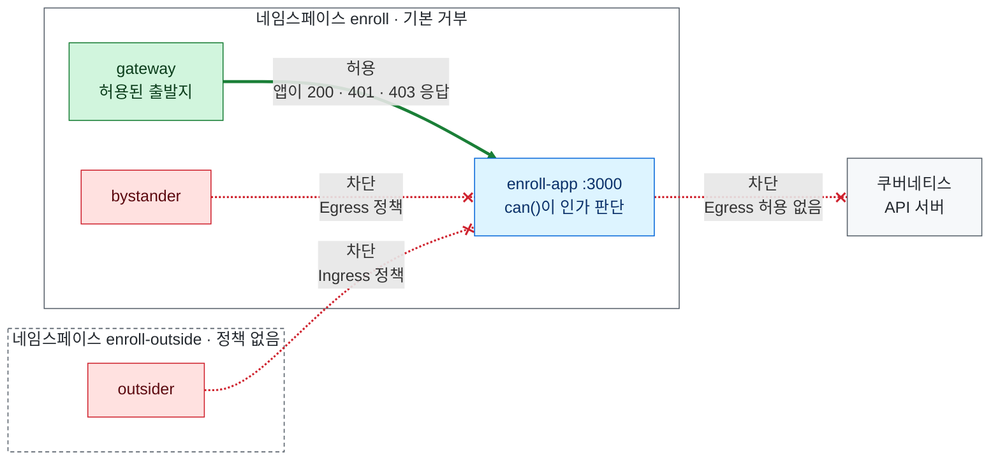

# secure-enroll-demo

[](https://github.com/loquemedalagana/secure-enroll-demo/actions/workflows/ci.yml)

세미나 신청 서비스를 웹(Next.js), API(Nest.js), DB(PostgreSQL)로 나누어 만들고, 인증과 인가를 설계해 테스트와 CI로 검증하는 저장소입니다.
결함을 경로마다 하나씩 고치지 않고 인가 판단을 한 곳에 모아, 같은 종류의 결함이 다시 생기지 않게 했습니다. 그 과정은 코드와 테스트에 남아 있습니다.
같은 원칙(기본 거부 + 명시 허용)을 네트워크 계층에도 적용해 로컬 쿠버네티스 클러스터에서 검증한 구성이 `k8s/`에 있습니다.

일부러 넣은 결함은 `vulnerable` 브랜치(v1)와 결함별 태그(v2)에만 있고, `main`에는 수정된 코드만 있습니다. 사용자, 데이터, 시크릿은 모두 더미 값입니다.

## 현재 상태

`main`은 v1(단일 Next.js 앱)에서 v2(웹·API·DB 분리)로 옮겨 가는 중입니다.

| 구성 | 위치 | 상태 |
|---|---|---|
| 웹 (Next.js 14) | `apps/web` | v1의 앱 그대로입니다. 인메모리 데이터로 동작하고 아직 API를 호출하지 않습니다 |
| API (Nest.js 12) | `apps/api` | 헬스 체크, 로그인, 토큰 발급·검증, 전역 인증·인가 Guard, 신청 조회·생성·취소, 강의 목록·검색과 수강생 명단, 요청 로그. 테스트 134건 |
| DB (PostgreSQL 18) | `compose.yaml`, `apps/api/prisma` | Prisma 마이그레이션과 더미 시드 |
| CI | `.github/workflows/ci.yml`, `.github/workflows/defects.yml` | `ci`: `web`, `api`, `audit`(앱별), `netpol`. `defects`: 결함마다 결함 태그와 수정 태그를 띄워 재현 |
| 네트워크 정책 | `k8s/` | kind와 Cilium으로 웹 앱에 적용해 검증 |
| v2의 의도된 결함 | [docs/v2-defects.md](docs/v2-defects.md) | 8개 중 5개를 다뤘습니다. 진단 보고서: [결함 1](docs/diagnosis/defect-1.md), [결함 2](docs/diagnosis/defect-2.md), [결함 3](docs/diagnosis/defect-3.md), [결함 6](docs/diagnosis/defect-6.md), [결함 8](docs/diagnosis/defect-8.md) |

다음 순서는 웹과 API 연결입니다.

### API의 권한 표

경로와 역할에 따라 응답의 상태 코드를 적은 표입니다. 이 표의 칸은 `apps/api/test/permission-matrix.test.mjs`(읽기)와 `apps/api/test/enrollments-write.test.mjs`(쓰기)가 전부 요청해서 확인합니다.

| 경로 | 비로그인 | 학생 | 강사 | 관리자 |
|---|---|---|---|---|
| `GET /health/live`, `GET /courses` | 200 | 200 | 200 | 200 |
| `GET /auth/me`, `GET /enrollments` | 401 | 200 | 200 | 200 |
| `GET /enrollments/:id` | 401 | 본인의 신청 200, 다른 사용자의 신청 403 | 자기 강의의 신청 200, 다른 강의의 신청 403 | 200 |
| `GET /courses/:id/enrollments` | 401 | 403 | 자기 강의 200, 다른 강의 403 | 200 |
| `GET /admin/enrollments` | 401 | 403 | 403 | 200 |
| `POST /enrollments` | 401 | 201 (자기 이름으로만) | 403 | 403 |
| `DELETE /enrollments/:id` | 401 | 본인의 신청 204, 다른 사용자의 신청 403 | 403 | 204 |

`GET /enrollments`는 사람마다 범위가 다릅니다. 학생은 자기 신청, 강사는 자기 강의의 신청, 관리자는 전체를 받습니다. 판단은 `apps/api/src/authz/policy.ts`의 `can()` 한 곳에서 하고, 모든 요청이 전역 Guard를 지납니다.

| 문서 | 내용 |
|---|---|
| [docs/decisions.md](docs/decisions.md) | v2의 설계 결정과 채택하지 않은 대안 |
| [docs/v2-defects.md](docs/v2-defects.md) | v2에서 다루는 결함 목록과 남기는 방법 |
| [docs/diagnosis/](docs/diagnosis/) | 결함별 진단 보고서(재현 절차, 원인, 조치 방안 비교, 재확인) |
| [docs/ci-hardening.md](docs/ci-hardening.md) | CI가 막는 것과 그 비용 |
| [docs/zero-trust-mapping.md](docs/zero-trust-mapping.md) | v1 인가 구조와 NIST SP 800-207의 대응 |

---

아래 '브랜치'부터 '한계'까지는 v1의 설명입니다. v1의 마지막 상태는 [`v1.4` 태그](https://github.com/loquemedalagana/secure-enroll-demo/tree/v1.4)에 있습니다.

## 브랜치
| 브랜치 | 내용 |
|---|---|
| `vulnerable` | 인증은 미들웨어에만 의존, 역할(RBAC)·소유자(ABAC) 검증 누락 |
| `fixed` | 정책 함수 한 곳에서 인가 판단, 모든 진입점에서 세션 재검증, 테스트 29건 통과 |
| `main` | `fixed`를 병합한 최종본 |

두 브랜치는 같은 의존성(`next@14.2.35`)과 같은 인증 코드를 씁니다. 코드상의 차이는 인가 코드와 그 테스트뿐이고, 문서와 CI, 네트워크 계층 검증(`k8s/`)은 `fixed`에만 있습니다.

## 보는 법
```bash
git diff vulnerable fixed -- app lib middleware.ts   # 인가 구조가 어떻게 바뀌었는지
git diff vulnerable fixed -- tests                   # 무엇으로 검증했는지
```

v2의 결함은 결함마다 태그 한 쌍으로 봅니다. 지금은 결함 1~3, 6, 8의 태그가 있고, 결함을 다루는 PR마다 한 쌍씩 생깁니다.
```bash
git diff v2-defect-N v2-fix-N -- apps                # 결함 N을 어떻게 고쳤는지
git checkout v2-defect-N                             # 결함 N의 상태 재현
```

## 의도된 결함 (vulnerable)
1. **역할 확인 누락 (OWASP A01 Broken Access Control)** — `/api/admin/enrollments`가 로그인 여부만 보고 역할은 보지 않음
2. **소유자 확인 누락 (BOLA/IDOR)** — `/api/enrollments/[id]`가 요청자와 신청 소유자를 비교하지 않음
3. **인증을 미들웨어에만 의존** — 핸들러 안에서 세션을 다시 검증하지 않음

## 인가의 전제: 세션 무결성 (두 브랜치 공통)
인가 판단은 세션이 위조되지 않았다는 것을 전제로 합니다. 그래서 세션을 위조할 수 없도록 인증을 보강했습니다. 의도된 결함과 무관하므로 두 브랜치에 똑같이 들어 있습니다.
- `SESSION_SECRET`이 없으면 공개된 기본값으로 서명하지 않고 실패합니다(세션 위조 방지).
- 로그인은 `application/json` request body만 받고(415), 다른 출처의 요청은 거부합니다(403). 다른 사이트의 폼으로 피해자를 공격자 계정에 로그인시키는 로그인 CSRF를 막습니다. 회귀 테스트: `apps/web/tests/login.test.mjs`

## 실행

### API (`apps/api`)
Docker와 Node 24가 필요합니다.
```bash
docker compose up -d --wait        # PostgreSQL (127.0.0.1:5433, 더미 값)
cd apps/api
cp .env.example .env
npm ci --ignore-scripts
npm run db:generate && npm run build
npm run db:migrate && npm run db:seed
npm test                           # 134건
npm start                          # http://127.0.0.1:4000/health/ready
```

### 웹 (`apps/web`)
Node 22.18 이상이 필요합니다(정책 단위 테스트가 TypeScript 파일을 직접 불러옵니다). CI는 Node 24를 씁니다.
```bash
cd apps/web
cp .env.example .env.local
npm ci
npm run build
npm test        # vulnerable: 13건 중 4건 실패가 정상(권한 매트릭스) / fixed: 29건 통과
npm run dev     # 수동 확인
```

데모 계정 (더미): `student1`/`student1-pass`, `student2`/`student2-pass`, `instructor1`/`instructor1-pass`, `instructor2`/`instructor2-pass`, `admin1`/`admin1-pass`

## 공급망 메모
- 처음 기준 버전은 `next@14.2.24`였습니다. 이 버전에는 공개된 미들웨어 우회 보안 권고(CVE-2025-29927)가 있어, 수정 버전인 `14.2.25`로 업그레이드했습니다(커밋 "next 14.2.25로 상향"). 이 미들웨어 우회는 결함 3번과 같은 문제입니다. 인증과 인가를 미들웨어에서만 하면, 미들웨어를 우회한 요청은 인증과 인가 없이 핸들러까지 갑니다. 이 저장소에는 해당 취약점을 재현하는 코드가 없습니다.
- 이후 14.x 최신 패치인 `14.2.35`로 다시 업그레이드해 공개 권고가 36건에서 29건으로 줄었습니다(2026-10-24 기준). 이후 moderate 권고 1건이 새로 공개돼 2026-11-23 기준으로는 30건입니다. 남은 high 이상 14건은 15.5.x 이상으로 메이저 버전을 업그레이드해야 해결되므로, 권고 ID 단위로 사유와 만료일을 붙여 예외로 관리합니다(`.github/audit-exceptions.json`).
- 예외 목록에 없는 high 이상 권고가 새로 나오거나 예외가 만료되면 CI가 실패합니다. 설계와 트레이드오프: [docs/ci-hardening.md](docs/ci-hardening.md)

## fixed 브랜치 요약

### 문제
`vulnerable`에서 권한 매트릭스 테스트 10건 중 4건이 실패했습니다.
- 학생과 강사가 관리자 API(`/api/admin/enrollments`)를 조회할 수 있음 (2건)
- 학생이 다른 학생의 신청을 조회할 수 있음
- 강사가 다른 강사 강의의 신청을 조회할 수 있음

### 구조적 원인
- 인가 판단이 아예 없거나, 있더라도 라우트마다 따로 분산되어 있었습니다.
- 핸들러는 요청이 미들웨어를 통과했으면 인증과 인가가 모두 끝난 것으로 보았습니다.
- 미들웨어는 로그인 여부만 확인할 수 있고, 요청한 리소스의 소유자가 누구인지는 알 수 없습니다.

### 재발 방지 설계
- 인가 판단은 `apps/web/lib/policy.ts`의 `can()` 한 곳에서만 합니다. 역할(RBAC)과 소유자·담당 강사(ABAC)를 보고, 명시적으로 허용한 경우 외에는 거부합니다.
- 모든 핸들러와 서버 컴포넌트는 `apps/web/lib/auth.ts`의 `getSession()`으로 세션을 직접 다시 검증합니다. API는 세션이 없으면 401, `can()`이 거부하면 403을 반환합니다. 페이지는 비로그인이면 로그인 화면으로 리다이렉트하고, 권한이 없으면 안내 화면을 보여줍니다.
- 미들웨어는 미인증 요청을 앞단에서 걸러 내는 보조 수단으로만 유지했습니다.
- 이 구조가 제로 트러스트의 정책 결정 지점(PDP)과 정책 시행 지점(PEP)에 어떻게 해당하는지는 다음 문서에 적었습니다: [docs/zero-trust-mapping.md](docs/zero-trust-mapping.md)

### 검증
- `npm test` 29건 통과, 0건 실패 (정책 단위 16건 + 권한 매트릭스 10건 + 로그인 요청 형식·출처 검사 3건)
- 오류 응답 점검 (`next start`로 로컬 실행, 2026-10-24): response body에 스택 트레이스나 파일 경로가 노출되지 않음

| 요청 | 응답 |
|---|---|
| 서명을 변조한 세션 쿠키로 신청 조회 | 401 `{"error":"unauthorized"}` |
| 존재하지 않는 신청 id | 404 `{"error":"not found"}` |
| 형식이 잘못된 JSON으로 로그인 | 401 `{"error":"invalid credentials"}` |
| 존재하지 않는 페이지·API 경로 | 404 |

## 네트워크 계층 검증 (`k8s/`)

앱 계층에서 적용한 "기본 거부 + 명시 허용"을 네트워크 계층에도 적용하고, 요청이 거부됐을 때 **어느 계층이 차단했는지**를 한 표에서 확인합니다. 로컬과 CI 러너의 kind 클러스터에서만 실행하며, 레지스트리 푸시나 배포는 하지 않습니다.

### 구성
| 이름 | 역할 |
|---|---|
| `enroll-app` | 이 저장소의 앱 (`k8s/Dockerfile`로 빌드) |
| `gateway` | 앱에 접근이 허용된 유일한 출발지 |
| `bystander` | 같은 네임스페이스에 있지만 허용되지 않은 출발지 |
| `outsider` | 정책이 없는 다른 네임스페이스의 출발지 |



초록 실선은 허용된 경로, 빨간 점선은 네트워크 정책이 차단하는 경로입니다. 앱에서 `gateway`로 나가는 연결도 차단되며, 그림에서는 생략했습니다.

정책은 표준 `NetworkPolicy` 3장입니다(`k8s/policies/`). 네임스페이스의 모든 파드에 Ingress와 Egress를 기본 거부로 두고, `gateway → enroll-app:3000` 한 경로만 `gateway`의 Egress와 `enroll-app`의 Ingress에서 허용합니다. `enroll-app`에는 Egress 허용 규칙이 없어서, 앱에서 나가는 연결은 모두 차단됩니다. 정책 적용과 차단 기록은 Cilium과 Hubble이 맡습니다.

### 실행
docker, kind v0.33.0, kubectl, Cilium CLI v0.20.1이 필요합니다.
```bash
./k8s/up.sh                 # 이미지 빌드, 클러스터 생성, Cilium 설치, 앱·클라이언트 배포
node k8s/verify/run.mjs     # 기준선 → 정책 적용 → 매트릭스 → Hubble 기록 확인. 어긋나면 종료 코드 1
./k8s/down.sh               # 이 저장소가 만든 클러스터만 삭제
```

### 결과
정책을 적용하기 전에는 유효한 관리자 계정으로 보낸 요청이 `bystander`와 `outsider`에서도 200을 받고, 앱은 쿠버네티스 API 서버에 연결됩니다. 정책을 적용한 뒤의 결과는 다음과 같습니다.

| 출발지 | 사용자 | 요청 | 결과 | 막은 계층 |
|---|---|---|---|---|
| `gateway` | 비로그인 | 관리자 API | 401 | 앱 |
| `gateway` | student1 | 관리자 API | 403 | 앱 |
| `gateway` | student1 | 본인 신청 | 200 | — |
| `gateway` | student1 | 다른 사용자의 신청 | 403 | 앱 |
| `gateway` | instructor1 | 다른 강사 강의의 신청 | 403 | 앱 |
| `gateway` | admin1 | 관리자 API | 200 | — |
| `bystander` | admin1 | 관리자 API | 시간 초과 | 네트워크 (Egress 정책) |
| `outsider` | admin1 | 관리자 API | 시간 초과 | 네트워크 (Ingress 정책) |
| `enroll-app` | — | 쿠버네티스 API 서버로 연결 | 시간 초과 | 네트워크 |
| `enroll-app` | — | `gateway` 3000번으로 연결 | 시간 초과 | 네트워크 |

- 유효한 관리자 계정으로 보낸 요청이라도 허용되지 않은 출발지에서 오면 앱에 도달하지 못합니다. 허용된 출발지에서 온 요청이라도 권한이 없으면 앱의 정책 함수가 거부합니다.
- 시간 초과만으로는 정책 때문인지 알 수 없어서, 네트워크에서 차단된 네 줄이 Hubble에 정책 거부(`POLICY_DENIED`)로 남았는지와 차단 방향을 함께 확인합니다.
- 서버가 없는 포트에 TCP로 연결하면, 정책을 적용하기 전에는 즉시 거절(`REFUSED`)되고 적용한 뒤에는 응답 없이 시간 초과가 됩니다. Cilium이 패킷을 응답 없이 폐기하기 때문입니다. 그래서 닫힌 포트와 정책 차단을 구분할 수 있습니다.

### 확인한 범위
- 로컬(arm64, 2026-11-15): 클러스터를 지우고 처음부터 실행해 기준선 4건, 두 계층 매트릭스 10건, Hubble 기록 4건이 모두 기대와 일치.
- GitHub Actions 러너(amd64, 2026-11-15): pull request 실행에서 `netpol` 잡 통과.
- 기본 거부 정책에서 Egress를 일부러 뺐을 때 4건이 어긋나 종료 코드 1로 끝나는 것을 로컬에서 확인.

## 한계
- 데이터는 인메모리이고 세션은 서명 쿠키입니다. 감사 로그와 저장 데이터 암호화는 없습니다.
- 세션은 서명 쿠키라 만료(1시간) 전에 즉시 폐기할 수 없습니다.
- 비밀번호 해시(scrypt)는 모든 사용자가 같은 솔트를 씁니다. 존재하지 않는 아이디로 로그인을 시도하면 해시 계산을 건너뛰기 때문에 응답 시간이 더 짧습니다. 이 차이로 아이디가 존재하는지 추정할 수 있습니다. 로그인 시도 횟수 제한은 없습니다.
- `/api/enrollments/[id]`는 존재 여부(404)를 권한 확인(403)보다 먼저 판단하므로, 로그인한 사용자가 신청 id의 존재 여부를 구분할 수 있습니다. 이 트레이드오프는 [docs/zero-trust-mapping.md](docs/zero-trust-mapping.md)의 4절에 판단 사항으로 기록했습니다.
- 네트워크 계층 검증은 단일 노드 로컬 클러스터(kind)에서 했습니다.
  - 정책은 주소와 포트 수준(L3/L4)입니다. 어떤 사용자가 어떤 경로를 요청했는지는 네트워크 정책이 보지 못하고, 그 판단은 앱의 `can()`이 합니다.
  - `gateway`는 허용된 출발지를 나타내는 빈 파드입니다. 실제 게이트웨이처럼 인증이나 라우팅을 하지 않습니다.
  - 요청을 서비스 이름이 아니라 서비스 IP로 보내서 DNS 허용 규칙을 두지 않았습니다. 이름으로 호출하는 구성이라면 DNS 허용이 추가로 필요합니다.
  - 구간 암호화(mTLS 등), 노드가 여러 개인 경우, 정책 변경이 반영되는 시간, 처리량과 지연은 확인하지 않았습니다.
  - 노드(kubelet)가 보내는 준비 상태 확인이 정책 아래에서 어떻게 처리되는지는 따로 검증하지 않았습니다.
- 관리자 페이지(`/admin`)는 권한이 없을 때 "403 접근 권한 없음" 안내 화면을 HTTP 200으로 보여줍니다. 데이터는 노출되지 않지만, 상태 코드만으로는 거부됐는지 알 수 없습니다. API 라우트는 403을 반환합니다.

---
작성: Claude Code 보조 · 검증: 테스트와 응답 점검을 직접 실행해 확인
