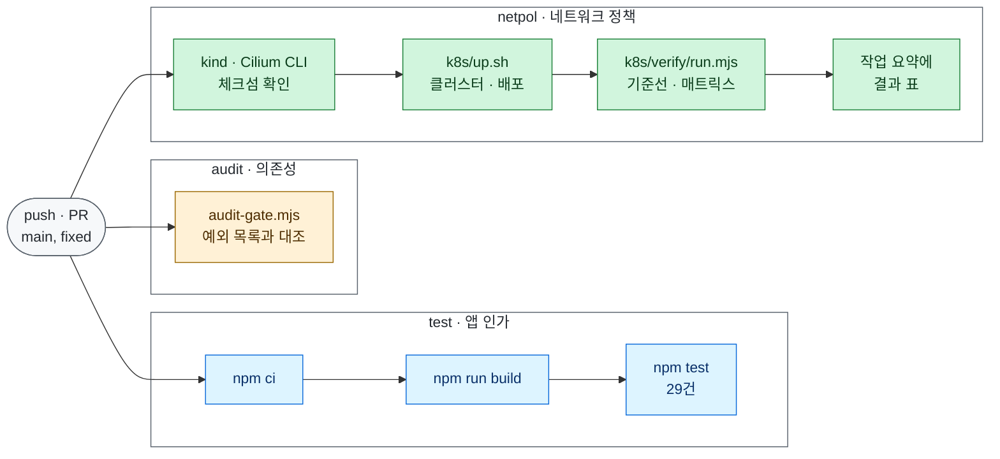

# CI 하드닝: 파이프라인이 구조적으로 막는 것

> 의존성과 CI 설정의 변경을 사람이 매번 확인하지 않아도, 파이프라인이 정해진 기준으로 막도록 구성했습니다. 각 통제가 무엇을 막고 어떤 비용이 드는지, 그리고 아직 남은 위험이 무엇인지 함께 적습니다.

## 1. 구성

| 잡 | 하는 일 | 권한 |
|---|---|---|
| `test` | `npm ci` → `npm run build` → `npm test`(정책 단위 16건 + 권한 매트릭스 10건 + 로그인 요청 형식·출처 검사 3건) | `contents: read` |
| `audit` | `.github/scripts/audit-gate.mjs`로 `npm audit` 결과를 예외 목록과 대조 | `contents: read` |
| `netpol` | 러너 안에 kind 클러스터를 만들고 `k8s/up.sh` → `k8s/verify/run.mjs`로 네트워크 정책과 앱 인가를 함께 검사. 결과 표는 작업 요약에 남김 | `contents: read` |

세 잡은 서로 기다리지 않고 따로 실행됩니다. 파랑은 앱 인가, 주황은 의존성, 초록은 네트워크 정책을 확인하는 단계입니다.

- 트리거: `main`, `fixed`의 push와 pull request, 그리고 Actions 탭의 수동 실행(`workflow_dispatch`). `vulnerable`은 의도된 결함 때문에 테스트 4건이 실패하는 것이 정상이라 자동 실행 대상이 아닙니다.
- 잡을 나눠서, 하나가 실패해도 나머지 결과는 따로 보이게 했습니다.
- `netpol` 잡의 워크플로에는 도구 설치와 스크립트 호출만 두었습니다. 내용은 로컬에서도 그대로 실행할 수 있는 `k8s/`의 스크립트에 있습니다. 클러스터는 러너와 함께 사라집니다.

## 2. 통제와 비용

| 통제 | 막는 위협 | 비용 | 남은 위험 |
|---|---|---|---|
| 액션을 커밋 SHA로 고정(태그는 주석) | 태그가 다른 커밋으로 옮겨지거나 탈취되어 의도하지 않은 코드가 실행됨 | 새 버전이 나와도 자동으로 반영되지 않음. 갱신 자동화(Dependabot)를 넣지 않아, 직접 확인해 업그레이드하지 않으면 오래된 버전을 계속 쓰게 됨 | 고정한 커밋 자체의 결함 |
| 기본 토큰 권한 `{}`, 잡마다 `contents: read` | 토큰이 유출됐을 때 쓰기 권한이 남용됨 | 권한이 필요한 단계가 생길 때마다 명시해야 함 | 읽기 토큰으로 저장소를 읽을 수 있음(공개 저장소라 영향 작음) |
| checkout의 `persist-credentials: false` | 이후 단계(npm 스크립트 등)가 `.git/config`에 남은 토큰을 읽어 유출 | CI 안에서 git push를 못 함(필요 없음) | — |
| 시크릿 없음, `pull_request_target` 미사용 | 포크에서 온 PR이 시크릿이나 쓰기 토큰에 접근 | CI에서 배포나 외부 연동을 할 수 없음 | — |
| `npm ci`와 커밋된 잠금 파일 | 설치 시점에 의도하지 않은 버전이 설치됨 | 의존성을 바꿀 때마다 잠금 파일 갱신이 필수 | 잠금 파일에 고정된 버전의 권고 → 감사 게이트가 다룸 |
| 의존성 캐시 미사용 | 캐시 오염을 통한 변조 | 실행마다 설치 시간이 늘어남 | — |
| 감사 게이트: high 이상 차단, 권고 ID 단위 예외, 만료일 | 새 high 이상 권고가 확인되지 않은 채 포함됨, 수용한 위험이 기한 없이 방치됨 | 예외 목록 관리, 만료마다 다시 판단해야 함 | moderate·low 15건은 차단하지 않음. 예외 14건은 수용 중인 위험 |
| 내려받는 도구(kind, Cilium CLI)를 버전과 SHA-256으로 고정 | 릴리스 파일이 바뀌거나 다른 파일로 바꿔치기됨 | 버전을 올릴 때마다 체크섬도 직접 갱신해야 함 | 고정한 버전 자체의 결함. 러너에 미리 설치된 docker와 kubectl은 고정하지 않음 |
| 컨테이너 이미지를 다이제스트로 고정(Node 베이스, kind 노드) | 같은 태그가 다른 이미지를 가리키게 됨 | 베이스 이미지의 보안 패치가 자동으로 들어오지 않음 | Cilium 이미지는 직접 고정하지 않고, 고정한 버전(1.20.1)의 설치 차트가 지정한 다이제스트를 따름 |
| 앱 이미지를 레지스트리에 푸시하지 않고 `kind load`로만 전달 | 빌드한 이미지가 외부에 공개되거나 다른 곳에서 당겨짐 | 러너마다 이미지를 새로 빌드해야 함 | — |
| `timeout-minutes`, `concurrency` | 멈춘 잡이 러너를 계속 점유함, 같은 브랜치의 중복 실행 | 오래 걸리는 정상 실행이 중단될 수 있음 | — |

## 3. 감사 게이트 설계

**현재 상태.** `next`를 14.x 최신 패치인 14.2.35로 업그레이드해 권고가 36건에서 29건(critical 3, high 11, moderate 13, low 2)으로 줄었습니다. 남은 high 이상 14건은 15.5.x 이상으로 메이저 버전을 업그레이드해야 해결됩니다. 이 중 `postcss` 2건은 `next`가 내부에 고정한 `postcss@8.4.31`에서 옵니다.

**검토한 세 안.**
- 결과만 기록(report-only): 항상 통과하므로 가용성은 가장 높지만, 통제가 아니라 관찰입니다.
- critical만 차단: 현재 critical이 있어 CI가 계속 실패합니다. CI가 계속 실패 상태이면 실패를 무시하게 됩니다.
- **high 이상 차단 + 문서화된 예외 (채택):** 지금 아는 위험은 사유와 기한을 붙여 수용하고, 그 밖의 새 위험만 막습니다.

**설계 판단.**
- **예외는 패키지가 아니라 권고 ID(GHSA) 단위입니다.** 패키지 단위로 예외를 적용하면 같은 패키지에 새 권고가 생겨도 드러나지 않습니다.
- **모든 예외에 만료일(2027-01-31)이 있습니다.** 만료되면 CI가 실패해서, 위험 수용을 다시 판단하게 만듭니다. 패치는 바로 적용하고, 메이저 업그레이드는 계획과 예외로 관리한다는 정책입니다.
- **판단할 수 없으면 실패합니다(fail-closed).** 레지스트리 장애 등으로 `npm audit`이 실패하면 CI도 실패합니다. 가용성을 일부 포기하는 대신, 확인 없이 통과하는 경로를 없앴습니다.
- 목록에 있지만 더 이상 보고되지 않는 예외는 경고만 하고 통과시킵니다. 의존성을 올린 직후 CI가 실패하지 않게 하기 위해서입니다.

## 4. 검증 (로컬에서 직접 실행)

| 경우 | 결과 |
|---|---|
| 현재 예외 목록 | 통과 (권고 29건, 게이트 대상 14건, 예외 14건) |
| 예외 하나를 뺀 목록 | 실패: 목록에 없는 critical 권고 보고 |
| 만료일이 지난 예외 + 존재하지 않는 예외 | 실패: 만료 예외 보고, 존재하지 않는 예외는 경고 |
| 접근할 수 없는 레지스트리 | 실패: 결과를 읽지 못해 실패로 처리 |

- `npm ci`, `npm run build`, `npm test` 29건 통과 (Node 24)
- `actionlint` 1.7.12로 워크플로 정적 검사 통과
- GitHub Actions에서 `main`과 `fixed` 푸시 실행 모두 `test`·`audit` 통과 (2026-10-24)
- `netpol` 잡 추가 후: 로컬에서 클러스터를 지우고 처음부터 실행해 통과, `actionlint` 통과, GitHub Actions의 pull request 실행에서 `test`·`audit`·`netpol` 통과 (2026-11-15). 러너에서 `netpol` 잡은 약 2분 30초 걸렸습니다.

## 5. 범위 밖과 확장 설계안 (구현하지 않음)

| 항목 | 이번에 넣지 않은 이유 | 넣는다면 |
|---|---|---|
| Next.js 15.5.x 이상으로 메이저 업그레이드 | React 19와 비동기 요청 API 대응이 필요해 별도 작업으로 분리 | 예외 14건을 대부분 지우는 가장 직접적인 해결 |
| Dependabot (actions·npm) | 작은 데모에서 갱신 PR 관리 비용이 큼 | actions만 주 단위로 갱신 PR을 받아, 고정한 버전이 오래 방치되는 문제를 줄임 |
| OSV-Scanner | `npm audit`과 같은 권고 데이터를 많이 공유해 이 규모에서 추가 이득이 작음 | 여러 생태계가 섞이면 두 번째 점검으로 |
| GitHub OIDC로 클라우드 역할 위임 | 배포·클라우드 설정은 이 저장소의 범위 밖 | 장기 액세스 키 없이 짧은 수명의 자격 증명으로 배포 |
| 환경 보호 규칙, 승인 단계, 브랜치 보호와 필수 점검 | 저장소 설정 영역이고 배포가 없음 | 운영 반영 전 사람의 승인과 CI 통과를 강제 |
| SBOM, 빌드 출처 증명과 서명 | 배포 산출물이 없음 | 무엇으로 빌드했는지 증명하고 변조를 검증 |

---
작성: Claude Code 보조 · 검증: 감사 게이트 4가지 경우, 빌드·테스트, 네트워크 정책 매트릭스, actionlint, GitHub Actions 실행 결과를 직접 확인
