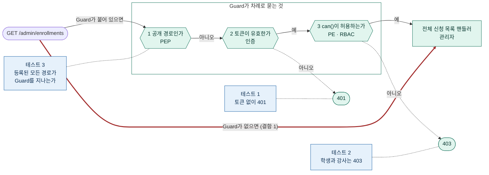
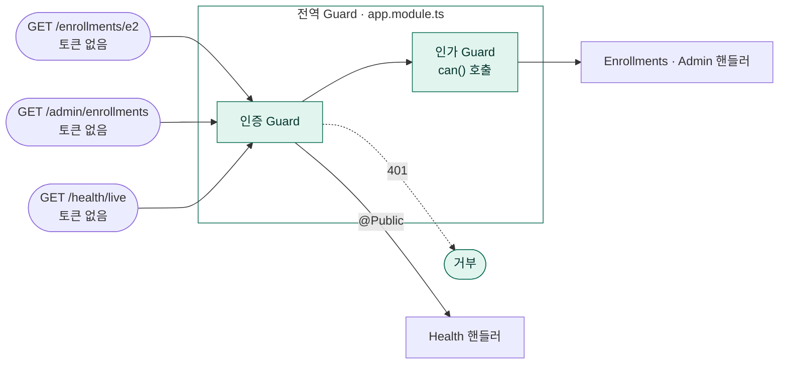

# 결함 1 진단 보고서: 전체 신청 목록 조회의 인증 누락 (컨트롤러에 Guard를 붙이지 않음)

| 항목 | 내용 |
|---|---|
| 대상 | 태그 `v2-defect-1`의 코드로 로컬에서 띄운 API (`http://127.0.0.1:4000`) |
| 경로 | `GET /admin/enrollments` |
| 분류 | OWASP Top 10 2025 A07 Authentication Failures / CWE-306 (중요 기능의 인증 누락) |
| 위험도 | 높음 |
| 해당 구성 요소 | PEP(정책 시행 지점). 결함 상태에서는 이 경로에 시행 지점이 없습니다 |
| 상태 | 조치 완료 (`v2-fix-1`) |

## 1. 요약

전체 신청 목록을 돌려주는 경로가 토큰 없이도 응답합니다. 응답에는 모든 신청의 사용자 id, 강의 id, 전화번호가 들어 있습니다. 학생 토큰으로 요청해도 같은 응답이 옵니다.

위험도를 높음으로 본 근거입니다.

| | 근거 |
|---|---|
| 높이는 쪽 | 인증이 필요 없습니다. 주소만 알면 됩니다 |
| 높이는 쪽 | 요청 한 번으로 끝납니다. 추측하거나 반복할 것이 없습니다 |
| 높이는 쪽 | 전체 사용자의 개인정보(전화번호)가 한 번에 나옵니다 |
| 낮추는 쪽 | 이 취약점은 기밀성만 침해합니다. 이 경로는 조회만 하므로 신청 데이터를 변경하거나 삭제할 수 없고, 무결성은 침해하지 않습니다 |
| 낮추는 쪽 | 응답에 비밀번호 해시나 토큰은 없습니다. 그래서 이 취약점만으로는 다른 사용자의 계정 탈취로 이어지지 않습니다 |

낮추는 쪽 두 가지는 피해의 종류를 좁힐 뿐이고, 누구나 전체 개인정보를 읽는다는 점은 그대로여서 높음으로 둡니다.

## 2. 재현 절차

준비:

```bash
git checkout v2-defect-1
docker compose up -d --wait
cd apps/api
cp .env.example .env
npm ci --ignore-scripts
npm run db:generate && npm run build
npm run db:migrate && npm run db:seed
npm start
```

요청 (토큰 없음):

```bash
curl -i http://127.0.0.1:4000/admin/enrollments
```

응답 (전화번호는 이 문서에서 가렸습니다):

```
HTTP/1.1 200 OK
Cache-Control: no-store
Content-Type: application/json; charset=utf-8

[{"id":"e1","userId":"u1","courseId":"c1","phone":"010-****-****"},
 {"id":"e2","userId":"u2","courseId":"c1","phone":"010-****-****"},
 {"id":"e3","userId":"u2","courseId":"c2","phone":"010-****-****"}]
```

재현 스크립트 (`main`의 스크립트를 결함 상태의 API에 실행):

```bash
node .github/scripts/defects/defect-1.mjs
```

```
결함 1: 전체 신청 목록(GET /admin/enrollments)의 인증·인가
대상: http://127.0.0.1:4000
- GET /admin/enrollments (토큰 없음)
    → 상태 200 · 3건 · 필드: courseId, id, phone, userId
- GET /admin/enrollments (학생 토큰)
    → 상태 200 · 3건 · 필드: courseId, id, phone, userId
판정: 취약
```

결함이 없다면 API는 토큰 없는 요청에 401, 학생 토큰의 요청에 403으로 응답해야 합니다.

## 3. 원인

API는 같은 "토큰 없는 요청"을 컨트롤러에 따라 다르게 처리합니다.


- 초록색 상자는 Guard가 요청을 확인하는 단계와 그 결과를 나타냅니다.
- 빨간색 상자는 Guard가 적용되지 않은 전체 신청 목록 핸들러와 그 응답을 나타냅니다.
- 빨간색 화살표는 Guard를 거치지 않고 핸들러에 도달한 요청의 흐름을 나타냅니다.

- Guard를 전역으로 등록하지 않고 컨트롤러마다 `@UseGuards(AuthGuard, AuthzGuard)`로 붙입니다([`auth/auth.controller.ts 10행`](https://github.com/loquemedalagana/secure-enroll-demo/blob/v2-defect-1/apps/api/src/auth/auth.controller.ts#L10), [`enrollments/enrollments.controller.ts 8행`](https://github.com/loquemedalagana/secure-enroll-demo/blob/v2-defect-1/apps/api/src/enrollments/enrollments.controller.ts#L8)).
- 관리자 컨트롤러([`enrollments/admin.controller.ts 5행`](https://github.com/loquemedalagana/secure-enroll-demo/blob/v2-defect-1/apps/api/src/enrollments/admin.controller.ts#L5))에는 `@UseGuards`가 없습니다.
- 핸들러에는 `@Authorize('admin:read')`가 붙어 있지만([`11행`](https://github.com/loquemedalagana/secure-enroll-demo/blob/v2-defect-1/apps/api/src/enrollments/admin.controller.ts#L11)), 이것은 인가 Guard가 읽는 표시일 뿐입니다. Guard가 적용되지 않으면 이 표시를 읽는 코드가 없습니다.
- 관리자로 로그인해서 확인하면 목록이 정상으로 나옵니다. 정상 경로만 확인하는 기존 테스트 59건은 이 상태에서 모두 통과합니다.

### 3.1 결함을 잡는 테스트

`apps/api/test/guard-coverage.test.mjs`에 테스트 3건을 넣었습니다. 요청이 핸들러에 도달하기 전에 Guard가 묻는 것은 세 가지이고, 테스트 3건은 그 세 가지를 하나씩 확인합니다.



- 초록색 상자는 Guard가 확인하는 1~3단계와 각 단계의 결과를 나타냅니다.
- 파란색 상자는 테스트를 나타냅니다.
- 빨간색 화살표는 결함 상태의 요청 흐름을 나타냅니다. 요청이 Guard를 거치지 않고 핸들러에 바로 도달합니다.

| 테스트 | 개발 관점: 무엇을 확인하나 | 보안 관점: 무엇을 지키나 |
|---|---|---|
| 1 토큰 없이 401 | 토큰 없는 요청에 401과 `{ "error": "unauthorized" }` | 인증. 시행 지점(PEP)이 이 경로에 있는가 |
| 2 학생과 강사는 403, 관리자는 200 | 역할별 토큰에 403, 403, 200 | 인가, RBAC. 판단(PE, `can()`)이 역할만 보고 정합니다 |
| 3 등록된 모든 경로 | 서버가 등록한 경로를 전부 읽어, 공개 목록에 없는 경로가 토큰 없이 401인지 | 시행 지점을 지나지 않는 경로가 없는가 |

결함 상태(`v2-defect-1`)에서는 세 건이 모두 실패합니다. 세 건이 실패한 원인은 하나입니다. 이 컨트롤러에는 Guard가 적용되지 않아서, 1~3을 확인하는 코드가 한 번도 실행되지 않습니다. `can()`을 Guard 없이 직접 호출하는 단위 테스트([`apps/api/test/policy.test.mjs` 17~28행](https://github.com/loquemedalagana/secure-enroll-demo/blob/v2-defect-1/apps/api/test/policy.test.mjs#L17-L28))는 결함 태그에서도 통과합니다.

테스트 1과 2는 이 경로 하나를 확인하고, 테스트 3은 등록된 모든 경로를 확인합니다. 컨트롤러를 새로 추가해도 테스트 3이 그 경로까지 확인합니다.

### 3.2 보안 관점: 접근통제 구성 요소로 본 결함

접근통제는 "누가(주체) 무엇에(객체) 무엇을 하려는가(행위)"를 규칙에 따라 판단하고, 그 판단대로 막거나 통과시키는 일입니다. 이 경로를 그 요소에 맞춰 보면 다음과 같습니다.

| 구성 요소 | 이 경로에서 | 결함 상태(`v2-defect-1`) | 코드에서 확인하는 곳 |
|---|---|---|---|
| 주체 | 요청을 보낸 사용자. 토큰에서 id를 읽고 DB에서 역할을 읽습니다 | API가 토큰을 읽지 않고, 요청한 사람이 누구인지 모르는 채로 응답합니다 | [`auth/auth.guard.ts 28~31행`](https://github.com/loquemedalagana/secure-enroll-demo/blob/v2-defect-1/apps/api/src/auth/auth.guard.ts#L28-L31): 사용자를 확인해 요청에 붙이는 곳. 이 경로에서는 실행되지 않습니다 |
| 객체 | 전체 신청 목록(사용자 id, 강의 id, 전화번호) | 확인 없이 응답에 그대로 들어갑니다 | [`enrollments/enrollments.service.ts 26행`](https://github.com/loquemedalagana/secure-enroll-demo/blob/v2-defect-1/apps/api/src/enrollments/enrollments.service.ts#L26): `listAll()` |
| 행위 | `admin:read`. 핸들러에 `@Authorize`로 적혀 있습니다 | 적혀 있지만 이 표시를 읽는 Guard가 적용되지 않습니다 | [`enrollments/admin.controller.ts 11행`](https://github.com/loquemedalagana/secure-enroll-demo/blob/v2-defect-1/apps/api/src/enrollments/admin.controller.ts#L11) |
| 판단 (PE) | `can()`. 관리자만 허용합니다 | 호출되지 않습니다. 규칙 자체는 맞습니다 | [`authz/policy.ts 28~29행`](https://github.com/loquemedalagana/secure-enroll-demo/blob/v2-defect-1/apps/api/src/authz/policy.ts#L28-L29) |
| 시행 (PEP) | 인증 Guard와 인가 Guard | **두 Guard 모두 이 경로에 적용되지 않습니다. 컨트롤러에 `@UseGuards`를 붙이지 않은 것이 결함이고, 그 결과 인증 없이 전체 신청 목록을 조회할 수 있는 취약점(인증 누락)이 생깁니다** | [`enrollments/admin.controller.ts 5행`](https://github.com/loquemedalagana/secure-enroll-demo/blob/v2-defect-1/apps/api/src/enrollments/admin.controller.ts#L5): `@Controller` 위에 `@UseGuards`가 없음 |
| 접근통제 모델 | RBAC. 역할만 보고 정합니다 | 적용되지 않습니다 | 판단과 같은 줄 |

정리하면 규칙(판단)은 맞는데, 이 경로에는 그 규칙을 적용하는 시행 지점이 없었습니다. 그래서 접근통제 실패(권한을 잘못 줌)가 아니라 인증 누락(CWE-306, 확인 자체를 하지 않음)으로 분류했습니다.

제로 트러스트의 원칙으로 보면 "모든 요청을 검증한다"를 지키지 않았습니다. 보호해야 하는 경로 넷 중 셋은 Guard가 확인하고, 이 경로 하나만 빠졌습니다.

## 4. 조치

### 4.1 조치 방안 비교

여기서 경로는 API가 받는 요청 주소(메서드와 URL)입니다. 이 API에 등록된 경로는 7개입니다.

| 경로 | 토큰 없이 요청하면 | 코드에서 확인하는 곳 |
|---|---|---|
| `GET /health/live` | 열려 있어야 함 (공개) | [`health.controller.ts` 6행](https://github.com/loquemedalagana/secure-enroll-demo/blob/v2-defect-1/apps/api/src/health/health.controller.ts#L6-L7): 컨트롤러에 `@Public()` |
| `GET /health/ready` | 열려 있어야 함 (공개) | 위와 같음 |
| `POST /auth/login` | 열려 있어야 함 (공개) | [`auth.controller.ts` 15행](https://github.com/loquemedalagana/secure-enroll-demo/blob/v2-defect-1/apps/api/src/auth/auth.controller.ts#L15-L16): 핸들러에 `@Public()` |
| `GET /auth/me` | 401 | [`auth.controller.ts` 10행](https://github.com/loquemedalagana/secure-enroll-demo/blob/v2-defect-1/apps/api/src/auth/auth.controller.ts#L10-L11): 컨트롤러에 `@UseGuards` |
| `GET /enrollments` | 401 | [`enrollments.controller.ts` 8행](https://github.com/loquemedalagana/secure-enroll-demo/blob/v2-defect-1/apps/api/src/enrollments/enrollments.controller.ts#L8-L9): 컨트롤러에 `@UseGuards` |
| `GET /enrollments/:id` | 401 | 위와 같음 |
| `GET /admin/enrollments` | 401이어야 하는데 지금은 200 (결함 1) | [`admin.controller.ts` 5행](https://github.com/loquemedalagana/secure-enroll-demo/blob/v2-defect-1/apps/api/src/enrollments/admin.controller.ts#L5-L11): `@Controller` 위에 `@UseGuards`가 없음 |

링크를 누르면 태그 `v2-defect-1`의 코드가 열립니다. Guard를 전역으로 등록하지 않았다는 것은 [`auth.module.ts` 9~10행](https://github.com/loquemedalagana/secure-enroll-demo/blob/v2-defect-1/apps/api/src/auth/auth.module.ts#L9-L10)에서 확인합니다. 실행해서 확인하려면 2절의 재현 스크립트를 쓰거나, API 테스트(`apps/api/test/guard-coverage.test.mjs`)의 세 번째 테스트를 봅니다. 이 테스트는 서버가 등록한 경로를 전부 읽어 토큰 없이 요청합니다.

고칠 방법은 두 가지입니다.

- **방안 1 (컨트롤러에 추가)**: Guard가 빠진 관리자 컨트롤러에 `@UseGuards(AuthGuard, AuthzGuard)`를 추가합니다.
- **방안 2 (전역 등록)**: Guard 두 개를 전역(`APP_GUARD`)으로 등록하고 컨트롤러의 `@UseGuards`를 지웁니다. 토큰 없이 열 경로 3개에만 `@Public`을 붙입니다.

| 기준 | 방안 1 (컨트롤러에 추가) | 방안 2 (전역 등록) |
|---|---|---|
| 표시를 빠뜨렸을 때 | 그 컨트롤러의 경로가 열립니다(`GET /admin/enrollments`처럼) | 그 경로가 막힙니다(401 또는 403) |
| 컨트롤러를 새로 추가할 때 | `@UseGuards`를 다시 붙여야 합니다 | 할 일이 없습니다 |
| 바꾸는 파일 | 1개 | 4개(모듈 1, 컨트롤러 3) |
| Guard가 적용되는지 확인하는 곳 | 그 컨트롤러 파일 | 모듈 파일 한 곳 |
| 사람이 관리할 목록 | 보호할 컨트롤러 전부 | 공개 경로(현재 3개) |
| 남는 실수 | 보호할 컨트롤러에 `@UseGuards`를 빠뜨림 | 보호할 경로에 `@Public`을 붙임 |

**고른 것**: 방안 2 (전역 등록).

**이유**: 이 결함의 원인은 컨트롤러 하나의 누락이 아니라, 빠뜨리면 열리는 구조입니다. 방안 1은 지금 열린 경로 하나를 닫지만 같은 누락이 다음 컨트롤러에서 다시 생길 수 있습니다. 방안 2는 기본값을 거부로 바꿉니다. 사람이 관리할 목록도 "보호할 것 전부"에서 "공개할 것 3개"로 줄어듭니다.

**채택하지 않은 대안 (방안 1)**: 변경이 한 줄이고 다른 경로에 영향이 없습니다. 이미 운영 중인 서비스에서 급히 막아야 할 때는 방안 1을 먼저 적용하고 방안 2를 뒤에 하는 순서가 맞습니다. 이 저장소는 그런 제약이 없어서 방안 2를 바로 적용합니다.

**감수하는 것**:

- 컨트롤러 파일만으로는 Guard가 적용되는지 알 수 없습니다. 모듈 파일을 함께 봐야 합니다.
- `@Public`을 잘못 붙이면 그 경로는 열립니다. 테스트(`apps/api/test/guard-coverage.test.mjs`)가 공개 경로 목록을 따로 가지고 있어서, 목록에 없는 경로가 토큰 없이 열리면 실패합니다.
- 전역 Guard 두 개는 등록한 순서(인증 → 인가)로 실행됩니다. 순서가 바뀌면 인가 Guard가 사용자 정보를 찾지 못해 401로 거부합니다. 순서를 잘못 등록해도 경로가 열리지는 않고, API가 요청을 거부합니다.

어느 방법을 고르든 3절의 누락을 잡는 테스트는 그대로 둡니다.

**전역 Guard를 등록하는 위치**: 최상위 모듈(`apps/api/src/app.module.ts`)과 인증 모듈(`apps/api/src/auth/auth.module.ts`) 중에서 최상위 모듈을 골랐습니다. 어느 쪽에 등록해도 적용 범위는 같습니다. 다른 점은 코드를 읽고 고칠 때 봐야 하는 파일입니다.

| 기준 | 최상위 모듈 | 인증 모듈 |
|---|---|---|
| 모든 요청에 적용되는 것을 확인하는 곳 | 파일 하나(오류 필터, 입력값 검증, Guard 두 개) | 파일 둘(필터와 검증은 최상위, Guard는 인증 모듈) |
| 인증 관련 코드가 모이는 곳 | Guard의 정의는 `auth/`, 등록은 최상위 | 정의와 등록 모두 `auth/` |
| 최상위 모듈이 아는 것 | Guard 두 개를 직접 가져옵니다 | 인증 모듈만 가져옵니다 |

고른 이유: 시행 지점(PEP)은 인증 기능에만 쓰이지 않고 모든 요청에 적용됩니다. 최상위 모듈에 등록하면 모든 요청이 무엇을 지나는지를 파일 하나에서 확인할 수 있습니다.

### 4.2 적용한 조치

커밋 두 개로 나눴습니다. 첫 커밋이 결함을 고치고, 둘째 커밋은 동작을 바꾸지 않는 정리입니다.

| 커밋 | 바꾼 것 | 동작 변화 |
|---|---|---|
| Guard를 전역으로 등록 | [`app.module.ts` 15~18행](https://github.com/loquemedalagana/secure-enroll-demo/blob/v2-fix-1/apps/api/src/app.module.ts#L15-L18): 인증 Guard와 인가 Guard를 `APP_GUARD`로 등록 | `GET /admin/enrollments`가 토큰 없이 200 → 401, 학생 토큰으로 200 → 403 |
| 컨트롤러별 Guard 적용 삭제 | `auth.controller.ts`, `enrollments.controller.ts`의 `@UseGuards`와 `auth.module.ts`, `enrollments.module.ts`의 Guard 등록 | 없음 |

관리자 컨트롤러([`admin.controller.ts`](https://github.com/loquemedalagana/secure-enroll-demo/blob/v2-fix-1/apps/api/src/enrollments/admin.controller.ts))는 바꾸지 않았습니다. 파일은 결함 상태와 같습니다. 이 컨트롤러로 가는 요청도 전역 Guard를 지나게 되어, API는 토큰 없는 요청에 401로 응답합니다.



모든 요청이 같은 Guard를 지납니다. `@Public`이 붙은 경로 3개에서만 Guard가 토큰 확인을 건너뛰고 요청을 통과시킵니다.

## 5. 조치 뒤 재확인

태그 `v2-fix-1`의 코드로 API를 로컬에서 띄우고, 2절과 같은 스크립트를 실행한 결과입니다.

```bash
node .github/scripts/defects/defect-1.mjs --expect blocked
```

```
결함 1: 전체 신청 목록(GET /admin/enrollments)의 인증·인가
- GET /admin/enrollments (토큰 없음)
    → 상태 401 · 필드: error
- GET /admin/enrollments (학생 토큰)
    → 상태 403 · 필드: error
판정: 차단
```

| 확인 | 결함 상태 (`v2-defect-1`) | 조치 뒤 (`v2-fix-1`) |
|---|---|---|
| 토큰 없음 | 200, 3건 | 401 |
| 학생 토큰 | 200, 3건 | 403 |
| 관리자 토큰 | 200, 3건 | 200, 3건 |
| 공개 경로(`GET /health/live`) | 200 | 200 |
| API 테스트 | 62건 중 3건 실패 | 62건 통과 |

실패하던 3건은 `apps/api/test/guard-coverage.test.mjs`의 테스트입니다. 세 번째 테스트는 서버가 등록한 경로를 전부 읽어 토큰 없이 요청하므로, 컨트롤러를 새로 추가해도 이 테스트가 그 경로까지 확인합니다.

### CI 실행 기록

이 결함을 다룬 PR에서 실행된 CI 기록입니다.

| 시점 | 커밋 | `api` 잡 | 실행 |
|---|---|---|---|
| 테스트를 추가한 뒤 | `fea395d` | 실패 (62건 중 3건) | [45597908796](https://github.com/loquemedalagana/secure-enroll-demo/actions/runs/45597908796) |
| 수정한 뒤 | `a691eca` | 통과 (62건) | [45758558647](https://github.com/loquemedalagana/secure-enroll-demo/actions/runs/45758558647) |

실행 로그는 GitHub의 보존 기간(기본 90일)이 지나면 삭제됩니다. 그 뒤에도 `defects.yml`을 실행하면 위 표의 실패와 통과를 재현할 수 있습니다. 이 워크플로는 결함 태그의 코드에 수정 태그의 테스트를 실행해 같은 테스트가 실패하는지 확인하고, 수정 태그의 코드에서는 모두 통과하는지 확인합니다. 실패한 테스트의 이름은 Summary에 남깁니다.

## 6. Burp Suite 진단 기록

작성 전.
