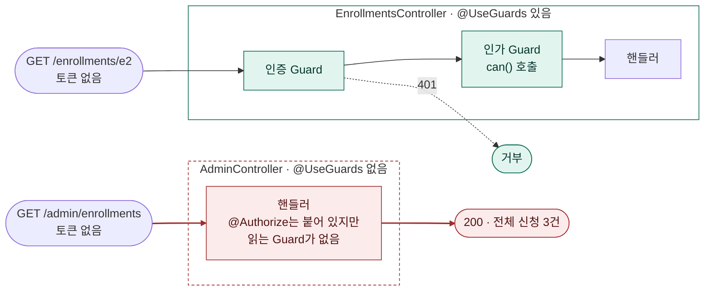

# 결함 1 진단 보고서: 전체 신청 목록이 인증 없이 열림

| 항목 | 내용 |
|---|---|
| 대상 | 이 저장소의 태그 `v2-defect-1`을 로컬에서 띄운 API (`http://127.0.0.1:4000`) |
| 경로 | `GET /admin/enrollments` |
| 분류 | OWASP Top 10 2025 A07 Authentication Failures / CWE-306 (중요 기능의 인증 누락) |
| 위험도 | 높음 |
| 해당 구성 요소 | PEP(정책 시행 지점). 이 경로에는 시행 지점이 없습니다 |
| 상태 | 결함 확인. 조치 전 |

## 1. 요약

전체 신청 목록을 돌려주는 경로가 토큰 없이도 응답합니다. 응답에는 모든 신청의 사용자 id, 강의 id, 전화번호가 들어 있습니다. 학생 토큰으로 요청해도 같은 응답이 옵니다.

위험도를 높음으로 본 근거는 세 가지입니다. 인증이 필요 없고, 요청 한 번으로 끝나며, 전체 사용자의 개인정보(전화번호)가 나옵니다.

## 2. 재현 절차

준비:

```bash
git checkout v2-defect-1
docker compose up -d --wait
cd apps/api
cp .env.example .env
npm ci --ignore-scripts
npm run db:generate && npm run build
npm run db:migrate && npm run db:seed
npm start
```

요청 (토큰 없음):

```bash
curl -i http://127.0.0.1:4000/admin/enrollments
```

응답 (전화번호는 이 문서에서 가렸습니다):

```
HTTP/1.1 200 OK
Cache-Control: no-store
Content-Type: application/json; charset=utf-8

[{"id":"e1","userId":"u1","courseId":"c1","phone":"010-****-****"},
 {"id":"e2","userId":"u2","courseId":"c1","phone":"010-****-****"},
 {"id":"e3","userId":"u2","courseId":"c2","phone":"010-****-****"}]
```

재현 스크립트 (`main`의 스크립트를 결함 상태의 API에 실행):

```bash
node .github/scripts/defects/defect-1.mjs
```

```
결함 1: 전체 신청 목록(GET /admin/enrollments)의 인증·인가
대상: http://127.0.0.1:4000
- GET /admin/enrollments (토큰 없음)
    → 상태 200 · 3건 · 필드: courseId, id, phone, userId
- GET /admin/enrollments (학생 토큰)
    → 상태 200 · 3건 · 필드: courseId, id, phone, userId
판정: 취약
```

기대한 동작은 토큰 없음 401, 학생 토큰 403입니다.

## 3. 원인

같은 "토큰 없는 요청"이 컨트롤러에 따라 다르게 처리됩니다.



초록은 검사가 이루어지는 곳, 빨강은 검사 없이 지나가는 곳입니다.

- Guard를 전역으로 등록하지 않고 컨트롤러마다 `@UseGuards(AuthGuard, AuthzGuard)`로 붙입니다(`apps/api/src/auth/auth.controller.ts`, `apps/api/src/enrollments/enrollments.controller.ts`).
- 관리자 컨트롤러(`apps/api/src/enrollments/admin.controller.ts`)에는 `@UseGuards`가 없습니다.
- 핸들러에는 `@Authorize('admin:read')`가 붙어 있지만, 이것은 인가 Guard가 읽는 표시일 뿐입니다. Guard가 돌지 않으면 아무도 읽지 않습니다.
- 관리자로 로그인해서 확인하면 목록이 정상으로 나옵니다. 정상 경로만 검사하는 기존 테스트 59건은 이 상태에서 모두 통과합니다.

## 4. 조치

### 4.1 조치 방안 비교

여기서 경로는 API가 받는 요청 주소(메서드와 URL)입니다. 이 API에 등록된 경로는 7개입니다.

| 경로 | 토큰 없이 요청하면 | 코드에서 확인하는 곳 |
|---|---|---|
| `GET /health/live` | 열려 있어야 함 (공개) | [`health.controller.ts` 6행](https://github.com/loquemedalagana/secure-enroll-demo/blob/v2-defect-1/apps/api/src/health/health.controller.ts#L6-L7): 컨트롤러에 `@Public()` |
| `GET /health/ready` | 열려 있어야 함 (공개) | 위와 같음 |
| `POST /auth/login` | 열려 있어야 함 (공개) | [`auth.controller.ts` 15행](https://github.com/loquemedalagana/secure-enroll-demo/blob/v2-defect-1/apps/api/src/auth/auth.controller.ts#L15-L16): 핸들러에 `@Public()` |
| `GET /auth/me` | 401 | [`auth.controller.ts` 10행](https://github.com/loquemedalagana/secure-enroll-demo/blob/v2-defect-1/apps/api/src/auth/auth.controller.ts#L10-L11): 컨트롤러에 `@UseGuards` |
| `GET /enrollments` | 401 | [`enrollments.controller.ts` 8행](https://github.com/loquemedalagana/secure-enroll-demo/blob/v2-defect-1/apps/api/src/enrollments/enrollments.controller.ts#L8-L9): 컨트롤러에 `@UseGuards` |
| `GET /enrollments/:id` | 401 | 위와 같음 |
| `GET /admin/enrollments` | 401이어야 하는데 지금은 200 (결함 1) | [`admin.controller.ts` 5행](https://github.com/loquemedalagana/secure-enroll-demo/blob/v2-defect-1/apps/api/src/enrollments/admin.controller.ts#L5-L11): `@Controller` 위에 `@UseGuards`가 없음 |

링크는 태그 `v2-defect-1`의 코드를 가리킵니다. Guard를 전역으로 등록하지 않았다는 것은 [`auth.module.ts` 9~10행](https://github.com/loquemedalagana/secure-enroll-demo/blob/v2-defect-1/apps/api/src/auth/auth.module.ts#L9-L10)에서 확인합니다. 실행해서 확인하려면 2절의 재현 스크립트를 쓰거나, API 테스트(`apps/api/test/guard-coverage.test.mjs`)의 세 번째 테스트를 봅니다. 이 테스트는 서버가 등록한 경로를 전부 읽어 토큰 없이 요청합니다.

고칠 방법은 두 가지입니다.

- **가**: Guard가 빠진 관리자 컨트롤러에 `@UseGuards(AuthGuard, AuthzGuard)`를 추가합니다.
- **나**: Guard 두 개를 전역(`APP_GUARD`)으로 등록하고 컨트롤러의 `@UseGuards`를 지웁니다. 토큰 없이 열 경로 3개에만 `@Public`을 붙입니다.

| 기준 | 가 (컨트롤러에 추가) | 나 (전역 등록) |
|---|---|---|
| 표시를 빠뜨렸을 때 | 그 컨트롤러의 경로가 열립니다(`GET /admin/enrollments`처럼) | 그 경로가 막힙니다(401 또는 403) |
| 컨트롤러를 새로 추가할 때 | `@UseGuards`를 다시 붙여야 합니다 | 할 일이 없습니다 |
| 바꾸는 파일 | 1개 | 4개(모듈 1, 컨트롤러 3) |
| Guard가 도는지 확인하는 곳 | 그 컨트롤러 파일 | 모듈 파일 한 곳 |
| 사람이 챙길 목록 | 보호할 컨트롤러 전부 | 공개 경로(현재 3개) |
| 남는 실수 | 보호할 컨트롤러에 `@UseGuards`를 빠뜨림 | 보호할 경로에 `@Public`을 붙임 |

**고른 것**: 나.

**이유**: 이 결함의 원인은 컨트롤러 하나의 누락이 아니라, 빠뜨리면 열리는 구조입니다. 가는 지금 열린 경로 하나를 닫지만 같은 누락이 다음 컨트롤러에서 다시 생길 수 있습니다. 나는 기본값을 거부로 바꿉니다. 사람이 챙길 목록도 "보호할 것 전부"에서 "공개할 것 3개"로 줄어듭니다.

**채택하지 않은 대안 (가)**: 변경이 한 줄이고 다른 경로에 영향이 없습니다. 이미 운영 중인 서비스에서 급히 막아야 할 때는 가를 먼저 적용하고 나를 뒤에 하는 순서가 맞습니다. 이 저장소는 그런 제약이 없어서 나를 바로 적용합니다.

**감수하는 것**:

- 컨트롤러 파일만 봐서는 Guard가 도는지 보이지 않습니다. 모듈 파일을 봐야 합니다.
- `@Public`을 잘못 붙이면 그 경로는 열립니다. 테스트(`apps/api/test/guard-coverage.test.mjs`)가 공개 경로 목록을 따로 들고 있어서, 목록에 없는 경로가 토큰 없이 열리면 실패합니다.
- 전역 Guard 두 개는 등록한 순서(인증 → 인가)로 돕니다. 순서가 바뀌면 인가 Guard가 사용자 정보를 찾지 못해 401로 거부합니다. 열리는 쪽이 아니라 막히는 쪽으로 틀립니다.

어느 방법을 고르든 3절의 누락을 잡는 테스트는 그대로 둡니다.

### 4.2 적용한 조치

작성 전. 수정 커밋(`v2-fix-1`) 뒤에 적습니다.

## 5. 조치 뒤 재확인

작성 전. `v2-fix-1`에서 2절과 같은 요청을 다시 보낸 결과를 적습니다.

## 6. Burp Suite 진단 기록

작성 전.
