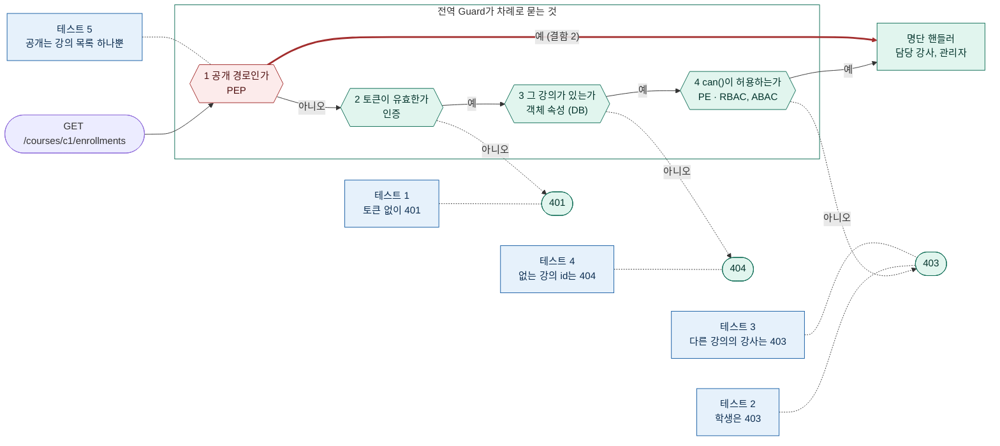

# 결함 2 진단 보고서: 수강생 명단이 인증 없이 열림

| 항목 | 내용 |
|---|---|
| 대상 | 이 저장소의 태그 `v2-defect-2`를 로컬에서 띄운 API (`http://127.0.0.1:4000`) |
| 경로 | `GET /courses/:id/enrollments` |
| 분류 | OWASP Top 10 2025 A07 Authentication Failures / CWE-306 (중요 기능의 인증 누락) |
| 위험도 | 높음 |
| 해당 구성 요소 | PEP(정책 시행 지점). 시행 지점은 있지만 경로의 앞부분만 보고 통과시켜서, 판단(PE, `can()`)에 묻지 않습니다 |
| 상태 | 조치 완료 (`v2-fix-2`) |

## 1. 요약

강의 목록(`GET /courses`)을 로그인 없이 보여 주려고 "경로가 `/courses`로 시작하면 공개"라는 조건을 넣었습니다. 같은 글자로 시작하는 수강생 명단(`GET /courses/:id/enrollments`)까지 토큰 없이 응답합니다. 응답에는 그 강의 수강생 전원의 사용자 id와 전화번호가 들어 있습니다. 학생 토큰이나 다른 강의의 강사 토큰으로 요청해도 같은 응답이 옵니다.

위험도를 높음으로 본 근거입니다.

| | 근거 |
|---|---|
| 높이는 쪽 | 인증이 필요 없습니다 |
| 높이는 쪽 | 필요한 강의 id를 공개된 강의 목록에서 그대로 얻습니다. 추측할 것이 없습니다 |
| 높이는 쪽 | 요청 한 번에 그 강의 수강생 전원의 개인정보(전화번호)가 나옵니다 |
| 낮추는 쪽 | 읽기만 됩니다. 이 경로로 신청을 바꾸거나 지울 수는 없습니다 |
| 낮추는 쪽 | 요청 한 번에 나오는 것은 강의 하나의 명단입니다 |

두 번째 낮추는 쪽은 약합니다. 강의 목록이 공개라서 강의마다 한 번씩 요청하면 전체 명단이 됩니다. 그래서 높음으로 둡니다.

## 2. 재현 절차

준비:

```bash
git checkout v2-defect-2
docker compose up -d --wait
cd apps/api
cp .env.example .env
npm ci --ignore-scripts
npm run db:generate && npm run build
npm run db:migrate && npm run db:seed
npm start
```

요청 1 (토큰 없음, 강의 id를 얻음):

```bash
curl -i http://127.0.0.1:4000/courses
```

```
HTTP/1.1 200 OK
Content-Type: application/json; charset=utf-8

[{"id":"c1","title":"웹 보안 입문"},{"id":"c2","title":"시큐어 코딩 실습"}]
```

이 응답은 의도한 동작입니다.

요청 2 (토큰 없음, 그 id로 명단을 요청):

```bash
curl -i http://127.0.0.1:4000/courses/c1/enrollments
```

응답 (전화번호는 이 문서에서 가렸습니다):

```
HTTP/1.1 200 OK
Cache-Control: no-store
Content-Type: application/json; charset=utf-8

[{"id":"e1","userId":"u1","courseId":"c1","phone":"010-****-****"},
 {"id":"e2","userId":"u2","courseId":"c1","phone":"010-****-****"}]
```

재현 스크립트 (`main`의 스크립트를 결함 상태의 API에 실행):

```bash
node .github/scripts/defects/defect-2.mjs
```

```
결함 2: 수강생 명단(GET /courses/:id/enrollments)의 인증·인가
대상: http://127.0.0.1:4000
- GET /courses (토큰 없음, 공개가 맞음)
    → 상태 200 · 2건 · 필드: id, title
- GET /courses/c1/enrollments (토큰 없음)
    → 상태 200 · 2건 · 필드: courseId, id, phone, userId
- GET /courses/c1/enrollments (학생 토큰)
    → 상태 200 · 2건 · 필드: courseId, id, phone, userId
- GET /courses/c1/enrollments (다른 강의의 강사 토큰)
    → 상태 200 · 2건 · 필드: courseId, id, phone, userId
판정: 취약
```

기대한 동작은 토큰 없음 401, 학생 토큰 403, 다른 강의의 강사 토큰 403입니다.

## 3. 원인

Guard는 모든 요청에 돕니다(결함 1의 조치). 그런데 Guard가 맨 처음에 묻는 "이 요청은 공개인가"의 답이 경로의 앞부분으로 정해집니다.


초록은 검사가 이루어지거나 의도대로 열린 곳, 빨강은 검사 없이 지나가는 곳, 노랑은 공개 여부를 판단하는 곳입니다.

### 3.1 원인 코드

- 공개 여부를 판단하는 함수가 경로의 앞부분을 비교합니다: [`auth/is-public.ts` 7행, 14~15행](https://github.com/loquemedalagana/secure-enroll-demo/blob/v2-defect-2/apps/api/src/auth/is-public.ts#L7-L15).
- 인증 Guard와 인가 Guard가 둘 다 이 함수를 맨 먼저 부르고, 참이면 바로 통과시킵니다: [`auth/auth.guard.ts` 18행](https://github.com/loquemedalagana/secure-enroll-demo/blob/v2-defect-2/apps/api/src/auth/auth.guard.ts#L18), [`authz/authz.guard.ts` 27행](https://github.com/loquemedalagana/secure-enroll-demo/blob/v2-defect-2/apps/api/src/authz/authz.guard.ts#L27).
- 명단 핸들러에는 `@Authorize('roster:read', ...)`가 붙어 있고 정책 `can()`에도 규칙이 있습니다: [`courses/courses.controller.ts` 17~18행](https://github.com/loquemedalagana/secure-enroll-demo/blob/v2-defect-2/apps/api/src/courses/courses.controller.ts#L17-L18). 인가 Guard가 27행에서 먼저 돌아가므로 이 표시는 읽히지 않습니다.

### 3.2 열려야 하는 경로와 실제로 열린 경로

등록된 경로는 9개입니다. "토큰 없이 요청하면" 칸은 이 태그의 코드가 실제로 하는 동작입니다.

| 경로 | 누가 볼 수 있어야 하나 | 토큰 없이 요청하면 | 근거 |
|---|---|---|---|
| `GET /health/live` | 누구나 | 열림 | [`health.controller.ts` 6행](https://github.com/loquemedalagana/secure-enroll-demo/blob/v2-defect-2/apps/api/src/health/health.controller.ts#L6): `@Public()` |
| `GET /health/ready` | 누구나 | 열림 | 위와 같음 |
| `POST /auth/login` | 누구나 | 열림 | [`auth.controller.ts` 12행](https://github.com/loquemedalagana/secure-enroll-demo/blob/v2-defect-2/apps/api/src/auth/auth.controller.ts#L12): 핸들러에 `@Public()` |
| `GET /courses` | 누구나 | 열림 | [`is-public.ts` 7행](https://github.com/loquemedalagana/secure-enroll-demo/blob/v2-defect-2/apps/api/src/auth/is-public.ts#L7): 경로가 `/courses`로 시작함 |
| `GET /courses/:id/enrollments` | 담당 강사와 관리자만 | **열림** | 이 경로도 `/courses`로 시작함 (결함 2) |
| `GET /auth/me` | 로그인한 사용자 | 막힘 (401) | `@Public()`이 없고 `/courses`로 시작하지도 않음 |
| `GET /enrollments` | 로그인한 사용자 | 막힘 (401) | 위와 같음 |
| `GET /enrollments/:id` | 소유자, 담당 강사, 관리자 | 막힘 (401) | 위와 같음 |
| `GET /admin/enrollments` | 관리자만 | 막힘 (401) | 위와 같음 |

`/courses` 아래에 경로를 새로 만들면 그 경로도 토큰 없이 열립니다.

### 3.3 이 결함을 처음 잡은 것

결함 1에서 넣은 테스트(`apps/api/test/guard-coverage.test.mjs`의 "등록된 모든 경로: 공개 목록에 없는 경로는 토큰 없이 401")가 이 태그에서 실패합니다. API 테스트 71건 중 70건 통과, 1건 실패입니다.

```
✖ 등록된 모든 경로: 공개 목록에 없는 경로는 토큰 없이 401
  + [
  +   'GET /courses/:id/enrollments → 200'
  + ]
  - []
```

이 테스트는 공개 경로를 메서드와 경로로 하나씩 적은 목록과 비교합니다. 강의 목록을 공개하면서 그 목록에 `GET /courses`를 추가했고, 명단은 목록에 없어서 잡혔습니다. 코드는 경로의 앞부분만 보고, 테스트는 경로 전체를 적은 목록과 비교합니다. 같은 질문에 두 답이 달랐습니다.

같은 태그에서 새로 넣은 강의 테스트 3건(`apps/api/test/courses.test.mjs`)은 허용되는 경우만 확인하므로 통과합니다.

### 3.4 결함을 잡는 테스트

`apps/api/test/courses.test.mjs`에 테스트 5건을 추가했습니다. 요청이 명단 핸들러에 도달하기 전에 Guard가 묻는 것은 네 가지이고, 테스트는 각각 다른 자리를 지킵니다.



빨강은 결함이 있는 단계와 그 단계를 지나 통과하는 경로, 초록은 그 뒤의 검사와 결과, 파랑은 테스트입니다.

| 테스트 | 개발 관점: 무엇을 확인하나 | 보안 관점: 무엇을 지키나 |
|---|---|---|
| 1 토큰 없이 401 | 토큰 없는 요청에 401과 `{ "error": "unauthorized" }` | 인증 |
| 2 학생은 403 | 그 강의를 신청한 학생의 토큰에 403 | 인가, RBAC. 판단(PE, `can()`)이 역할만 보고 거부합니다 |
| 3 다른 강의의 강사는 403 | 역할은 강사이지만 그 강의의 담당이 아닌 토큰에 403 | 인가, ABAC. 판단(PE)이 주체의 id와 강의의 담당 강사를 비교합니다 |
| 4 없는 강의 id는 404 | 없는 id에 404와 `{ "error": "not_found" }` | 판단에 넣을 객체 속성을 DB에서 실제로 읽는가 |
| 5 공개는 강의 목록 하나뿐 | `GET /courses`는 200이고, `/courses` 아래의 다른 경로 4개는 토큰 없이 200이 아님 | 시행 지점(PEP)을 건너뛰는 길이 없는가 |

테스트 2와 3은 같은 403이지만 거부되는 이유가 다릅니다. 2는 역할 때문이고, 3은 역할은 맞는데 대상과의 관계가 맞지 않아서입니다.

이 커밋에서 API 테스트는 76건 중 70건 통과, 6건 실패입니다. 위 5건과 3.3절의 1건입니다.

```
✖ 수강생 명단 1: 토큰 없이 401            200 !== 401
✖ 수강생 명단 2: 학생은 ... 403           200 !== 403
✖ 수강생 명단 3: 다른 강의의 강사는 403    200 !== 403
✖ 수강생 명단 4: 없는 강의 id는 404        200 !== 404
✖ 수강생 명단 5: 공개는 강의 목록 하나뿐... 
✖ 등록된 모든 경로: ...                    'GET /courses/:id/enrollments → 200'
```

여섯 건이 서로 다른 자리를 지키는데 모두 실패합니다. 원인은 1단계 한 곳입니다. 1단계에서 "공개"로 답하면 2~4단계가 돌지 않습니다. 정책(`can()`)의 단위 테스트는 같은 커밋에서 모두 통과합니다.

### 3.5 보안 관점: 접근통제 구성 요소로 본 결함

접근통제는 "누가(주체) 무엇에(객체) 무엇을 하려는가(행위)"를 규칙에 따라 판단하고, 그 판단대로 막거나 통과시키는 일입니다. 이 경로를 그 요소에 맞춰 보면 다음과 같습니다.

| 구성 요소 | 이 경로에서 | 결함 상태(`v2-defect-2`) | 코드에서 확인하는 곳 |
|---|---|---|---|
| 주체 | 요청을 보낸 사용자. 토큰에서 id를 읽고 DB에서 역할을 읽습니다 | 토큰을 읽지 않습니다 | [`auth/auth.guard.ts 24~27행`](https://github.com/loquemedalagana/secure-enroll-demo/blob/v2-defect-2/apps/api/src/auth/auth.guard.ts#L24-L27): 사용자를 확인해 요청에 붙이는 곳. 18행에서 먼저 통과해 여기까지 오지 않습니다 |
| 객체 | 강의 하나의 수강생 명단. 그 강의의 담당 강사가 누구인지가 판단에 쓰입니다 | 담당 강사를 읽지 않고 명단이 그대로 나갑니다 | [`courses/courses.service.ts 17행`](https://github.com/loquemedalagana/secure-enroll-demo/blob/v2-defect-2/apps/api/src/courses/courses.service.ts#L17): `roster()`. 담당 강사를 읽는 곳은 [`authz/authz.guard.ts 51~56행`](https://github.com/loquemedalagana/secure-enroll-demo/blob/v2-defect-2/apps/api/src/authz/authz.guard.ts#L51-L56) |
| 행위 | `roster:read`. 핸들러에 `@Authorize`로 적혀 있습니다 | 적혀 있지만 읽히지 않습니다 | [`courses/courses.controller.ts 18행`](https://github.com/loquemedalagana/secure-enroll-demo/blob/v2-defect-2/apps/api/src/courses/courses.controller.ts#L18) |
| 판단 (PE) | `can()`. 관리자, 또는 그 강의의 담당 강사만 허용합니다 | 불리지 않습니다. 규칙 자체는 맞습니다 | [`authz/policy.ts 38~42행`](https://github.com/loquemedalagana/secure-enroll-demo/blob/v2-defect-2/apps/api/src/authz/policy.ts#L38-L42) |
| 시행 (PEP) | 전역 Guard. 모든 요청이 지나갑니다 | **요청은 Guard를 지나가지만, Guard는 경로가 `/courses`로 시작하면 확인 없이 통과시킵니다. 경로의 앞부분만 비교하는 이 조건이 결함이고, 그 결과 수강생 명단이 인증 없이 열리는 취약점(인증 누락)이 생깁니다** | [`auth/is-public.ts 7행, 15행`](https://github.com/loquemedalagana/secure-enroll-demo/blob/v2-defect-2/apps/api/src/auth/is-public.ts#L7-L15). 부르는 곳은 [`auth/auth.guard.ts 18행`](https://github.com/loquemedalagana/secure-enroll-demo/blob/v2-defect-2/apps/api/src/auth/auth.guard.ts#L18), [`authz/authz.guard.ts 27행`](https://github.com/loquemedalagana/secure-enroll-demo/blob/v2-defect-2/apps/api/src/authz/authz.guard.ts#L27) |
| 접근통제 모델 | RBAC(관리자인가)와 ABAC(이 강의의 담당 강사인가) | 둘 다 적용되지 않습니다 | 판단과 같은 줄. 40행이 RBAC, 42행이 ABAC |

결함 1과 비교하면 이렇습니다.

| | 결함 1 | 결함 2 |
|---|---|---|
| 시행하는 자리 | 없었습니다 | 있습니다 |
| 무엇이 틀렸나 | 자리를 빠뜨렸습니다 | 자리는 있는데 "검사하지 않아도 되는 요청"을 고르는 기준이 틀렸습니다 |
| 판단(`can()`) | 맞습니다 | 맞습니다 |

두 결함 모두 규칙은 맞고, 그 규칙에 물어보지 않은 것이 문제입니다. 그래서 둘 다 분류가 인증 누락(CWE-306)입니다.

제로 트러스트의 원칙으로 보면 "모든 요청을 검사한다"에서 예외를 두는 방법이 틀린 경우입니다. 검사하지 않을 요청을 하나씩 정하지 않고, 주소가 `/courses`로 시작하면 모두 통과시켰습니다.

## 4. 조치

### 4.1 조치 방안 비교

고칠 곳은 `apps/api/src/auth/is-public.ts`입니다. 이 파일은 Guard가 요청을 토큰 없이 통과시킬지 정하는 곳이고, 지금은 주소가 `/courses`로 시작하면 통과시킵니다. 고칠 방법은 세 가지입니다.

- **방안 1 (글자가 같을 때만)**: 주소가 `/courses`로 "시작하면"을 `/courses`와 "같으면"으로 바꿉니다.
- **방안 2 (`@Public` 표시만)**: 주소 비교를 없애고, 핸들러에 붙인 `@Public`만 봅니다. 강의 목록 핸들러에 `@Public`을 붙입니다.
- **방안 3 (경로 목록)**: 토큰 없이 통과시킬 경로를 메서드와 등록 경로로 적은 목록을 한 곳에 두고, 서버가 그 요청에 연결한 등록 경로와 비교합니다.

#### 실제로 바꿔 본 결과

세 방안을 태그 `v2-defect-2`의 코드에 각각 적용해 테스트와 요청을 돌려 봤습니다. 이 변경들은 커밋하지 않았고, 아래 코드를 그대로 적용하면 같은 결과를 다시 볼 수 있습니다.

방안 1:

```diff
-  return PUBLIC_PREFIXES.some((prefix) => path.startsWith(prefix));
+  return PUBLIC_PREFIXES.some((prefix) => path === prefix);
```

방안 2:

```diff
 // auth/is-public.ts
-  if (marked === true) return true;
-
-  const { path } = context.switchToHttp().getRequest<Request>();
-  return PUBLIC_PREFIXES.some((prefix) => path.startsWith(prefix));
+  return marked === true;

 // courses/courses.controller.ts
+  @Public()
   @Get()
   list(): Promise<CourseView[]> {
```

방안 3:

```diff
-const PUBLIC_PREFIXES: readonly string[] = ['/courses'];
+const PUBLIC_ROUTES: readonly string[] = ['GET /courses'];
 ...
-  const { path } = context.switchToHttp().getRequest<Request>();
-  return PUBLIC_PREFIXES.some((prefix) => path.startsWith(prefix));
+  const req = context.switchToHttp().getRequest<Request>();
+  return PUBLIC_ROUTES.includes(`${req.method} ${String(req.route?.path)}`);
```

토큰 없이 보낸 요청의 상태 코드입니다.

| 요청 | 처리하는 핸들러 | 결함 상태 | 방안 1 | 방안 2 | 방안 3 |
|---|---|---|---|---|---|
| `GET /courses` | 강의 목록 | 200 | 200 | 200 | 200 |
| `GET /courses/` | 강의 목록 | 200 | **401** | 200 | 200 |
| `GET /Courses` | 강의 목록 | **401** | **401** | 200 | 200 |
| `GET /courses/c1/enrollments` | 수강생 명단 | **200** | 401 | 401 | 401 |
| `GET /courses/c1/enrollments/` | 수강생 명단 | **200** | 401 | 401 | 401 |
| `GET /COURSES/c1/enrollments` | 수강생 명단 | 401 | 401 | 401 | 401 |
| API 테스트 76건 | | 6건 실패 | 모두 통과 | 모두 통과 | 모두 통과 |

이 표에서 볼 것은 두 가지입니다.

- 세 방안 모두 수강생 명단을 막고, 테스트 76건을 통과합니다. 방안 1도 결함을 고칩니다.
- 방안 1에서는 같은 핸들러로 가는 요청인데 주소의 글자에 따라 답이 갈립니다. 서버는 `/courses/`와 `/Courses`를 강의 목록 핸들러로 보내는데(끝의 `/`와 대소문자를 구분하지 않습니다), 글자 비교는 이것을 다른 주소로 봅니다. 이번에는 막히는 쪽으로 어긋났습니다. 결함 상태의 `/Courses` 401도 같은 이유입니다.

같은 요청(`GET /courses/`, 토큰 없음)을 방안 1과 방안 2에서 각각 처리하는 순서입니다.


방안 1에서는 서버와 Guard가 같은 주소를 각자 해석하고, 두 해석이 다릅니다. 방안 2에서는 서버만 주소를 해석하고, Guard는 그 결과로 정해진 핸들러의 표시를 읽습니다. 노랑은 Guard가 묻는 질문입니다.

#### 비교

| 기준 | 방안 1 (글자가 같을 때만) | 방안 2 (`@Public` 표시만) | 방안 3 (경로 목록) |
|---|---|---|---|
| 바꾸는 줄 | 1줄 | 5줄 안팎, 파일 2개 | 4줄, 파일 1개 |
| 무엇을 보고 정하나 | 주소의 글자 | 요청을 처리하는 핸들러 | 요청에 연결된 등록 경로 |
| 서버가 주소를 해석하는 방식과 어긋날 수 있나 | 있습니다(위 표) | 없습니다 | 없습니다 |
| 경로 이름을 바꿀 때 | 목록의 글자도 고쳐야 합니다 | 할 일이 없습니다 | 목록도 고쳐야 합니다 |
| 토큰 없이 통과하는 경로를 한눈에 보는 곳 | `is-public.ts` | 없습니다. `@Public`을 검색해야 합니다 | `is-public.ts` |
| 토큰 없이 통과시키는 방법의 수 | 둘(`@Public`, 글자 목록) | 하나 | 둘(`@Public`, 경로 목록) |

**고른 것**: 방안 2 (`@Public` 표시만).

**이유**: 이 결함의 원인은 `startsWith`라는 함수 하나가 아니라, 토큰 없이 통과시킬지를 주소의 글자로 정한다는 점입니다. 주소를 핸들러로 보내는 일은 서버가 하고, 그 규칙(끝의 `/`, 대소문자, 앞으로 생길 경로)을 글자 비교가 똑같이 따라가야 맞습니다. 방안 2는 서버가 이미 정한 결과(어느 핸들러인가)를 그대로 쓰므로 어긋날 일이 없습니다. 헬스 체크와 로그인이 이미 `@Public`을 쓰고 있어서 통과시키는 방법도 하나로 줄어듭니다.

**채택하지 않은 대안 (방안 1)**: 한 줄로 끝나고 결함을 실제로 고칩니다. 급히 막아야 할 때는 방안 1을 먼저 적용하는 것이 맞습니다. 다만 글자 비교가 남아서, 다음에는 반대로 막아야 할 요청이 통과하는 쪽으로 어긋날 수 있습니다.

**채택하지 않은 대안 (방안 3)**: 서버의 해석과 어긋나지 않고, 토큰 없이 통과하는 경로가 한 파일에 모입니다. 그런데 그 목록은 이미 테스트(`apps/api/test/guard-coverage.test.mjs`의 `PUBLIC_ROUTES`)에 있습니다. 코드에도 두면 같은 목록이 두 곳이 되고, 통과시키는 방법도 둘로 남습니다.

**감수하는 것**:

- 토큰 없이 통과하는 경로를 코드 한 곳에서 볼 수 없습니다. 테스트의 `PUBLIC_ROUTES`가 그 역할을 하고, 목록에 없는 경로가 토큰 없이 열리면 테스트가 실패합니다.
- 보호해야 할 핸들러에 `@Public`을 잘못 붙이면 열립니다. 이것도 같은 테스트가 잡습니다.

### 4.2 적용한 조치

방안 2를 커밋 하나로 적용했습니다. 동작을 바꾸지 않는 정리는 따로 없습니다.

| 바꾼 곳 | 내용 |
|---|---|
| [`auth/is-public.ts` 7~9행](https://github.com/loquemedalagana/secure-enroll-demo/blob/v2-fix-2/apps/api/src/auth/is-public.ts#L7-L9) | 주소가 `/courses`로 시작하는지 보는 비교를 지웠습니다. 핸들러나 컨트롤러에 `@Public`이 붙어 있는지만 봅니다 |
| [`courses/courses.controller.ts` 12행](https://github.com/loquemedalagana/secure-enroll-demo/blob/v2-fix-2/apps/api/src/courses/courses.controller.ts#L12) | 강의 목록 핸들러에 `@Public()`을 붙였습니다 |
| `app.module.ts` | 주석 한 줄 |

수강생 명단 핸들러([`courses/courses.controller.ts`](https://github.com/loquemedalagana/secure-enroll-demo/blob/v2-fix-2/apps/api/src/courses/courses.controller.ts))는 바꾸지 않았습니다. `@Public`이 없으므로 Guard의 검사를 거치고, 붙어 있던 `@Authorize('roster:read', ...)`가 읽힙니다.


3절의 그림과 다른 점은 노란 질문 하나입니다. 주소가 아니라 핸들러를 봅니다.

## 5. 조치 뒤 재확인

`v2-fix-2`를 로컬에서 띄우고 2절과 같은 스크립트를 실행한 결과입니다.

```bash
node .github/scripts/defects/defect-2.mjs --expect blocked
```

```
결함 2: 수강생 명단(GET /courses/:id/enrollments)의 인증·인가
- GET /courses (토큰 없음, 공개가 맞음)
    → 상태 200 · 2건 · 필드: id, title
- GET /courses/c1/enrollments (토큰 없음)
    → 상태 401 · 필드: error
- GET /courses/c1/enrollments (학생 토큰)
    → 상태 403 · 필드: error
- GET /courses/c1/enrollments (다른 강의의 강사 토큰)
    → 상태 403 · 필드: error
판정: 차단
```

| 확인 | 결함 상태 (`v2-defect-2`) | 조치 뒤 (`v2-fix-2`) |
|---|---|---|
| 강의 목록, 토큰 없음 | 200, 2건 | 200, 2건 |
| 명단, 토큰 없음 | 200, 2건 | 401 |
| 명단, 학생 토큰 | 200, 2건 | 403 |
| 명단, 다른 강의의 강사 토큰 | 200, 2건 | 403 |
| 명단, 담당 강사와 관리자 토큰 | 200 | 200 |
| `GET /courses/`, `GET /Courses` (토큰 없음) | 200, 401 | 200, 200 |
| `GET /courses/c1/enrollments/` (토큰 없음) | 200 | 401 |
| 결함 1의 재현 스크립트 | 차단 | 차단 |
| API 테스트 | 76건 중 6건 실패 | 76건 통과 |

실패하던 6건은 3.4절의 테스트 1~5와 결함 1에서 넣은 경로 전수 검사입니다.

### CI 실행 기록

이 결함을 다룬 PR에서 실제로 돈 실행입니다.

| 시점 | 커밋 | `api` 잡 | 실행 |
|---|---|---|---|
| 결함이 든 구현을 올린 뒤 | `4fc176d` | 실패 (71건 중 1건, 결함 1의 테스트) | [45767152542](https://github.com/loquemedalagana/secure-enroll-demo/actions/runs/45767152542) |
| 테스트를 추가한 뒤 | `410813e` | 실패 (76건 중 6건) | [45768924998](https://github.com/loquemedalagana/secure-enroll-demo/actions/runs/45768924998) |
| 수정한 뒤 | `5d826a6` | 통과 (76건) | [45776323334](https://github.com/loquemedalagana/secure-enroll-demo/actions/runs/45776323334) |

실행 로그는 GitHub의 보존 기간(기본 90일)이 지나면 삭제됩니다. 그 뒤에도 `defects.yml`을 실행하면 위 표의 실패와 통과를 재현할 수 있습니다. 결함 태그의 코드에 수정 태그의 테스트를 돌려 위와 같은 테스트가 실패하는지, 수정 태그에서는 모두 통과하는지 확인하고 Summary에 실패한 테스트의 이름을 남깁니다.

## 6. Burp Suite 진단 기록

작성 전.
