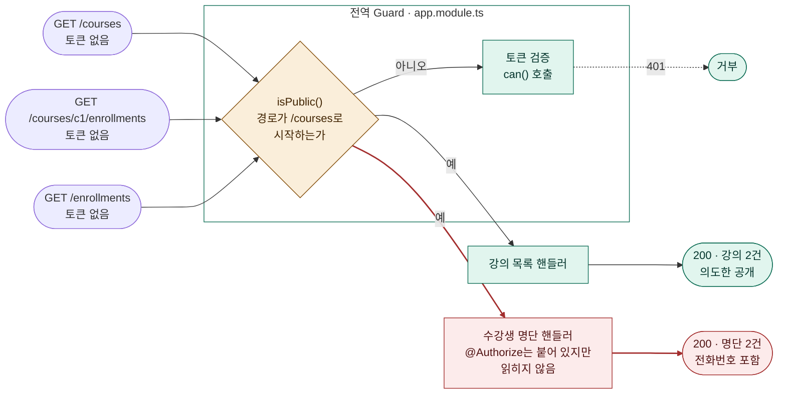
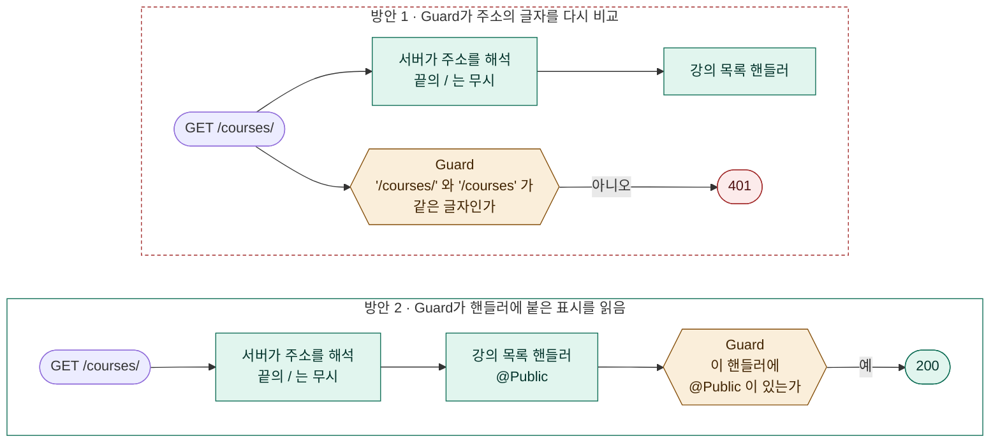
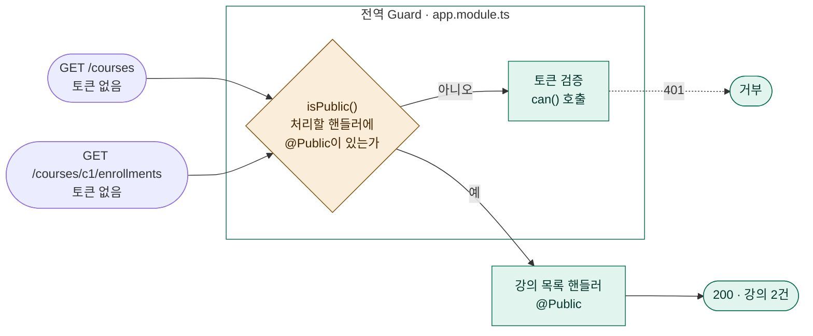

# 결함 2 진단 보고서: 수강생 명단 조회의 인증 누락 (경로의 앞부분만 비교하는 공개 조건)

| 항목 | 내용 |
|---|---|
| 대상 | 이 저장소의 태그 `v2-defect-2`를 로컬에서 띄운 API (`http://127.0.0.1:4000`) |
| 경로 | `GET /courses/:id/enrollments` |
| 분류 | OWASP Top 10 2025 A07 Authentication Failures / CWE-306 (중요 기능의 인증 누락) |
| 위험도 | 높음 |
| 해당 구성 요소 | PEP(정책 시행 지점). 시행 지점은 있지만 경로의 앞부분만 보고 통과시켜서, 판단(PE, `can()`)에 묻지 않습니다 |
| 상태 | 조치 완료 (`v2-fix-2`) |

## 1. 요약

강의 목록(`GET /courses`)을 로그인 없이 보여 주려고, Guard가 공개 여부를 판단하는 곳에 "경로가 `/courses`로 시작하면 공개"라는 조건을 넣었습니다. 그 결과 API는 똑같이 `/courses`로 시작하는 수강생 명단 요청(`GET /courses/:id/enrollments`)에도 토큰 확인 없이 응답합니다. 응답에는 그 강의 수강생 전원의 사용자 id와 전화번호가 들어 있습니다. 학생 토큰이나 다른 강의의 강사 토큰으로 요청해도 같은 응답이 옵니다.

위험도를 높음으로 본 근거입니다.

| | 근거 |
|---|---|
| 높이는 쪽 | 인증이 필요 없습니다 |
| 높이는 쪽 | 공격자는 요청에 넣을 강의 id를 추측할 필요가 없습니다. 강의 id가 공개된 강의 목록(`GET /courses`)의 응답에 들어 있기 때문입니다 |
| 높이는 쪽 | 요청 한 번에 그 강의 수강생 전원의 개인정보(전화번호)가 나옵니다 |
| 낮추는 쪽 | 이 취약점은 기밀성만 침해합니다. 이 경로는 조회만 하므로 신청 데이터를 변경하거나 삭제할 수 없고, 무결성은 침해하지 않습니다 |
| 낮추는 쪽 | 응답 하나에는 강의 한 개의 수강생 명단만 들어 있습니다 |

낮추는 쪽의 두 번째 근거는 위험도를 크게 낮추지 못합니다. 공격자는 공개된 강의 목록에서 모든 강의의 id를 확인할 수 있으므로, 강의 수만큼 요청하면 전체 수강생의 명단을 조회할 수 있습니다. 그래서 위험도를 높음으로 둡니다.

## 2. 재현 절차

준비:

```bash
git checkout v2-defect-2
docker compose up -d --wait
cd apps/api
cp .env.example .env
npm ci --ignore-scripts
npm run db:generate && npm run build
npm run db:migrate && npm run db:seed
npm start
```

요청 1 (토큰 없음, 강의 목록을 조회해 강의 id를 확인):

```bash
curl -i http://127.0.0.1:4000/courses
```

```
HTTP/1.1 200 OK
Content-Type: application/json; charset=utf-8

[{"id":"c1","title":"웹 보안 입문"},{"id":"c2","title":"시큐어 코딩 실습"}]
```

강의 목록은 공개 경로이므로 이 응답은 의도한 동작입니다.

요청 2 (토큰 없음, 요청 1에서 확인한 강의 id로 수강생 명단을 조회):

```bash
curl -i http://127.0.0.1:4000/courses/c1/enrollments
```

응답 (전화번호는 이 문서에서 가렸습니다):

```
HTTP/1.1 200 OK
Cache-Control: no-store
Content-Type: application/json; charset=utf-8

[{"id":"e1","userId":"u1","courseId":"c1","phone":"010-****-****"},
 {"id":"e2","userId":"u2","courseId":"c1","phone":"010-****-****"}]
```

재현 스크립트 (`main`의 스크립트를 결함 상태의 API에 실행):

```bash
node .github/scripts/defects/defect-2.mjs
```

```
결함 2: 수강생 명단(GET /courses/:id/enrollments)의 인증·인가
대상: http://127.0.0.1:4000
- GET /courses (토큰 없음, 공개가 맞음)
    → 상태 200 · 2건 · 필드: id, title
- GET /courses/c1/enrollments (토큰 없음)
    → 상태 200 · 2건 · 필드: courseId, id, phone, userId
- GET /courses/c1/enrollments (학생 토큰)
    → 상태 200 · 2건 · 필드: courseId, id, phone, userId
- GET /courses/c1/enrollments (다른 강의의 강사 토큰)
    → 상태 200 · 2건 · 필드: courseId, id, phone, userId
판정: 취약
```

결함이 없다면 API는 토큰 없는 요청에 401, 학생 토큰의 요청과 다른 강의의 강사 토큰의 요청에 403으로 응답해야 합니다.

## 3. 원인

결함 1을 고친 뒤로 Guard는 모든 요청에 적용됩니다. Guard는 토큰을 확인하기 전에 요청의 경로가 공개 경로인지를 먼저 판단합니다. 결함 상태에서는 경로가 `/courses`로 시작하기만 하면 공개 경로로 판단합니다.



- 초록색 상자는 Guard가 요청을 확인하는 단계와, 의도한 대로 공개한 강의 목록을 나타냅니다.
- 노란색 상자는 Guard가 공개 여부를 판단하는 단계를 나타냅니다.
- 빨간색 상자는 Guard의 확인 없이 실행되는 명단 핸들러와 그 응답을 나타냅니다.
- 빨간색 화살표는 확인 없이 통과한 요청의 흐름을 나타냅니다.

### 3.1 원인 코드

- 공개 여부를 판단하는 함수가 경로의 앞부분을 비교합니다: [`auth/is-public.ts` 7행, 14~15행](https://github.com/loquemedalagana/secure-enroll-demo/blob/v2-defect-2/apps/api/src/auth/is-public.ts#L7-L15).
- 인증 Guard와 인가 Guard는 둘 다 이 함수를 맨 먼저 호출하고, 함수가 참을 반환하면 요청을 바로 통과시킵니다: [`auth/auth.guard.ts` 18행](https://github.com/loquemedalagana/secure-enroll-demo/blob/v2-defect-2/apps/api/src/auth/auth.guard.ts#L18), [`authz/authz.guard.ts` 27행](https://github.com/loquemedalagana/secure-enroll-demo/blob/v2-defect-2/apps/api/src/authz/authz.guard.ts#L27).
- 명단 핸들러에는 `@Authorize('roster:read', ...)`가 붙어 있고 정책 `can()`에도 규칙이 있습니다: [`courses/courses.controller.ts` 17~18행](https://github.com/loquemedalagana/secure-enroll-demo/blob/v2-defect-2/apps/api/src/courses/courses.controller.ts#L17-L18). 그런데 인가 Guard가 `authz.guard.ts` 27행에서 요청을 먼저 통과시키므로, 이 표시를 읽는 코드는 실행되지 않습니다.

### 3.2 공개하려던 경로와 실제로 공개된 경로

등록된 경로는 9개입니다. "토큰 없는 요청" 칸에는 이 태그의 코드에서 Guard가 토큰 없는 요청을 통과시키는지를 적었습니다.

| 경로 | 누가 요청할 수 있어야 하나 | 토큰 없는 요청 | 근거 |
|---|---|---|---|
| `GET /health/live` | 누구나 | Guard가 통과시킴 | [`health.controller.ts` 6행](https://github.com/loquemedalagana/secure-enroll-demo/blob/v2-defect-2/apps/api/src/health/health.controller.ts#L6): `@Public()` |
| `GET /health/ready` | 누구나 | Guard가 통과시킴 | 위와 같음 |
| `POST /auth/login` | 누구나 | Guard가 통과시킴 | [`auth.controller.ts` 12행](https://github.com/loquemedalagana/secure-enroll-demo/blob/v2-defect-2/apps/api/src/auth/auth.controller.ts#L12): 핸들러에 `@Public()` |
| `GET /courses` | 누구나 | Guard가 통과시킴 | [`is-public.ts` 7행](https://github.com/loquemedalagana/secure-enroll-demo/blob/v2-defect-2/apps/api/src/auth/is-public.ts#L7): 경로가 `/courses`로 시작함 |
| `GET /courses/:id/enrollments` | 담당 강사와 관리자만 | **Guard가 통과시킴** | 이 경로도 `/courses`로 시작함 (결함 2) |
| `GET /auth/me` | 로그인한 사용자 | 401 | `@Public()`이 없고 `/courses`로 시작하지도 않음 |
| `GET /enrollments` | 로그인한 사용자 | 401 | 위와 같음 |
| `GET /enrollments/:id` | 신청자, 담당 강사, 관리자 | 401 | 위와 같음 |
| `GET /admin/enrollments` | 관리자만 | 401 | 위와 같음 |

앞으로 `/courses`로 시작하는 경로를 추가하면, API는 그 경로의 요청에도 토큰 확인 없이 응답합니다.

### 3.3 이 결함을 처음 잡은 테스트

결함 1에서 넣은 테스트(`apps/api/test/guard-coverage.test.mjs`의 "등록된 모든 경로: 공개 목록에 없는 경로는 토큰 없이 401")가 이 태그에서 실패합니다. API 테스트 71건 중 70건이 통과하고 1건이 실패합니다.

```
✖ 등록된 모든 경로: 공개 목록에 없는 경로는 토큰 없이 401
  + [
  +   'GET /courses/:id/enrollments → 200'
  + ]
  - []
```

이 테스트에는 공개 경로를 메서드와 경로로 하나씩 적은 목록이 있습니다. 테스트는 목록에 없는 경로마다 토큰 없이 요청해서 API가 401로 응답하는지 확인합니다. 강의 목록을 공개하면서 이 목록에 `GET /courses`를 추가했습니다. 수강생 명단(`GET /courses/:id/enrollments`)은 목록에 없는데 API가 200으로 응답해서 테스트가 실패했습니다. 코드는 경로의 앞부분만 비교하고 테스트는 경로 전체를 비교합니다. 그래서 코드는 수강생 명단을 공개 경로로 판단했고, 테스트는 공개 경로가 아니라고 판단했습니다.

이 태그에서 새로 추가한 강의 테스트 3건(`apps/api/test/courses.test.mjs`)은 허용해야 하는 요청만 확인하므로 통과합니다.

### 3.4 결함을 잡는 테스트

`apps/api/test/courses.test.mjs`에 테스트 5건을 추가했습니다. Guard는 요청이 명단 핸들러에 도달하기 전에 네 가지를 차례로 확인합니다. 테스트 5건은 이 네 단계를 확인합니다. 4단계는 `can()`의 규칙이 둘(역할, 담당 강사)이어서 테스트도 2건입니다.


- 빨간색 상자는 결함이 있는 1단계를 나타냅니다.
- 빨간색 화살표는 결함 상태의 요청 흐름을 나타냅니다. 요청이 1단계에서 명단 핸들러에 바로 도달합니다.
- 초록색 상자는 2~4단계와 각 단계의 결과를 나타냅니다.
- 파란색 상자는 테스트를 나타냅니다.

| 테스트 | 개발 관점: 무엇을 확인하나 | 보안 관점: 무엇을 지키나 |
|---|---|---|
| 1 토큰 없이 401 | API가 토큰 없는 요청에 401과 `{ "error": "unauthorized" }`로 응답하는지 | 인증 |
| 2 학생은 403 | API가 그 강의를 신청한 학생의 요청에 403으로 응답하는지 | 인가, RBAC. `can()`은 역할이 `admin`이나 `instructor`가 아닌 요청을 거부합니다([`authz/policy.ts` 40~42행](https://github.com/loquemedalagana/secure-enroll-demo/blob/v2-defect-2/apps/api/src/authz/policy.ts#L40-L42)) |
| 3 다른 강의의 강사는 403 | API가 다른 강의를 담당하는 강사의 요청에 403으로 응답하는지 | 인가, ABAC. `can()`은 `resource.instructorId === user.id`일 때만 허용합니다([42행](https://github.com/loquemedalagana/secure-enroll-demo/blob/v2-defect-2/apps/api/src/authz/policy.ts#L42)) |
| 4 없는 강의 id는 404 | API가 존재하지 않는 강의 id로 온 요청에 404와 `{ "error": "not_found" }`로 응답하는지 | Guard가 판단에 쓸 객체 속성(담당 강사)을 DB에서 실제로 읽는가 |
| 5 공개는 강의 목록 하나뿐 | 토큰 없이 요청했을 때 API가 200으로 응답하는 경로가 `GET /courses` 하나뿐인지. `/courses`로 시작하는 경로 4개를 더 요청해 확인합니다 | 시행 지점(PEP)이 `GET /courses`가 아닌 요청을 토큰 확인 없이 통과시키지 않는가 |

테스트 2와 3의 응답은 둘 다 403이지만 `can()`이 거부하는 규칙이 다릅니다.

- 테스트 2, 역할 규칙(RBAC): 요청한 사람의 역할이 `student`입니다. `roster:read`는 `admin`과 `instructor`만 할 수 있습니다.
- 테스트 3, 속성 규칙(ABAC): 역할은 `instructor`이지만 강의의 `instructorId`가 요청한 사람의 id와 다릅니다.

이 커밋에서 API 테스트는 76건 중 70건이 통과하고 6건이 실패합니다. 실패한 6건은 이 절에서 추가한 "수강생 명단 1~5" 5건과 3.3절의 "등록된 모든 경로" 1건입니다.

```
✖ 수강생 명단 1: 토큰 없이 401            200 !== 401
✖ 수강생 명단 2: 학생은 ... 403           200 !== 403
✖ 수강생 명단 3: 다른 강의의 강사는 403    200 !== 403
✖ 수강생 명단 4: 없는 강의 id는 404        200 !== 404
✖ 수강생 명단 5: 공개는 강의 목록 하나뿐... 
✖ 등록된 모든 경로: ...                    'GET /courses/:id/enrollments → 200'
```

실패한 6건은 서로 다른 단계를 확인하지만 실패한 원인은 하나입니다. Guard가 1단계에서 요청을 공개 경로로 판단하면 2~4단계의 코드는 실행되지 않습니다. 그래서 2~4단계의 코드에 결함이 없어도 2~4단계를 확인하는 테스트가 실패합니다. 4단계의 `can()`을 Guard 없이 직접 호출하는 단위 테스트([`apps/api/test/policy.test.mjs` 39~44행](https://github.com/loquemedalagana/secure-enroll-demo/blob/v2-defect-2/apps/api/test/policy.test.mjs#L39-L44))는 이 커밋에서도 통과합니다.

### 3.5 보안 관점: 접근통제 구성 요소로 본 결함

접근통제는 "누가(주체) 무엇에(객체) 무엇을 하려는가(행위)"를 규칙에 따라 판단하고, 그 판단대로 막거나 통과시키는 일입니다. 이 경로를 그 요소에 맞춰 보면 다음과 같습니다.

| 구성 요소 | 이 경로에서 | 결함 상태(`v2-defect-2`) | 코드에서 확인하는 곳 |
|---|---|---|---|
| 주체 | 요청한 사람. 인증 Guard가 토큰에서 id를 읽고 DB에서 역할을 읽습니다 | 인증 Guard가 18행에서 `true`를 반환해서, `authenticate(token)`(24행)과 `req.user = user`(27행)가 실행되지 않습니다 | [`auth/auth.guard.ts` 24~27행](https://github.com/loquemedalagana/secure-enroll-demo/blob/v2-defect-2/apps/api/src/auth/auth.guard.ts#L24-L27): `authenticate(token)`으로 토큰을 검증하고 `req.user = user`를 실행합니다. [18행](https://github.com/loquemedalagana/secure-enroll-demo/blob/v2-defect-2/apps/api/src/auth/auth.guard.ts#L18): `isPublic()`이 `true`이면 `true`를 반환합니다 |
| 객체 | 강의 하나의 수강생 명단. `can()`은 그 강의의 `instructorId`를 요청한 사람의 id와 비교합니다 | 인가 Guard가 27행에서 `true`를 반환해서, `prisma.course.findUnique()`(54행)와 `resource = { instructorId: course.instructorId }`(56행)가 실행되지 않습니다. 명단 핸들러는 [21행](https://github.com/loquemedalagana/secure-enroll-demo/blob/v2-defect-2/apps/api/src/courses/courses.controller.ts#L21)에서 `this.courses.roster(id)`의 결과를 반환합니다 | [`courses/courses.service.ts` 17행](https://github.com/loquemedalagana/secure-enroll-demo/blob/v2-defect-2/apps/api/src/courses/courses.service.ts#L17): `roster()`. [`authz/authz.guard.ts` 51~56행](https://github.com/loquemedalagana/secure-enroll-demo/blob/v2-defect-2/apps/api/src/authz/authz.guard.ts#L51-L56): `prisma.course.findUnique()`로 강의를 조회하고 `resource = { instructorId: course.instructorId }`를 실행합니다 |
| 행위 | `roster:read`. 핸들러에 `@Authorize('roster:read', { resource: 'course' })`가 붙어 있습니다 | 인가 Guard가 `@Authorize`를 읽는 [`authz/authz.guard.ts` 33~36행](https://github.com/loquemedalagana/secure-enroll-demo/blob/v2-defect-2/apps/api/src/authz/authz.guard.ts#L33-L36)이 실행되지 않습니다 | [`courses/courses.controller.ts` 18행](https://github.com/loquemedalagana/secure-enroll-demo/blob/v2-defect-2/apps/api/src/courses/courses.controller.ts#L18) |
| 판단 (PE) | `can()`. 역할이 `admin`이거나, 역할이 `instructor`이고 `resource.instructorId === user.id`일 때 허용합니다 | 인가 Guard가 `can()`을 호출하는 [59행](https://github.com/loquemedalagana/secure-enroll-demo/blob/v2-defect-2/apps/api/src/authz/authz.guard.ts#L59)이 실행되지 않습니다. `can()`의 단위 테스트는 통과합니다(3.4절) | [`authz/policy.ts` 38~42행](https://github.com/loquemedalagana/secure-enroll-demo/blob/v2-defect-2/apps/api/src/authz/policy.ts#L38-L42) |
| 시행 (PEP) | 전역으로 등록한 인증 Guard와 인가 Guard. 모든 요청에 적용됩니다 | **요청은 Guard를 지나가지만, Guard는 경로가 `/courses`로 시작하면 확인 없이 통과시킵니다. 경로의 앞부분만 비교하는 이 조건이 결함이고, 그 결과 인증 없이 수강생 명단을 조회할 수 있는 취약점(인증 누락)이 생깁니다** | [`auth/is-public.ts` 7행, 15행](https://github.com/loquemedalagana/secure-enroll-demo/blob/v2-defect-2/apps/api/src/auth/is-public.ts#L7-L15). `isPublic()`을 호출하는 곳은 [`auth/auth.guard.ts` 18행](https://github.com/loquemedalagana/secure-enroll-demo/blob/v2-defect-2/apps/api/src/auth/auth.guard.ts#L18), [`authz/authz.guard.ts` 27행](https://github.com/loquemedalagana/secure-enroll-demo/blob/v2-defect-2/apps/api/src/authz/authz.guard.ts#L27) |
| 접근통제 모델 | RBAC(관리자인가)와 ABAC(이 강의의 담당 강사인가) | 둘 다 적용되지 않습니다 | 판단(PE)과 같습니다. `authz/policy.ts` 40행이 RBAC, 42행이 ABAC입니다 |

결함 1과 비교하면 다음과 같습니다.

| | 결함 1 | 결함 2 |
|---|---|---|
| 시행 지점(PEP) | 관리자 컨트롤러에 Guard가 적용되지 않았습니다 | Guard가 모든 요청에 적용됩니다 |
| 결함 | 컨트롤러에 `@UseGuards`를 붙이지 않았습니다 | Guard가 공개 여부를 경로의 앞부분만 비교해 판단합니다 |
| 판단(PE, `can()`) | 호출되지 않았습니다 | 호출되지 않았습니다 |

두 결함 모두 `can()`의 규칙이 아니라 `can()`을 호출하기 전 단계에 결함이 있습니다. API가 요청한 사람을 확인하지 않고 응답하므로, 둘 다 접근통제 실패가 아니라 인증 누락(CWE-306)으로 분류했습니다.

제로 트러스트의 원칙 "모든 요청을 검증한다"에는 공개 경로라는 예외가 있습니다. 이 예외는 경로를 하나씩 지정해야 합니다. 결함 상태에서는 경로를 하나씩 지정하지 않고, `/courses`로 시작하는 경로를 모두 예외로 두었습니다.

## 4. 조치

### 4.1 조치 방안 비교

고칠 곳은 `apps/api/src/auth/is-public.ts`의 `isPublic()`입니다. 인증 Guard와 인가 Guard는 `isPublic()`이 `true`를 반환하면 토큰 확인 없이 요청을 통과시킵니다. 결함 상태의 `isPublic()`은 15행에서 `path.startsWith(prefix)`로 비교해, 요청의 주소가 `/courses`로 시작하면 `true`를 반환합니다. 여기서 주소는 요청에 적힌 URL의 경로 부분(`path`)입니다. 서버가 요청의 메서드와 주소를 등록 경로와 비교해 실행할 핸들러를 정하는 일은 URL 라우팅이라고 부릅니다. 고칠 방법은 세 가지입니다.

- **방안 1 (글자가 같을 때만)**: 15행의 `path.startsWith(prefix)`를 `path === prefix`로 바꿉니다. `isPublic()`은 주소가 `/courses`와 같을 때만 `true`를 반환합니다.
- **방안 2 (`@Public` 표시만)**: 주소를 비교하는 14~15행을 지우고 `return marked === true`만 남깁니다. `isPublic()`은 핸들러나 컨트롤러에 `@Public`이 붙어 있을 때만 `true`를 반환합니다. 강의 목록 핸들러에 `@Public()`을 붙입니다.
- **방안 3 (경로 목록)**: `PUBLIC_PREFIXES`를 메서드와 등록 경로를 적은 목록 `PUBLIC_ROUTES`(`['GET /courses']`)로 바꿉니다. `isPublic()`은 서버가 요청을 라우팅한 등록 경로(`req.route.path`)가 이 목록에 있을 때 `true`를 반환합니다.

#### 실제로 바꿔 본 결과

세 방안을 태그 `v2-defect-2`가 가리키는 코드에 하나씩 적용해 결과를 비교했습니다. 방안을 하나 적용할 때마다 `npm test`로 API 테스트를 실행하고, 토큰 없는 요청 6개를 보내 응답의 상태 코드를 기록했습니다. 세 방안의 변경은 커밋하지 않았습니다. 아래 diff를 `v2-defect-2`의 코드에 적용하면 같은 결과를 다시 확인할 수 있습니다.

방안 1:

```diff
-  return PUBLIC_PREFIXES.some((prefix) => path.startsWith(prefix));
+  return PUBLIC_PREFIXES.some((prefix) => path === prefix);
```

방안 2:

```diff
 // auth/is-public.ts
-  if (marked === true) return true;
-
-  const { path } = context.switchToHttp().getRequest<Request>();
-  return PUBLIC_PREFIXES.some((prefix) => path.startsWith(prefix));
+  return marked === true;

 // courses/courses.controller.ts
+  @Public()
   @Get()
   list(): Promise<CourseView[]> {
```

방안 3:

```diff
-const PUBLIC_PREFIXES: readonly string[] = ['/courses'];
+const PUBLIC_ROUTES: readonly string[] = ['GET /courses'];
 ...
-  const { path } = context.switchToHttp().getRequest<Request>();
-  return PUBLIC_PREFIXES.some((prefix) => path.startsWith(prefix));
+  const req = context.switchToHttp().getRequest<Request>();
+  return PUBLIC_ROUTES.includes(`${req.method} ${String(req.route?.path)}`);
```

아래 표는 토큰 없이 보낸 요청 6개에 API가 응답한 상태 코드입니다.

| 요청 | 처리하는 핸들러 | 결함 상태 | 방안 1 | 방안 2 | 방안 3 |
|---|---|---|---|---|---|
| `GET /courses` | 강의 목록 | 200 | 200 | 200 | 200 |
| `GET /courses/` | 강의 목록 | 200 | **401** | 200 | 200 |
| `GET /Courses` | 강의 목록 | **401** | **401** | 200 | 200 |
| `GET /courses/c1/enrollments` | 수강생 명단 | **200** | 401 | 401 | 401 |
| `GET /courses/c1/enrollments/` | 수강생 명단 | **200** | 401 | 401 | 401 |
| `GET /COURSES/c1/enrollments` | 수강생 명단 | 401 | 401 | 401 | 401 |
| API 테스트 76건 | | 6건 실패 | 모두 통과 | 모두 통과 | 모두 통과 |

이 표에서 확인할 것은 두 가지입니다.

- 세 방안 모두 토큰 없는 수강생 명단 요청(`GET /courses/c1/enrollments`)에 401로 응답하고, API 테스트 76건이 모두 통과합니다. 방안 1도 결함을 고칩니다.
- 방안 1에서는 같은 핸들러가 처리하는 요청인데 주소의 글자에 따라 응답이 다릅니다. 서버의 URL 라우팅은 주소 끝의 `/`와 대소문자를 구분하지 않습니다. 그래서 서버는 `GET /courses/`와 `GET /Courses`를 강의 목록 핸들러로 라우팅합니다. 방안 1의 `path === prefix`는 `/courses/`와 `/Courses`를 `/courses`와 다른 값으로 비교합니다. 그래서 API는 공개해야 하는 두 요청에 401로 응답합니다. 결함 상태에서 `GET /Courses`에 401로 응답하는 것도 `startsWith`가 대소문자를 구분하기 때문입니다.

아래 그림은 토큰 없는 `GET /courses/` 요청을 방안 1과 방안 2가 처리하는 순서입니다.



방안 1에서 서버는 `GET /courses/` 요청을 강의 목록 핸들러로 라우팅합니다. 그런데 Guard의 `path === prefix`가 `false`여서, Guard는 이 요청을 공개 경로로 판단하지 않습니다. 방안 2에서는 Guard가 주소를 비교하지 않습니다. Guard는 서버가 라우팅한 핸들러에 `@Public`이 붙어 있는지만 확인합니다.

- 노란색 상자는 Guard가 확인하는 조건을 나타냅니다.
- 초록색 상자는 서버의 처리와 200 응답을 나타냅니다.
- 빨간색 상자는 공개해야 하는 요청에 대한 401 응답을 나타냅니다.

#### 비교

| 기준 | 방안 1 (글자가 같을 때만) | 방안 2 (`@Public` 표시만) | 방안 3 (경로 목록) |
|---|---|---|---|
| 바꾸는 줄 | 1줄 | 5줄 안팎, 파일 2개 | 4줄, 파일 1개 |
| 공개 여부를 판단하는 값 | 요청의 주소(`path`) | 핸들러에 붙은 `@Public` | 서버가 라우팅한 등록 경로(`req.route.path`) |
| 같은 핸들러로 라우팅된 요청에 Guard의 판단이 달라질 수 있나 | 있습니다(위 표의 `GET /courses`와 `GET /courses/`) | 없습니다 | 없습니다 |
| 경로의 이름을 바꿀 때 | `PUBLIC_PREFIXES`도 고쳐야 합니다 | 고칠 곳이 없습니다 | `PUBLIC_ROUTES`도 고쳐야 합니다 |
| 공개 경로를 모아 볼 수 있는 파일 | `is-public.ts` | 없습니다. `@Public`을 검색해야 합니다 | `is-public.ts` |
| 공개 여부를 정하는 방법의 수 | 둘(`@Public`, `PUBLIC_PREFIXES`) | 하나(`@Public`) | 둘(`@Public`, `PUBLIC_ROUTES`) |

**고른 것**: 방안 2 (`@Public` 표시만).

**이유**: 이 결함의 원인은 `startsWith` 하나가 아니라, Guard가 공개 여부를 요청의 주소로 판단하는 구조입니다. 요청을 핸들러로 라우팅하는 일은 서버가 합니다. Guard가 주소를 따로 비교하면, 서버의 URL 라우팅 규칙(끝의 `/`, 대소문자)을 Guard의 비교식에도 똑같이 구현해야 합니다. 방안 2에서는 Guard가 주소를 비교하지 않고, 서버가 라우팅한 핸들러에 `@Public`이 붙어 있는지만 확인합니다. 그래서 같은 핸들러로 라우팅된 요청에는 Guard의 판단이 항상 같습니다. 헬스 체크와 로그인은 이미 `@Public`을 쓰고 있습니다. 방안 2를 적용하면 공개 여부를 정하는 방법이 `@Public` 하나뿐입니다.

**채택하지 않은 대안 (방안 1)**: 변경이 한 줄이고 결함을 고칩니다. 이미 운영 중인 서비스에서 급히 막아야 할 때는 방안 1을 먼저 적용하는 것이 맞습니다. 다만 방안 1에서도 Guard는 요청의 주소를 직접 비교합니다. 위 표에서는 서버가 강의 목록 핸들러로 라우팅한 `GET /courses/` 요청을 Guard가 공개 경로로 판단하지 않아서, API가 401로 응답했습니다. 반대로 인증이 필요한 핸들러로 라우팅된 요청을 Guard가 공개 경로로 판단하면, API는 그 요청에 토큰 확인 없이 응답합니다.

**채택하지 않은 대안 (방안 3)**: 방안 3은 서버가 라우팅한 등록 경로(`req.route.path`)를 비교하므로, 같은 핸들러로 라우팅된 요청에는 Guard의 판단이 항상 같습니다. 공개 경로도 `is-public.ts` 한 파일에 모입니다. 그런데 같은 목록이 이미 테스트(`apps/api/test/guard-coverage.test.mjs`의 `PUBLIC_ROUTES`)에 있습니다. 코드에도 목록을 두면 같은 목록을 두 곳에서 고쳐야 하고, 공개 여부를 정하는 방법도 둘(`@Public`, `PUBLIC_ROUTES`)로 남습니다.

**감수하는 것**:

- `@Public`이 여러 파일에 흩어져 있어서, 공개 경로를 코드 한 파일에서 확인할 수 없습니다. 그 목록은 테스트의 `PUBLIC_ROUTES`에 있습니다. `PUBLIC_ROUTES`에 없는 경로가 토큰 없는 요청에 401로 응답하지 않으면 "등록된 모든 경로" 테스트가 실패합니다.
- 보호해야 할 핸들러에 `@Public`을 잘못 붙이면 API는 그 경로의 요청에 토큰 확인 없이 응답합니다. 이 실수도 같은 테스트가 잡습니다.

### 4.2 적용한 조치

방안 2를 커밋 하나([`11f1ae7`](https://github.com/loquemedalagana/secure-enroll-demo/commit/11f1ae7))로 적용했습니다. 태그 `v2-fix-2`가 이 커밋을 가리킵니다. 결함 1의 조치는 결함을 고치는 커밋과 동작을 바꾸지 않는 정리 커밋으로 나눴는데, 결함 2에는 정리 커밋이 없습니다.

| 바꾼 곳 | 내용 |
|---|---|
| [`auth/is-public.ts` 7~9행](https://github.com/loquemedalagana/secure-enroll-demo/blob/v2-fix-2/apps/api/src/auth/is-public.ts#L7-L9) | `PUBLIC_PREFIXES`와 `path.startsWith(prefix)`를 지웠습니다. `isPublic()`은 `marked === true`만 반환합니다. 핸들러나 컨트롤러에 `@Public`이 붙어 있을 때만 `true`입니다 |
| [`courses/courses.controller.ts` 12행](https://github.com/loquemedalagana/secure-enroll-demo/blob/v2-fix-2/apps/api/src/courses/courses.controller.ts#L12) | 강의 목록 핸들러에 `@Public()`을 붙였습니다 |
| `app.module.ts` | 주석 한 줄을 고쳤습니다 |

수강생 명단 핸들러([`courses/courses.controller.ts`](https://github.com/loquemedalagana/secure-enroll-demo/blob/v2-fix-2/apps/api/src/courses/courses.controller.ts))는 고치지 않았습니다. 이 핸들러에는 `@Public`이 없어서 `isPublic()`이 `false`를 반환합니다. 인증 Guard는 토큰을 검증하고, 인가 Guard는 `@Authorize('roster:read', { resource: 'course' })`를 읽어 `can()`을 호출합니다.



3절의 그림과 다른 곳은 노란색 상자 하나입니다. `isPublic()`이 요청의 주소가 아니라, 서버가 라우팅한 핸들러에 `@Public`이 붙어 있는지를 확인합니다.

## 5. 조치 뒤 재확인

`v2-fix-2`를 로컬에서 띄우고 2절과 같은 스크립트를 실행한 결과입니다.

```bash
node .github/scripts/defects/defect-2.mjs --expect blocked
```

```
결함 2: 수강생 명단(GET /courses/:id/enrollments)의 인증·인가
- GET /courses (토큰 없음, 공개가 맞음)
    → 상태 200 · 2건 · 필드: id, title
- GET /courses/c1/enrollments (토큰 없음)
    → 상태 401 · 필드: error
- GET /courses/c1/enrollments (학생 토큰)
    → 상태 403 · 필드: error
- GET /courses/c1/enrollments (다른 강의의 강사 토큰)
    → 상태 403 · 필드: error
판정: 차단
```

| 확인 | 결함 상태 (`v2-defect-2`) | 조치 뒤 (`v2-fix-2`) |
|---|---|---|
| 강의 목록, 토큰 없음 | 200, 2건 | 200, 2건 |
| 명단, 토큰 없음 | 200, 2건 | 401 |
| 명단, 학생 토큰 | 200, 2건 | 403 |
| 명단, 다른 강의의 강사 토큰 | 200, 2건 | 403 |
| 명단, 담당 강사와 관리자 토큰 | 200 | 200 |
| `GET /courses/`, `GET /Courses` (토큰 없음) | 200, 401 | 200, 200 |
| `GET /courses/c1/enrollments/` (토큰 없음) | 200 | 401 |
| 결함 1의 재현 스크립트 | 차단 | 차단 |
| API 테스트 | 76건 중 6건 실패 | 76건 통과 |

결함 상태에서 실패하던 6건은 3.4절의 "수강생 명단 1~5"와 결함 1에서 추가한 "등록된 모든 경로" 테스트입니다.

### CI 실행 기록

이 결함을 다룬 PR에서 실행된 CI 기록입니다.

| 시점 | 커밋 | `api` 잡 | 실행 |
|---|---|---|---|
| 결함이 든 구현을 올린 뒤 | `4fc176d` | 실패 (71건 중 1건, 결함 1의 테스트) | [45767152542](https://github.com/loquemedalagana/secure-enroll-demo/actions/runs/45767152542) |
| 테스트를 추가한 뒤 | `410813e` | 실패 (76건 중 6건) | [45768924998](https://github.com/loquemedalagana/secure-enroll-demo/actions/runs/45768924998) |
| 수정한 뒤 | `5d826a6` | 통과 (76건) | [45776323334](https://github.com/loquemedalagana/secure-enroll-demo/actions/runs/45776323334) |

실행 로그는 GitHub의 보존 기간(기본 90일)이 지나면 삭제됩니다. 그 뒤에도 `defects.yml`을 실행하면 위 표의 실패와 통과를 재현할 수 있습니다. 이 워크플로는 결함 태그의 코드에 수정 태그의 테스트를 실행해 같은 테스트가 실패하는지 확인하고, 수정 태그의 코드에서는 모두 통과하는지 확인합니다. 실패한 테스트의 이름은 Summary에 남깁니다.

## 6. Burp Suite 진단 기록

작성 전.
