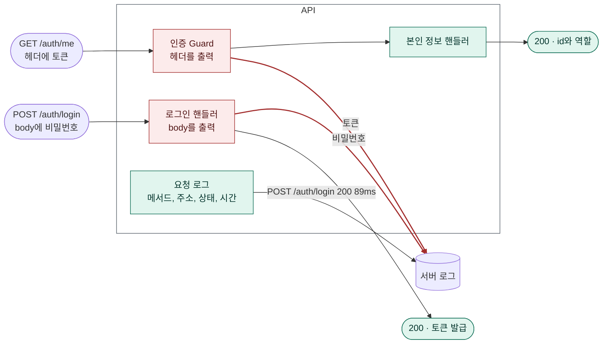
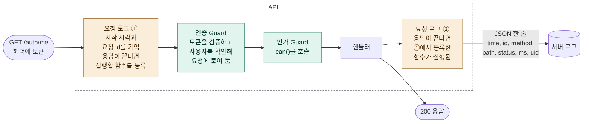

# 결함 3 진단 보고서: 서버 로그에 비밀번호와 토큰이 남음

| 항목 | 내용 |
|---|---|
| 대상 | 이 저장소의 태그 `v2-defect-3`을 로컬에서 띄운 API (`http://127.0.0.1:4000`)와 그 프로세스의 출력 |
| 경로 | `POST /auth/login`, 그리고 토큰을 붙여 보내는 모든 경로 |
| 분류 | OWASP Top 10 2025 A09 Security Logging and Alerting Failures / CWE-532 (로그 파일에 민감 정보 기록) |
| 위험도 | 중간 |
| 해당 구성 요소 | 주체의 자격 증명(비밀번호, 토큰). 시행 지점(PEP)과 판단(PE)은 정상으로 동작하고, 인증에 쓰인 값이 로그로 나갑니다 |
| 상태 | 조치 완료 (`v2-fix-3`) |

## 1. 요약

요청 로그를 넣으면서 인증이 제대로 되는지 보려고 넣은 출력 두 줄이 남아 있습니다. 로그인하면 request body의 비밀번호가, 토큰을 붙여 요청하면 `Authorization` 헤더의 토큰이 서버 로그에 그대로 찍힙니다. 요청을 보낸 사람이 받는 응답은 정상이라, 응답만으로는 값이 로그에 남았다는 것을 알 수 없습니다.

위험도를 중간으로 본 근거입니다. 두 곳에 공통인 것과 곳마다 다른 것을 나눠 적습니다.

| | 근거 |
|---|---|
| 낮추는 쪽 (공통) | 요청만으로는 얻을 것이 없습니다. 서버 로그를 읽을 수 있어야 합니다 |
| 높이는 쪽 (공통) | 로그를 읽은 사람은 인증을 거치지 않고 그 사용자의 요청을 보낼 수 있습니다. 관리자가 로그인했다면 관리자의 것이 남습니다 |
| 높이는 쪽 (공통) | 로그는 보통 앱보다 넓은 범위에서 읽히고 오래 보관됩니다 |

| 노출되는 곳 | 낮추는 쪽 | 높이는 쪽 |
|---|---|---|
| 인증 Guard (토큰) | 발급 1시간 뒤에 만료됩니다 | 로그인이 필요한 요청마다 찍혀서 양이 많습니다. 만료 전에 무효로 만드는 방법이 없습니다. 검증하기 전에 찍혀서 틀리거나 만료된 토큰도 남습니다 |
| 로그인 핸들러 (비밀번호) | 로그인할 때만 찍힙니다 | 원문입니다. 만료가 없어서 바꾸기 전까지 계속 통합니다. 확인하기 전에 찍혀서 잘못 입력한 비밀번호도 남습니다 |

둘 중에서는 비밀번호 쪽이 더 무겁습니다. 토큰은 한 시간이 지나면 쓸 수 없지만 비밀번호는 그렇지 않습니다. 전체를 높음이 아니라 중간으로 둔 것은 로그를 읽을 수 있어야 한다는 조건 때문이고, 로그가 넓게 공유되는 환경이라면 높음으로 봐야 합니다.

## 2. 재현 절차

준비 (서버의 출력을 파일로 받습니다):

```bash
git checkout v2-defect-3
docker compose up -d --wait
cd apps/api
cp .env.example .env
npm ci --ignore-scripts
npm run db:generate && npm run build
npm run db:migrate && npm run db:seed
npm start > /tmp/api.log 2>&1 &
```

요청 1 (로그인):

```bash
curl -s -X POST -H 'content-type: application/json' \
  -d '{"username":"student1","password":"student1-pass"}' \
  http://127.0.0.1:4000/auth/login
```

요청 2 (받은 토큰으로 본인 정보 조회):

```bash
curl -s -H 'authorization: Bearer <받은 토큰>' http://127.0.0.1:4000/auth/me
```

두 요청 모두 200으로 정상 응답합니다. 그 뒤의 서버 로그입니다(비밀번호와 토큰은 이 문서에서 가렸습니다).

```
login LoginDto { username: 'student1', password: '<비밀번호>' }
POST /auth/login 200 89ms
auth header Bearer <토큰>
GET /auth/me 200 2ms
```

1행과 3행이 문제입니다. 2행과 4행은 요청 로그가 원래 남기려던 줄입니다.

재현 스크립트 (`main`의 스크립트를 결함 상태의 API에 실행):

```bash
node .github/scripts/defects/defect-3.mjs /tmp/api.log
```

```
결함 3: 서버 로그의 비밀번호와 토큰
대상: http://127.0.0.1:4000
- POST /auth/login (student1)
    → 상태 200
- GET /auth/me (받은 토큰)
    → 상태 200
- 서버 로그에 추가된 줄: 4줄
    → 비밀번호 있음 (1줄) · 토큰 있음 (1줄)
판정: 취약
```

스크립트는 자기가 요청을 보낸 뒤에 추가된 줄만 보고, 찾은 값은 출력하지 않습니다. 기대한 동작은 비밀번호 없음, 토큰 없음입니다.

## 3. 원인

요청 하나가 처리되는 동안 로그를 남기는 곳이 세 군데이고, 그중 두 군데에서 받은 값이 그대로 노출됩니다.



빨강은 받은 값이 로그에 그대로 노출되는 곳과 그 값이 나가는 경로, 초록은 정상으로 동작하는 곳입니다. 응답은 두 요청 모두 정상입니다.

### 3.1 원인 코드

- 인증 Guard가 받은 `Authorization` 헤더를 출력합니다: [`auth/auth.guard.ts` 22행](https://github.com/loquemedalagana/secure-enroll-demo/blob/v2-defect-3/apps/api/src/auth/auth.guard.ts#L22). 토큰을 검증하기 전의 줄이라, 틀린 토큰이나 만료된 토큰도 찍힙니다.
- 로그인 핸들러가 받은 request body를 출력합니다: [`auth/auth.controller.ts` 18행](https://github.com/loquemedalagana/secure-enroll-demo/blob/v2-defect-3/apps/api/src/auth/auth.controller.ts#L18). 비밀번호를 확인하기 전의 줄이라, 틀린 비밀번호도 찍힙니다.
- 요청 로그 자체는 메서드, 주소, 상태 코드, 걸린 시간만 남깁니다: [`common/request-log.ts` 6~8행](https://github.com/loquemedalagana/secure-enroll-demo/blob/v2-defect-3/apps/api/src/common/request-log.ts#L6-L8).

### 3.2 로그에 값이 노출되는 곳

| 로그를 남기는 곳 | 언제 | 남기는 값 | 노출되는 민감한 값 |
|---|---|---|---|
| [`common/request-log.ts` 7행](https://github.com/loquemedalagana/secure-enroll-demo/blob/v2-defect-3/apps/api/src/common/request-log.ts#L7) | 모든 요청이 끝날 때 | 메서드, 주소, 상태 코드, 걸린 시간 | 없음 |
| [`auth/auth.guard.ts` 22행](https://github.com/loquemedalagana/secure-enroll-demo/blob/v2-defect-3/apps/api/src/auth/auth.guard.ts#L22) | `@Public`이 아닌 모든 요청 | `Authorization` 헤더 전체 | **토큰** |
| [`auth/auth.controller.ts` 18행](https://github.com/loquemedalagana/secure-enroll-demo/blob/v2-defect-3/apps/api/src/auth/auth.controller.ts#L18) | `POST /auth/login` | request body 전체 | **비밀번호** |

`GET /courses`처럼 `@Public`이 붙은 경로는 인증 Guard가 헤더를 읽기 전에 통과시키므로 헤더가 찍히지 않습니다. 토큰이 찍히는 것은 로그인이 필요한 경로 5개 전부입니다.

### 3.3 이 결함을 처음 잡은 테스트

인증을 만들 때 넣어 둔 테스트(`apps/api/test/auth.test.mjs`의 "서버 출력에 비밀번호와 토큰 값이 없음")가 이 태그에서 실패합니다. API 테스트 86건 중 85건 통과, 1건 실패입니다.

이 테스트는 로그인한 뒤 서버 출력에 비밀번호와 발급된 토큰이 있는지 봅니다. 비밀번호가 찍혀서 실패했습니다. 토큰 쪽은 이 테스트로 확인되지 않습니다. 테스트가 받은 토큰을 다시 보내지 않아서, 헤더가 로그에 찍힐 일이 테스트 안에서 생기지 않습니다.

### 3.4 결함을 잡는 테스트

`apps/api/test/auth.test.mjs`에 테스트 하나를 추가했습니다. 3.3절의 테스트와 합쳐 두 건이 값이 노출되는 두 곳을 하나씩 확인합니다.


빨강은 받은 값이 로그에 노출되는 곳과 그 경로, 파랑은 테스트입니다.

| 테스트 | 개발 관점: 무엇을 확인하나 | 보안 관점: 무엇을 지키나 |
|---|---|---|
| 1 서버 출력에 비밀번호와 토큰 값이 없음 (기존) | 로그인한 뒤 서버 출력에 맞는 비밀번호, 틀린 비밀번호, 발급된 토큰이 없는지 | 주체의 자격 증명 중 비밀번호. 인증에 실패한 입력도 포함합니다 |
| 2 서버 출력에 요청으로 받은 토큰 값이 없음 (추가) | 받은 토큰으로 요청한 뒤, 그리고 틀린 토큰으로 요청한 뒤 서버 출력에 그 토큰이 없는지 | 주체의 자격 증명 중 토큰. 검증에 실패한 토큰도 포함합니다 |

테스트 1이 토큰을 확인하지 못한 이유는 3.3절에 적었습니다. 받은 토큰을 다시 보내지 않기 때문입니다. 테스트 2는 받은 토큰을 `GET /auth/me`에 붙여 보냅니다.

이 커밋에서 API 테스트는 87건 중 85건 통과, 2건 실패입니다.

```
✖ 서버 출력에 비밀번호와 토큰 값이 없음
✖ 서버 출력에 요청으로 받은 토큰 값이 없음 (유효한 토큰, 틀린 토큰)
    유효한 토큰이 서버 출력에 있습니다
```

테스트 2의 실패 문구는 직접 적은 것입니다. 기본 문구를 쓰면 비교한 값(토큰)이 테스트 로그에 찍힐 수 있어서입니다. 나머지 85건은 통과합니다. 응답은 모두 정상이고, 문제는 서버 로그에만 있습니다.

### 3.5 보안 관점: 접근통제 구성 요소로 본 결함

결함 1과 2는 요청을 막아야 할 곳에서 막지 못한 경우였습니다. 결함 3에서는 막는 일이 모두 정상으로 이루어집니다. 그 과정에서 쓰인 값이 다른 길로 나갑니다.

| 구성 요소 | 이 결함에서 | 코드에서 확인하는 곳 |
|---|---|---|
| 주체의 자격 증명 | 비밀번호와 토큰. **인증에 쓰인 뒤 로그에 그대로 남습니다. 결함은 여기입니다** | [`auth/auth.guard.ts` 22행](https://github.com/loquemedalagana/secure-enroll-demo/blob/v2-defect-3/apps/api/src/auth/auth.guard.ts#L22), [`auth/auth.controller.ts` 18행](https://github.com/loquemedalagana/secure-enroll-demo/blob/v2-defect-3/apps/api/src/auth/auth.controller.ts#L18) |
| 시행 (PEP) | 정상. 토큰이 없거나 틀리면 401입니다 | [`auth/auth.guard.ts` 24~26행](https://github.com/loquemedalagana/secure-enroll-demo/blob/v2-defect-3/apps/api/src/auth/auth.guard.ts#L24-L26) |
| 판단 (PE) | 정상. `can()`이 규칙대로 허용하고 거부합니다 | `authz/policy.ts` |
| 로그 | 앱 바깥에서 읽히는 출력. 읽을 수 있는 사람의 범위가 앱의 접근통제와 따로 정해집니다 | 프로세스의 표준 출력 |

토큰은 만료(1시간) 전까지 그 사용자를 대신합니다. 로그를 읽을 수 있는 사람은 로그인하지 않고도 그 자격을 얻습니다. 앱의 접근통제가 아무리 맞아도, 자격 증명이 접근통제 밖으로 나가면 소용이 없습니다.

제로 트러스트의 원칙으로 보면 "요청마다 인증한다"는 지켜지고 있지만, 그 인증에 쓰는 값을 지키지 못한 경우입니다.

## 4. 조치

### 4.1 조치 방안 비교

고칠 방법은 세 가지입니다.

- **방안 1 (두 줄 삭제)**: 인증 Guard와 로그인 핸들러의 출력 두 줄을 지웁니다.
- **방안 2 (삭제 + 정해진 필드)**: 두 줄을 지우고, 요청 로그 한 줄에 들어가는 필드를 한 곳에서 정합니다. 헤더, request body, 쿼리 문자열은 넣지 않습니다.
- **방안 3 (방안 2 + 린트)**: 방안 2에 더해 린트 규칙(`no-console`)을 넣어 `console` 호출이 다시 들어오면 CI에서 걸리게 합니다.

#### 실제로 바꿔 본 결과

방안 1과 2를 태그 `v2-defect-3`의 코드(테스트를 보강한 커밋)에 각각 적용해 돌려 봤습니다. 이 변경들은 커밋하지 않았습니다. 방안 3은 돌려 보지 않았습니다. API에 린트가 아직 없어서 의존성과 CI 잡을 새로 들여야 합니다.

방안 1:

```diff
 // auth/auth.guard.ts
-    console.log('auth header', header);

 // auth/auth.controller.ts
-    console.log('login', body);
```

방안 2 (방안 1에 더해 `common/request-log.ts`):

```diff
-    console.log(`${req.method} ${req.originalUrl} ${res.statusCode} ${Date.now() - started}ms`);
+    const line: RequestLogLine = {
+      time: new Date().toISOString(),
+      id,
+      method: req.method,
+      path: req.originalUrl.split('?')[0] ?? '',
+      status: res.statusCode,
+      ms: Date.now() - started,
+    };
+    const uid = (req as AuthedRequest).user?.id;
+    if (uid !== undefined) line.uid = uid;
+    process.stdout.write(`${JSON.stringify(line)}\n`);
```

| 확인 | 결함 상태 | 방안 1 | 방안 2 |
|---|---|---|---|
| 로그에 비밀번호 | **있음** | 없음 | 없음 |
| 로그에 토큰 | **있음** | 없음 | 없음 |
| 재현 스크립트 판정 | 취약 | 차단 | 차단 |
| API 테스트 87건 | 2건 실패 | 모두 통과 | 모두 통과 |
| `GET /courses?q=probe-query-value`를 보낸 뒤 로그에 그 값 | **있음** | **있음** | 없음 |

로그의 마지막 줄을 비교하면 이렇습니다.

```
방안 1   GET /courses?q=probe-query-value 200 8ms
방안 2   {"time":"...","id":"...","method":"GET","path":"/courses","status":200,"ms":9}
```

이 표에서 볼 것은 두 가지입니다.

- 방안 1도 결함을 고칩니다. 비밀번호와 토큰이 로그에서 사라지고 테스트 87건을 통과합니다.
- 방안 1에서는 요청 로그가 주소를 쿼리 문자열까지 그대로 남깁니다. 지금은 쿼리 문자열에 민감한 값을 받는 경로가 없어서 문제가 드러나지 않습니다. 검색어를 쿼리 문자열로 받는 경로가 생기면 그 입력이 로그에 들어갑니다.

#### 비교

| 기준 | 방안 1 (두 줄 삭제) | 방안 2 (삭제 + 정해진 필드) | 방안 3 (방안 2 + 린트) |
|---|---|---|---|
| 바꾸는 양 | 2줄 | 파일 3개 | 방안 2 + 의존성, 설정 파일, CI 잡 |
| 로그에 무엇이 들어가는지 정하는 곳 | 없습니다. 출력하는 줄마다 정합니다 | `common/request-log.ts`의 타입 하나 | 방안 2와 같음 |
| 쿼리 문자열 | 로그에 남습니다 | 남지 않습니다 | 남지 않습니다 |
| 누가 한 요청인지 | 알 수 없습니다 | 사용자 id(`uid`)가 남습니다 | 방안 2와 같음 |
| 같은 출력이 다시 들어오면 | 테스트 2건이 잡습니다 | 테스트 2건이 잡습니다 | 테스트와 린트가 잡습니다 |
| 로그를 기계로 읽기 | 줄마다 형식이 다릅니다 | JSON 한 줄 | 방안 2와 같음 |

**고른 것**: 방안 2 (삭제 + 정해진 필드).

**이유**: 이 결함의 원인은 출력 두 줄이지만, 그 두 줄이 들어올 수 있었던 것은 로그에 무엇을 남길지 정한 곳이 없었기 때문입니다. 방안 2는 그 자리를 만듭니다. 남기는 필드를 타입 하나로 적어 두면, 필드를 추가할 때 그 파일을 고쳐야 하고 무엇이 추가되는지가 변경 내용에 드러납니다. 쿼리 문자열처럼 아직 문제가 되지 않은 입력도 같이 막힙니다.

**채택하지 않은 대안 (방안 1)**: 두 줄로 끝나고 결함을 실제로 고칩니다. 급히 막아야 할 때는 방안 1을 먼저 적용하는 것이 맞습니다. 다만 요청 로그가 주소를 그대로 남기는 것은 그대로입니다.

**채택하지 않은 대안 (방안 3)**: 린트는 `console`을 쓰는 줄을 전부 잡으므로 같은 종류의 출력이 다시 들어오는 것을 가장 일찍 막습니다. 이 브랜치에 넣지 않은 이유는 범위입니다. API에 린트를 들이는 일(의존성, 설정, CI 잡)은 결함 3의 수정과 다른 변경이라 따로 합니다(`docs/decisions.md` 5번). 그리고 린트는 `console`을 썼는지만 봅니다. 다른 방법으로 같은 값을 출력하면 잡지 못하므로, 린트를 넣더라도 출력 결과를 확인하는 테스트는 그대로 필요합니다.

**감수하는 것**:

- 필드를 한 곳에서 정해도, 다른 곳에서 따로 출력하는 것을 막지는 못합니다. 그것을 잡는 것은 3.4절의 테스트 2건입니다.
- 사용자 id가 로그에 남습니다. `u1` 같은 내부 값이고 누가 한 요청인지 추적하는 데 필요해서 넣었습니다. 이름, 전화번호 같은 값은 넣지 않습니다.
- 주소의 경로 부분은 그대로 남습니다. `/enrollments/e1`처럼 신청 id가 들어갑니다.

### 4.2 적용한 조치

방안 2를 커밋 두 개로 나눠 적용했습니다. 첫 커밋이 결함을 고치고, 둘째 커밋은 로그에 무엇이 들어가는지를 한 곳에서 정하게 합니다.

| 커밋 | 바꾼 것 | 달라지는 것 |
|---|---|---|
| 인증 Guard와 로그인 핸들러의 출력 삭제 | `auth/auth.guard.ts`와 `auth/auth.controller.ts`에서 출력 두 줄을 지움 | 서버 로그에 토큰과 비밀번호가 남지 않음. 실패하던 테스트 2건이 통과 |
| 요청 로그를 정해진 필드의 JSON 한 줄로 바꿈 | [`common/request-log.ts` 7~15행](https://github.com/loquemedalagana/secure-enroll-demo/blob/v2-fix-3/apps/api/src/common/request-log.ts#L7-L15): 필드를 타입 하나로 정함 | 로그가 JSON 한 줄이 됨. 쿼리 문자열이 빠지고 사용자 id가 들어감 |

수정 뒤에 요청 하나가 처리되는 순서와 로그 한 줄이 만들어지는 때입니다.



노랑은 요청 로그, 초록은 검사입니다. 요청 로그는 요청이 들어올 때(①)와 응답이 끝날 때(②) 두 번 일하고, 서버 로그에 쓰는 것은 ②의 한 줄뿐입니다.

- 응답이 끝난 뒤에 쓰는 이유는 상태 코드, 걸린 시간, 사용자를 그때 알 수 있기 때문입니다. Guard가 401이나 403으로 거부해도 응답은 끝나므로 거부된 요청도 한 줄이 남습니다.
- 로그의 `uid`는 토큰에서 바로 읽은 값이 아닙니다. 인증 Guard가 서명과 만료를 검증하고 DB에서 사용자를 확인한 뒤 요청에 붙여 둔 값입니다. 검증에 실패한 요청과 `@Public` 경로의 요청에는 `uid`가 없습니다.

로그 한 줄의 예입니다.

```json
{"time":"2026-11-26T09:52:57.261Z","id":"8f9e2e0e-a94e-494c-a56d-4030604bae33","method":"GET","path":"/auth/me","status":200,"ms":2,"uid":"u1"}
```

### 4.3 수정 뒤에 추가한 것

결함 3의 분류(A09)는 남기면 안 되는 것을 남기는 경우와 함께, 남겨야 할 것을 남기지 않는 경우도 다룹니다. 접근을 거부한 기록이 대표적입니다. 수정 태그(`v2-fix-3`) 뒤의 커밋에서 요청 로그에 두 가지를 추가했습니다. 결함의 수정이 아니라 기능 추가입니다.

| 추가한 것 | 내용 |
|---|---|
| 인가 판단의 결과 | 인가 Guard가 `can()`에 물은 행위(`action`)와 그 결과(`allowed`)를 로그 한 줄에 넣습니다. 허용한 경우와 거부한 경우 모두 남깁니다 |
| 요청 id를 응답 헤더로 | 로그의 `id`와 같은 값을 응답의 `X-Request-Id`로 돌려줍니다. 요청을 보낸 쪽이 알려 준 id로 로그의 그 줄을 찾을 수 있습니다 |

학생이 수강생 명단을 요청해 거부된 경우의 로그입니다.

```json
{"time":"...","id":"...","method":"GET","path":"/courses/c1/enrollments","status":403,"ms":4,"uid":"u1","action":"roster:read","allowed":false}
```

판단까지 가지 않은 요청에는 `action`과 `allowed`가 없습니다. `@Public` 경로, 인증에서 401로 끝난 요청, 대상이 없어 404로 끝난 요청이 그렇습니다. 이 필드들도 `common/request-log.ts`의 타입에 적혀 있고, `apps/api/test/request-log.test.mjs`가 로그 한 줄에 그 목록 밖의 필드가 없는지 확인합니다.

## 5. 조치 뒤 재확인

`v2-fix-3`을 로컬에서 띄우고 2절과 같은 스크립트를 실행한 결과입니다.

```bash
node .github/scripts/defects/defect-3.mjs /tmp/api.log --expect blocked
```

```
결함 3: 서버 로그의 비밀번호와 토큰
- POST /auth/login (student1)
    → 상태 200
- GET /auth/me (받은 토큰)
    → 상태 200
- 서버 로그에 추가된 줄: 2줄
    → 비밀번호 없음 · 토큰 없음
판정: 차단
```

추가된 줄이 4줄에서 2줄로 줄었습니다. 그 두 줄입니다.

```json
{"time":"...","id":"...","method":"POST","path":"/auth/login","status":200,"ms":91}
{"time":"...","id":"...","method":"GET","path":"/auth/me","status":200,"ms":2,"uid":"u1"}
```

| 확인 | 결함 상태 (`v2-defect-3`) | 조치 뒤 (`v2-fix-3`) |
|---|---|---|
| 로그에 비밀번호 | 있음 | 없음 |
| 로그에 토큰 | 있음 | 없음 |
| `GET /courses?q=probe-query-value` 뒤 로그에 그 값 | 있음 | 없음 |
| 누가 한 요청인지 | 알 수 없음 | `uid` |
| 응답 | 정상 | 정상 (바뀐 것 없음) |
| API 테스트 | 87건 중 2건 실패 | 87건 통과 |

실패하던 2건은 3.4절의 테스트 1과 2입니다. 테스트 2는 유효한 토큰과 검증에 실패한 토큰을 둘 다 확인하는데, 결함 상태에서는 유효한 토큰에서 먼저 멈췄습니다. 조치 뒤에는 두 검사를 모두 통과합니다.

### CI 실행 기록

이 결함을 다룬 PR에서 실제로 돈 실행입니다.

| 시점 | 커밋 | `api` 잡 | 실행 |
|---|---|---|---|
| 결함이 든 구현을 올린 뒤 | `78e3752` | 실패 (86건 중 1건, 인증 때 넣은 테스트) | [45789306932](https://github.com/loquemedalagana/secure-enroll-demo/actions/runs/45789306932) |
| 테스트를 추가한 뒤 | `223a7e4` | 실패 (87건 중 2건) | [45791174560](https://github.com/loquemedalagana/secure-enroll-demo/actions/runs/45791174560) |
| 수정한 뒤 | `2502f20` | 통과 (87건) | [45796468140](https://github.com/loquemedalagana/secure-enroll-demo/actions/runs/45796468140) |

실행 로그는 GitHub의 보존 기간(기본 90일)이 지나면 삭제됩니다. 그 뒤에도 `defects.yml`을 실행하면 위 표의 실패와 통과를 재현할 수 있습니다. 결함 태그의 코드에 수정 태그의 테스트를 돌려 위와 같은 테스트가 실패하는지, 수정 태그에서는 모두 통과하는지 확인하고 Summary에 실패한 테스트의 이름을 남깁니다.

## 6. Burp Suite 진단 기록

작성 전.
