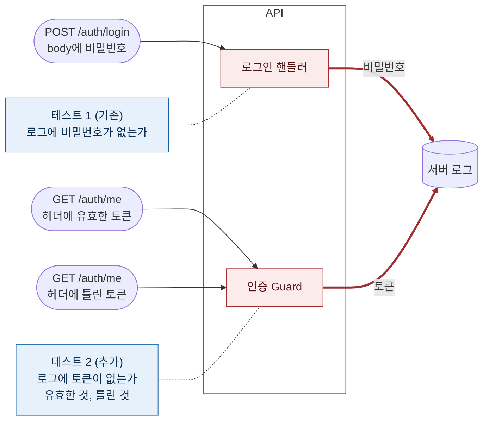

# 결함 3 진단 보고서: 서버 로그의 비밀번호와 토큰 노출 (헤더와 request body를 서버 로그에 기록)

| 항목 | 내용 |
|---|---|
| 대상 | 태그 `v2-defect-3`의 코드로 로컬에서 띄운 API (`http://127.0.0.1:4000`)와 그 API의 서버 로그 |
| 경로 | `POST /auth/login`, 그리고 토큰을 붙여 보내는 모든 경로 |
| 분류 | OWASP Top 10 2025 A09 Security Logging and Alerting Failures / CWE-532 (로그 파일에 민감 정보 기록) |
| 위험도 | 중간 |
| 해당 구성 요소 | 주체의 자격 증명(비밀번호, 토큰). 시행 지점(PEP)과 판단(PE)은 정상으로 동작합니다. 인증 Guard와 로그인 핸들러가 인증에 쓰는 값을 서버 로그에 기록합니다 |
| 상태 | 조치 완료 (`v2-fix-3`) |

## 1. 요약

요청 로그를 추가하면서, 인증이 정상으로 동작하는지 확인하려고 넣은 `console.log` 두 줄이 코드에 남아 있습니다. 로그인 핸들러는 request body를 서버 로그에 기록하고, 그 안에 비밀번호가 들어 있습니다. 인증 Guard는 `Authorization` 헤더를 서버 로그에 기록하고, 그 안에 토큰이 들어 있습니다. 두 요청 모두 응답은 정상이어서, 요청한 사람은 API가 비밀번호와 토큰을 서버 로그에 기록했다는 것을 응답으로는 알 수 없습니다.

위험도를 중간으로 본 근거입니다. 첫째 표에는 두 곳(인증 Guard, 로그인 핸들러)에 공통인 근거를, 둘째 표에는 곳마다 다른 근거를 적었습니다.

| | 근거 |
|---|---|
| 낮추는 쪽 (공통) | 공격자가 API에 요청을 보내는 것만으로는 비밀번호와 토큰을 확인할 수 없습니다. 서버 로그를 읽을 수 있어야 합니다 |
| 높이는 쪽 (공통) | 로그를 읽은 사람은 로그에 있는 토큰이나 비밀번호로 해당 사용자를 사칭해 요청할 수 있습니다. 관리자가 로그인했다면 관리자의 비밀번호와 토큰도 서버 로그에 남으므로, 로그를 읽은 사람은 관리자를 사칭해 관리자만 볼 수 있는 전체 신청 목록(전화번호 포함)을 조회할 수 있습니다 |
| 높이는 쪽 (공통) | 서버에 접근할 수 있는 사람은 앱의 접근통제 없이 로그를 읽을 수 있습니다. 로그는 요청이 끝난 뒤에도 남습니다 |

| 노출되는 곳 | 낮추는 쪽 | 높이는 쪽 |
|---|---|---|
| 인증 Guard (토큰) | 토큰은 발급 1시간 뒤에 만료됩니다 | 인증 Guard는 `@Public`이 아닌 요청마다 헤더를 서버 로그에 기록하므로, 로그에 남는 토큰이 많습니다. 만료 전에 토큰을 무효로 만드는 기능이 없습니다. 인증 Guard가 토큰을 검증하기 전에 헤더를 기록하므로, 유효하지 않은 토큰(서명이 맞지 않거나 만료된 토큰)도 서버 로그에 남습니다 |
| 로그인 핸들러 (비밀번호) | 비밀번호는 로그인 요청에서만 서버 로그에 남습니다 | 해시가 아니라 원문이 남습니다. 비밀번호는 만료되지 않아서, 사용자가 변경하기 전까지 그 비밀번호로 로그인할 수 있습니다. 로그인 핸들러가 비밀번호를 확인하기 전에 request body를 기록하므로, 잘못 입력한 비밀번호도 서버 로그에 남습니다 |

비밀번호 노출이 토큰 노출보다 더 위험합니다. 토큰은 1시간이 지나면 쓸 수 없지만, 비밀번호는 사용자가 변경하기 전까지 유효합니다. 위험도를 높음이 아니라 중간으로 둔 이유는, 공격하려면 서버 로그를 읽을 수 있어야 하기 때문입니다. 서버 로그를 여러 사람이 읽을 수 있는 환경이라면 높음으로 봐야 합니다.

## 2. 재현 절차

준비 (서버 로그를 파일에 저장합니다):

```bash
git checkout v2-defect-3
docker compose up -d --wait
cd apps/api
cp .env.example .env
npm ci --ignore-scripts
npm run db:generate && npm run build
npm run db:migrate && npm run db:seed
npm start > /tmp/api.log 2>&1 &
```

요청 1 (로그인):

```bash
curl -s -X POST -H 'content-type: application/json' \
  -d '{"username":"student1","password":"student1-pass"}' \
  http://127.0.0.1:4000/auth/login
```

요청 2 (받은 토큰으로 본인 정보 조회):

```bash
curl -s -H 'authorization: Bearer <받은 토큰>' http://127.0.0.1:4000/auth/me
```

API는 두 요청 모두에 200으로 응답합니다. 아래는 두 요청을 보낸 뒤의 서버 로그입니다(비밀번호와 토큰은 이 문서에서 가렸습니다).

```
login LoginDto { username: 'student1', password: '<비밀번호>' }
POST /auth/login 200 89ms
auth header Bearer <토큰>
GET /auth/me 200 2ms
```

첫째 줄은 로그인 핸들러가 기록한 request body이고, 셋째 줄은 인증 Guard가 기록한 `Authorization` 헤더입니다. 이 두 줄에 비밀번호와 토큰이 들어 있습니다. 둘째 줄과 넷째 줄은 요청 로그(`common/request-log.ts`)가 기록했습니다.

재현 스크립트 (`main`의 스크립트를 결함 상태의 API에 실행):

```bash
node .github/scripts/defects/defect-3.mjs /tmp/api.log
```

```
결함 3: 서버 로그의 비밀번호와 토큰
대상: http://127.0.0.1:4000
- POST /auth/login (student1)
    → 상태 200
- GET /auth/me (받은 토큰)
    → 상태 200
- 서버 로그에 추가된 줄: 4줄
    → 비밀번호 있음 (1줄) · 토큰 있음 (1줄)
판정: 취약
```

스크립트는 요청을 보낸 뒤에 서버 로그에 추가된 줄만 확인하고, 찾은 값은 출력하지 않습니다. 결함이 없다면 추가된 줄에 비밀번호와 토큰이 없어야 합니다.

## 3. 원인

API가 요청 하나를 처리하는 동안 서버 로그에 기록하는 코드는 세 곳에 있습니다. 그중 두 곳(인증 Guard, 로그인 핸들러)이 요청에서 받은 값을 그대로 기록합니다.


- 빨간색 상자는 받은 값을 서버 로그에 그대로 기록하는 인증 Guard와 로그인 핸들러를 나타냅니다.
- 빨간색 화살표는 인증 Guard와 로그인 핸들러가 토큰과 비밀번호를 서버 로그에 기록하는 흐름을 나타냅니다.
- 초록색 상자는 정상으로 동작하는 단계와 응답을 나타냅니다.

두 요청 모두 응답은 정상입니다.

### 3.1 원인 코드

- 인증 Guard가 `console.log('auth header', header)`로 `Authorization` 헤더를 서버 로그에 기록합니다: [`auth/auth.guard.ts` 22행](https://github.com/loquemedalagana/secure-enroll-demo/blob/v2-defect-3/apps/api/src/auth/auth.guard.ts#L22). 토큰을 검증하는 `authenticate(token)`(25행)보다 앞에 있어서, 유효하지 않은 토큰도 서버 로그에 남습니다.
- 로그인 핸들러가 `console.log('login', body)`로 request body를 서버 로그에 기록합니다: [`auth/auth.controller.ts` 18행](https://github.com/loquemedalagana/secure-enroll-demo/blob/v2-defect-3/apps/api/src/auth/auth.controller.ts#L18). 비밀번호를 확인하는 `this.auth.login(...)`(19행)보다 앞에 있어서, 잘못 입력한 비밀번호도 서버 로그에 남습니다.
- 요청 로그(`common/request-log.ts`)는 메서드, 주소, 상태 코드, 요청을 처리하는 데 걸린 시간만 기록합니다: [`common/request-log.ts` 6~8행](https://github.com/loquemedalagana/secure-enroll-demo/blob/v2-defect-3/apps/api/src/common/request-log.ts#L6-L8).

### 3.2 로그에 값이 노출되는 곳

| 서버 로그에 기록하는 곳 | 언제 | 기록하는 값 | 노출되는 민감한 값 |
|---|---|---|---|
| [`common/request-log.ts` 7행](https://github.com/loquemedalagana/secure-enroll-demo/blob/v2-defect-3/apps/api/src/common/request-log.ts#L7) | 모든 요청이 끝날 때 | 메서드, 주소, 상태 코드, 요청을 처리하는 데 걸린 시간 | 없음 |
| [`auth/auth.guard.ts` 22행](https://github.com/loquemedalagana/secure-enroll-demo/blob/v2-defect-3/apps/api/src/auth/auth.guard.ts#L22) | `@Public`이 아닌 모든 요청 | `Authorization` 헤더 전체 | **토큰** |
| [`auth/auth.controller.ts` 18행](https://github.com/loquemedalagana/secure-enroll-demo/blob/v2-defect-3/apps/api/src/auth/auth.controller.ts#L18) | `POST /auth/login` | request body 전체 | **비밀번호** |

`GET /courses`처럼 `@Public`이 붙은 경로의 요청은 인증 Guard가 18행에서 통과시키므로, 헤더를 기록하는 22행이 실행되지 않습니다. 인증 Guard는 로그인이 필요한 경로 5개의 요청에서 모두 토큰을 서버 로그에 기록합니다.

### 3.3 이 결함을 처음 잡은 테스트

인증 기능을 만들 때 추가한 테스트(`apps/api/test/auth.test.mjs`의 "서버 출력에 비밀번호와 토큰 값이 없음")가 이 태그에서 실패합니다. API 테스트 86건 중 85건이 통과하고 1건이 실패합니다.

이 테스트는 로그인한 뒤 서버 로그에 비밀번호와 발급된 토큰이 있는지 확인합니다. 서버 로그에 비밀번호가 있어서 테스트가 실패했습니다. 이 테스트로는 인증 Guard가 토큰을 서버 로그에 기록하는 것을 확인할 수 없습니다. 테스트가 발급받은 토큰을 `Authorization` 헤더에 넣어 다시 요청하지 않으므로, 인증 Guard의 22행이 그 토큰으로 실행되지 않기 때문입니다.

### 3.4 결함을 잡는 테스트

`apps/api/test/auth.test.mjs`에 테스트 1건을 추가했습니다. 값을 서버 로그에 기록하는 곳이 두 곳이므로 테스트도 2건입니다. 3.3절의 기존 테스트는 로그인 핸들러를, 추가한 테스트는 인증 Guard를 확인합니다.



- 빨간색 상자는 받은 값을 서버 로그에 기록하는 로그인 핸들러와 인증 Guard를 나타냅니다.
- 빨간색 화살표는 로그인 핸들러와 인증 Guard가 비밀번호와 토큰을 서버 로그에 기록하는 흐름을 나타냅니다.
- 파란색 상자는 테스트를 나타냅니다.

| 테스트 | 개발 관점: 무엇을 확인하나 | 보안 관점: 무엇을 지키나 |
|---|---|---|
| 1 서버 로그에 비밀번호와 토큰 값이 없음 (기존) | 로그인에 성공한 뒤와 실패한 뒤에, 서버 로그에 올바른 비밀번호, 잘못 입력한 비밀번호, 발급된 토큰이 없는지 | 주체의 자격 증명 가운데 비밀번호. 잘못 입력한 비밀번호도 포함합니다 |
| 2 서버 출력에 요청으로 받은 토큰 값이 없음 (추가) | 유효한 토큰으로 요청한 뒤와 유효하지 않은 토큰으로 요청한 뒤에, 서버 출력에 그 토큰이 없는지 | 주체의 자격 증명 가운데 토큰. 유효하지 않은 토큰도 포함합니다 |

테스트 1로는 인증 Guard가 토큰을 서버 로그에 기록하는 것을 확인할 수 없습니다. 3.3절에 적은 대로, 테스트 1은 발급받은 토큰을 `Authorization` 헤더에 넣어 다시 요청하지 않습니다. 테스트 2는 토큰을 헤더에 넣어 `GET /auth/me`를 요청합니다.

이 커밋에서 API 테스트는 87건 중 85건이 통과하고 2건이 실패합니다.

```
✖ 서버 출력에 비밀번호와 토큰 값이 없음
✖ 서버 출력에 요청으로 받은 토큰 값이 없음 (유효한 토큰, 틀린 토큰)
    유효한 토큰이 서버 출력에 있습니다
```

테스트 2의 실패 문구("유효한 토큰이 서버 출력에 있습니다")는 `assert.ok`에 직접 지정했습니다. 실패 문구에 토큰 값이 들어가서 테스트 로그에 남는 일이 없게 하려는 것입니다. 나머지 85건은 통과합니다. API의 응답은 모두 정상이고, 결함은 서버 로그에서만 확인할 수 있습니다.

### 3.5 보안 관점: 접근통제 구성 요소로 본 결함

결함 1과 2에서는 API가 인증이 필요한 요청에 토큰을 확인하지 않고 응답했습니다. 결함 3에서는 인증과 인가가 모두 정상으로 동작합니다. 대신 인증 Guard와 로그인 핸들러가 인증에 쓰는 값(토큰, 비밀번호)을 서버 로그에 기록합니다.

| 구성 요소 | 이 결함에서 | 코드에서 확인하는 곳 |
|---|---|---|
| 주체의 자격 증명 | 비밀번호와 토큰. **인증 Guard와 로그인 핸들러가 이 값을 서버 로그에 그대로 기록합니다. 이 부분이 결함이고, 그 결과 서버 로그를 읽을 수 있는 사람에게 비밀번호와 토큰이 노출되는 취약점(CWE-532)이 생깁니다** | [`auth/auth.guard.ts` 22행](https://github.com/loquemedalagana/secure-enroll-demo/blob/v2-defect-3/apps/api/src/auth/auth.guard.ts#L22), [`auth/auth.controller.ts` 18행](https://github.com/loquemedalagana/secure-enroll-demo/blob/v2-defect-3/apps/api/src/auth/auth.controller.ts#L18) |
| 시행 (PEP) | 정상으로 동작합니다. 인증 Guard는 토큰이 없거나 유효하지 않은 요청에 401로 응답합니다 | [`auth/auth.guard.ts` 24~26행](https://github.com/loquemedalagana/secure-enroll-demo/blob/v2-defect-3/apps/api/src/auth/auth.guard.ts#L24-L26) |
| 판단 (PE) | 정상으로 동작합니다. `can()`이 규칙대로 허용하거나 거부합니다 | `authz/policy.ts` |
| 로그 | 프로세스의 표준 출력. 서버에 접근할 수 있는 사람은 앱의 접근통제 없이 서버 로그를 읽을 수 있습니다 | `console.log`가 쓰는 프로세스의 표준 출력 |

로그를 읽은 사람은 로그에 있는 토큰으로 만료(1시간) 전까지 그 토큰의 사용자를 사칭해 요청할 수 있습니다. 로그인할 필요가 없습니다. 앱의 접근통제가 정상으로 동작해도, 자격 증명이 서버 로그에 남아 있으면 API는 사칭한 요청과 본인의 요청을 구분할 수 없습니다.

제로 트러스트의 원칙으로 보면, API는 "모든 요청을 검증한다"를 지킵니다. 그러나 검증에 쓰는 자격 증명(비밀번호, 토큰)을 보호하지 못합니다. 인증 Guard와 로그인 핸들러가 비밀번호와 토큰을 서버 로그에 기록하기 때문입니다.

## 4. 조치

### 4.1 조치 방안 비교

고칠 방법은 세 가지입니다.

- **방안 1 (두 줄 삭제)**: 인증 Guard의 `console.log('auth header', header)`와 로그인 핸들러의 `console.log('login', body)`를 지웁니다.
- **방안 2 (삭제 + 정해진 필드)**: 방안 1에 더해, 요청 로그가 한 줄에 기록하는 필드를 `common/request-log.ts`의 타입 `RequestLogLine` 하나로 정합니다. 헤더, request body, 쿼리 문자열은 필드에 넣지 않습니다.
- **방안 3 (방안 2 + 린트)**: 방안 2에 더해 린트 규칙(`no-console`)을 추가합니다. `console`을 호출하는 코드가 다시 추가되면 CI의 린트 잡이 실패합니다.

#### 실제로 바꿔 본 결과

방안 1과 2를 태그 `v2-defect-3`의 코드(테스트를 추가한 커밋)에 하나씩 적용해 결과를 비교했습니다. 방안을 하나 적용할 때마다 `npm test`로 API 테스트를 실행하고, 재현 스크립트를 실행하고, `GET /courses?q=probe-query-value`를 보낸 뒤 서버 로그를 확인했습니다. 두 방안의 변경은 커밋하지 않았습니다. 방안 3은 적용해 보지 않았습니다. 이 저장소에는 린트가 없고, 린트를 넣는 일은 결함 3의 수정에 포함하지 않았기 때문입니다(`docs/decisions.md` 5번).

방안 1:

```diff
 // auth/auth.guard.ts
-    console.log('auth header', header);

 // auth/auth.controller.ts
-    console.log('login', body);
```

방안 2 (방안 1에 더해 `common/request-log.ts`):

```diff
-    console.log(`${req.method} ${req.originalUrl} ${res.statusCode} ${Date.now() - started}ms`);
+    const line: RequestLogLine = {
+      time: new Date().toISOString(),
+      id,
+      method: req.method,
+      path: req.originalUrl.split('?')[0] ?? '',
+      status: res.statusCode,
+      ms: Date.now() - started,
+    };
+    const uid = (req as AuthedRequest).user?.id;
+    if (uid !== undefined) line.uid = uid;
+    process.stdout.write(`${JSON.stringify(line)}\n`);
```

| 확인 | 결함 상태 | 방안 1 | 방안 2 |
|---|---|---|---|
| 서버 로그에 비밀번호 | **있음** | 없음 | 없음 |
| 서버 로그에 토큰 | **있음** | 없음 | 없음 |
| 재현 스크립트 판정 | 취약 | 차단 | 차단 |
| API 테스트 87건 | 2건 실패 | 모두 통과 | 모두 통과 |
| `GET /courses?q=probe-query-value`를 보낸 뒤 서버 로그에 `probe-query-value` | **있음** | **있음** | 없음 |

로그의 마지막 줄을 비교하면 다음과 같습니다.

```
방안 1   GET /courses?q=probe-query-value 200 8ms
방안 2   {"time":"...","id":"...","method":"GET","path":"/courses","status":200,"ms":9}
```

이 표에서 확인할 것은 두 가지입니다.

- 방안 1도 결함을 고칩니다. 서버 로그에 비밀번호와 토큰이 남지 않고, API 테스트 87건이 모두 통과합니다.
- 방안 1에서는 요청 로그가 `req.originalUrl`을 그대로 기록하므로, 쿼리 문자열도 서버 로그에 남습니다. 이 태그에는 쿼리 문자열로 민감한 값을 받는 경로가 없습니다. 검색어를 쿼리 문자열로 받는 경로를 추가하면 검색어가 서버 로그에 남습니다.

#### 비교

| 기준 | 방안 1 (두 줄 삭제) | 방안 2 (삭제 + 정해진 필드) | 방안 3 (방안 2 + 린트) |
|---|---|---|---|
| 바꾸는 양 | 2줄 | 파일 3개 | 방안 2 + 의존성, 설정 파일, CI 잡 |
| 서버 로그에 기록할 값을 정하는 곳 | 없습니다. `console.log`를 호출하는 곳마다 정합니다 | `common/request-log.ts`의 타입 `RequestLogLine` | 방안 2와 같음 |
| 쿼리 문자열 | 로그에 남습니다 | 남지 않습니다 | 남지 않습니다 |
| 어느 사용자의 요청인지 | 로그로는 확인할 수 없습니다 | 사용자 id(`uid`)가 남습니다 | 방안 2와 같음 |
| 자격 증명을 기록하는 코드가 다시 추가되면 | 테스트 2건이 잡습니다 | 테스트 2건이 잡습니다 | 테스트와 린트가 잡습니다 |
| 로그의 형식 | 기록하는 곳마다 다릅니다 | 한 줄에 JSON 하나 | 방안 2와 같음 |

**고른 것**: 방안 2 (삭제 + 정해진 필드).

**이유**: 이 결함의 직접 원인은 `console.log` 두 줄입니다. 그런데 그 두 줄을 추가할 수 있었던 것은, 서버 로그에 기록할 값을 정해 둔 곳이 없었기 때문입니다. 방안 2는 기록할 값을 `common/request-log.ts`의 타입 `RequestLogLine`으로 정합니다. 필드를 추가하려면 이 타입을 고쳐야 하므로, 무엇을 추가하는지가 그 커밋의 diff에 나타납니다. 쿼리 문자열도 필드에 없어서 서버 로그에 남지 않습니다.

**채택하지 않은 대안 (방안 1)**: 변경이 두 줄이고 결함을 고칩니다. 이미 운영 중인 서비스에서 급히 막아야 할 때는 방안 1을 먼저 적용하는 것이 맞습니다. 다만 요청 로그는 여전히 `req.originalUrl`을 그대로 기록하므로, 쿼리 문자열이 서버 로그에 남습니다.

**채택하지 않은 대안 (방안 3)**: 린트 규칙 `no-console`은 `console`을 호출하는 코드를 모두 찾으므로, 같은 코드가 다시 추가되면 가장 먼저 CI에서 실패합니다. 이 브랜치에 넣지 않은 이유는 두 가지입니다. 첫째, API에 린트를 추가하는 일(의존성, 설정 파일, CI 잡)은 결함 3의 수정과 별개의 변경이어서 이 브랜치에 포함하지 않았습니다(`docs/decisions.md` 5번). 둘째, 린트는 `console`을 호출했는지만 검사합니다. `process.stdout.write`처럼 다른 방법으로 같은 값을 기록하면 린트는 찾지 못합니다. 그래서 린트를 추가하더라도 서버 출력을 확인하는 테스트는 그대로 필요합니다.

**감수하는 것**:

- `RequestLogLine`은 요청 로그가 기록하는 한 줄의 필드만 정합니다. 다른 코드에 추가한 `console.log`가 기록하는 값은 이 타입과 상관없이 서버 로그에 남습니다. 서버 로그에 비밀번호와 토큰이 있는지는 3.4절의 테스트 2건이 확인합니다.
- 사용자 id(`uid`)가 서버 로그에 남습니다. `u1` 같은 내부 식별자입니다. 요청 로그의 줄마다 어느 사용자의 요청인지 확인하려고 넣었습니다. 이름과 전화번호는 넣지 않습니다.
- 주소에서 쿼리 문자열을 뺀 경로 부분(`path`)은 서버 로그에 남습니다. `/enrollments/e1`처럼 신청 id가 들어 있습니다.

### 4.2 적용한 조치

방안 2를 커밋 두 개로 나눠 적용했습니다. 첫 커밋([`982b048`](https://github.com/loquemedalagana/secure-enroll-demo/commit/982b048))은 `console.log` 두 줄을 지워 결함을 고칩니다. 이 커밋으로 비밀번호와 토큰이 노출되는 취약점(CWE-532)이 없어집니다. 둘째 커밋([`2371126`](https://github.com/loquemedalagana/secure-enroll-demo/commit/2371126))은 요청 로그가 기록하는 필드를 타입 `RequestLogLine`으로 정합니다. 태그 `v2-fix-3`은 둘째 커밋을 가리킵니다.

| 커밋 | 바꾼 것 | 달라지는 것 |
|---|---|---|
| 인증 Guard와 로그인 핸들러의 `console.log` 삭제 | `auth/auth.guard.ts`와 `auth/auth.controller.ts`에서 `console.log` 두 줄을 지웠습니다 | 서버 로그에 토큰과 비밀번호가 남지 않습니다. 실패하던 테스트 2건이 통과합니다 |
| 요청 로그를 정해진 필드의 JSON 한 줄로 변경 | [`common/request-log.ts` 7~15행](https://github.com/loquemedalagana/secure-enroll-demo/blob/v2-fix-3/apps/api/src/common/request-log.ts#L7-L15): 요청 로그가 기록하는 필드를 타입 `RequestLogLine`으로 정했습니다 | 요청 로그가 한 줄에 JSON 하나를 기록합니다. 쿼리 문자열은 기록하지 않고, 사용자 id(`uid`)를 기록합니다 |

아래 그림은 수정 뒤에 API가 요청 하나를 처리하는 순서와, 요청 로그가 한 줄을 기록하는 시점입니다.


- 노란색 상자는 요청 로그를 나타냅니다.
- 초록색 상자는 인증 Guard와 인가 Guard를 나타냅니다.

요청 로그는 요청이 들어올 때(①)와 응답이 끝날 때(②) 두 번 실행됩니다. 서버 로그에는 ②에서만 한 줄을 기록합니다.

- 요청 로그는 응답이 끝났을 때(`res.on('finish', …)`) 한 줄을 기록합니다. 상태 코드(`res.statusCode`), 요청을 처리하는 데 걸린 시간(`ms`), 인증된 사용자(`req.user`)는 요청 로그가 처음 실행되는 ①에서는 아직 값이 없고, 응답이 끝난 ②에서 읽을 수 있기 때문입니다. Guard가 요청에 401이나 403으로 응답할 때도 `finish`가 발생하므로, 거부한 요청도 한 줄씩 서버 로그에 남습니다.
- 로그의 `uid`는 요청 로그가 토큰에서 직접 읽은 값이 아닙니다. 인증 Guard는 토큰의 서명과 만료를 검증하고 DB에서 사용자를 확인한 뒤 `req.user = user`를 실행합니다. 요청 로그는 그 `req.user.id`를 `uid`로 기록합니다. 토큰 검증에 실패한 요청과 공개 경로의 요청에는 `uid`가 없습니다.

아래는 요청 로그 한 줄의 예입니다.

```json
{"time":"2026-11-26T09:52:57.261Z","id":"8f9e2e0e-a94e-494c-a56d-4030604bae33","method":"GET","path":"/auth/me","status":200,"ms":2,"uid":"u1"}
```

### 4.3 수정 뒤에 추가한 것

결함 3의 분류(A09 Security Logging and Alerting Failures)에는 두 가지가 들어 있습니다. 하나는 기록하면 안 되는 값을 로그에 기록하는 것(CWE-532)이고, 다른 하나는 보안 사건을 기록하지 않는 것(CWE-778, Insufficient Logging)입니다. 접근을 거부한 요청을 기록하지 않는 것이 CWE-778의 예입니다. 수정 태그(`v2-fix-3`) 뒤의 커밋([`bcf5f19`](https://github.com/loquemedalagana/secure-enroll-demo/commit/bcf5f19))에서 요청 로그에 두 가지를 추가했습니다. 이 커밋은 결함 3의 수정이 아니라 기능 추가입니다.

| 추가한 것 | 내용 |
|---|---|
| 인가 판단의 결과 | 인가 Guard가 `can()`에 넘긴 행위(`action`)와 `can()`의 반환값(`allowed`)을 요청 로그의 필드에 추가했습니다. 허용한 요청과 거부한 요청을 모두 기록합니다 |
| 응답 헤더의 요청 id | 요청 로그의 `id`와 같은 값을 응답 헤더 `X-Request-Id`에 넣습니다. 요청한 사람이 응답의 `X-Request-Id` 값을 알려 주면, 그 값으로 서버 로그를 검색해 그 요청을 기록한 줄을 찾을 수 있습니다 |

아래는 학생이 수강생 명단을 요청했을 때 요청 로그가 기록한 줄입니다. API는 이 요청에 403으로 응답했습니다.

```json
{"time":"...","id":"...","method":"GET","path":"/courses/c1/enrollments","status":403,"ms":4,"uid":"u1","action":"roster:read","allowed":false}
```

인가 Guard가 `can()`을 호출하지 않은 요청에는 요청 로그가 `action`과 `allowed`를 기록하지 않습니다. 공개 경로의 요청, 인증 Guard가 401로 응답한 요청, 인가 Guard가 대상을 찾지 못해 404로 응답한 요청이 여기에 해당합니다. 두 필드도 `common/request-log.ts`의 타입 `RequestLogLine`에 추가했습니다. `apps/api/test/request-log.test.mjs`는 요청 로그 한 줄에 이 타입에 없는 필드가 있는지 확인합니다.

## 5. 조치 뒤 재확인

태그 `v2-fix-3`의 코드로 API를 로컬에서 띄우고, 2절과 같은 스크립트를 실행한 결과입니다.

```bash
node .github/scripts/defects/defect-3.mjs /tmp/api.log --expect blocked
```

```
결함 3: 서버 로그의 비밀번호와 토큰
- POST /auth/login (student1)
    → 상태 200
- GET /auth/me (받은 토큰)
    → 상태 200
- 서버 로그에 추가된 줄: 2줄
    → 비밀번호 없음 · 토큰 없음
판정: 차단
```

스크립트를 실행하는 동안 서버 로그에 추가된 줄이 4줄에서 2줄로 줄었습니다. 남은 2줄은 요청 로그가 기록한 줄입니다.

```json
{"time":"...","id":"...","method":"POST","path":"/auth/login","status":200,"ms":91}
{"time":"...","id":"...","method":"GET","path":"/auth/me","status":200,"ms":2,"uid":"u1"}
```

| 확인 | 결함 상태 (`v2-defect-3`) | 조치 뒤 (`v2-fix-3`) |
|---|---|---|
| 서버 로그에 비밀번호 | 있음 | 없음 |
| 서버 로그에 토큰 | 있음 | 없음 |
| `GET /courses?q=probe-query-value`를 보낸 뒤 서버 로그에 `probe-query-value` | 있음 | 없음 |
| 어느 사용자의 요청인지 | 로그로는 확인할 수 없음 | `uid`로 확인할 수 있음 |
| 응답 | 정상 | 정상 (바뀐 것 없음) |
| API 테스트 | 87건 중 2건 실패 | 87건 통과 |

결함 상태에서 실패하던 2건은 3.4절의 테스트 1과 2입니다. 테스트 2는 유효한 토큰과 유효하지 않은 토큰을 차례로 확인합니다. 결함 상태에서는 첫 `assert.ok`(유효한 토큰)에서 실패해서 둘째 `assert.ok`는 실행되지 않았습니다. 조치 뒤에는 두 `assert.ok`가 모두 통과합니다.

### CI 실행 기록

이 결함을 다룬 PR에서 실행된 CI 기록입니다.

| 시점 | 커밋 | `api` 잡 | 실행 |
|---|---|---|---|
| 결함이 든 구현을 올린 뒤 | `78e3752` | 실패 (86건 중 1건, 3.3절의 테스트) | [45789306932](https://github.com/loquemedalagana/secure-enroll-demo/actions/runs/45789306932) |
| 테스트를 추가한 뒤 | `223a7e4` | 실패 (87건 중 2건) | [45791174560](https://github.com/loquemedalagana/secure-enroll-demo/actions/runs/45791174560) |
| 수정한 뒤 | `2502f20` | 통과 (87건) | [45796468140](https://github.com/loquemedalagana/secure-enroll-demo/actions/runs/45796468140) |

실행 로그는 GitHub의 보존 기간(기본 90일)이 지나면 삭제됩니다. 그 뒤에도 `defects.yml`을 실행하면 위 표의 실패와 통과를 재현할 수 있습니다. 이 워크플로는 결함 태그의 코드에 수정 태그의 테스트를 실행해 같은 테스트가 실패하는지 확인하고, 수정 태그의 코드에서는 모두 통과하는지 확인합니다. 실패한 테스트의 이름은 Summary에 남깁니다.

## 6. Burp Suite 진단 기록

작성 전.
