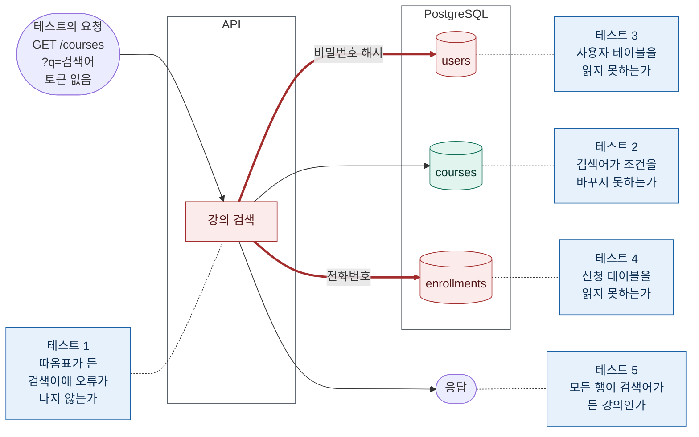
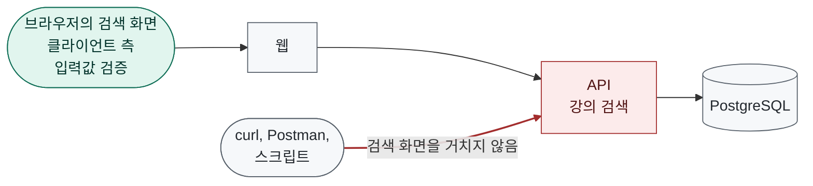
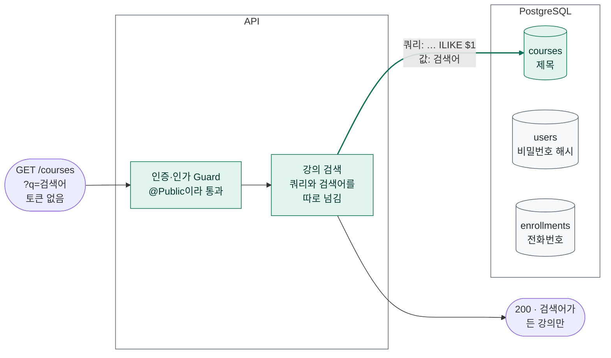

# 결함 6 진단 보고서: 강의 검색의 SQL 인젝션 (검색어를 SQL 문자열에 이어 붙임)

| 항목 | 내용 |
|---|---|
| 대상 | 태그 `v2-defect-6`의 코드로 로컬에서 띄운 API (`http://127.0.0.1:4000`) |
| 경로 | `GET /courses?q=` (공개 경로) |
| 분류 | OWASP Top 10 2025 A05 Injection / CWE-89 (SQL 인젝션) |
| 위험도 | 높음 |
| 해당 구성 요소 | 객체. 강의 검색이 읽어야 하는 테이블은 `courses`뿐입니다. 결함 상태에서는 공격자가 검색어에 넣은 SQL로 다른 객체(사용자 테이블, 신청 테이블)까지 읽을 수 있습니다. 시행 지점(PEP)인 Guard는 정상으로 동작합니다 |
| 상태 | 조치 완료 (`v2-fix-6`) |

## 1. 요약

강의 검색(`GET /courses?q=`)은 검색어를 SQL 문자열에 이어 붙여 실행합니다. 검색어에 작은따옴표가 들어 있으면 DB는 그 작은따옴표 뒤의 글자를 값이 아니라 쿼리의 일부로 실행합니다. 강의 검색은 공개 경로입니다. 그래서 공격자는 토큰 없이 테이블마다 요청 한 번으로 사용자 테이블의 계정 이름과 비밀번호 해시, 신청 테이블의 전화번호를 읽을 수 있습니다.

위험도를 높음으로 본 근거입니다.

| | 근거 |
|---|---|
| 높이는 쪽 | 인증이 필요 없습니다. 강의 검색은 공개 경로입니다 |
| 높이는 쪽 | 공격자는 요청 한 번으로 테이블 하나의 모든 행을 읽을 수 있습니다. 2절에서 사용자 테이블을 읽은 요청의 응답에는 계정 5개의 비밀번호 해시가, 신청 테이블을 읽은 요청의 응답에는 신청 3건의 전화번호가 들어 있습니다 |
| 높이는 쪽 | API는 이 요청에 200으로 응답하고, 응답의 필드(`id`, `title`)도 강의 목록과 같습니다. 그래서 상태 코드와 필드 이름만으로는 공격인지 알 수 없습니다 |
| 높이는 쪽 | API가 DB에 접속하는 계정이 모든 테이블을 읽을 수 있습니다. 강의 검색에 필요한 테이블은 `courses`뿐입니다 |
| 낮추는 쪽 | 응답에 든 비밀번호는 원문이 아니라 scrypt 해시입니다. 공격자가 원문을 알아내려면 해시마다 따로 비밀번호를 대입해야 합니다 |
| 낮추는 쪽 | 이 보고서는 공격자가 검색어로 다른 테이블을 읽을 수 있다는 것(기밀성 침해)만 확인했습니다. 검색어로 데이터를 변경하거나 삭제할 수 있는지는 확인하지 않았습니다 |

## 2. 재현 절차

준비:

```bash
git checkout v2-defect-6
docker compose up -d --wait
cd apps/api
cp .env.example .env
npm ci --ignore-scripts
npm run db:generate && npm run build
npm run db:migrate && npm run db:seed
npm start
```

요청 1 (정상 검색어 `보안`):

```bash
curl -s -G --data-urlencode "q=보안" http://127.0.0.1:4000/courses
```

```json
[{"id":"c1","title":"웹 보안 입문"}]
```

API는 제목에 "보안"이 든 강의 1건으로 응답합니다. 이 응답은 의도한 동작입니다.

요청 2 (작은따옴표 하나):

```bash
curl -s -G --data-urlencode "q='" http://127.0.0.1:4000/courses
```

```json
{"error":"internal_error"}
```

API는 500으로 응답합니다. DB는 검색어의 작은따옴표를 문자열 리터럴의 끝으로 읽습니다. 코드가 검색어 뒤에 붙인 `%'`의 작은따옴표는 짝이 없어서 SQL 문법 오류가 납니다. 결함이 없다면 DB는 작은따옴표를 검색할 글자로 읽고, API는 200과 빈 배열(`[]`)로 응답해야 합니다.

요청 3 (조건을 항상 참으로 만드는 검색어, tautology 기반):

```bash
curl -s -G --data-urlencode "q=암호학' OR '%'='" http://127.0.0.1:4000/courses
```

제목에 "암호학"이 든 강의는 없습니다. 그런데 API는 강의 2건이 모두 든 목록으로 응답합니다.

요청 4 (사용자 테이블의 행을 검색 결과에 합치는 검색어, UNION 기반):

```bash
curl -s -G --data-urlencode "q=암호학' UNION SELECT username, \"passwordHash\" FROM users --" http://127.0.0.1:4000/courses
```

API는 토큰 없는 이 요청에 200으로 응답하고, 응답에는 5건이 들어 있습니다(비밀번호 해시는 이 문서에서 가렸습니다).

```json
[
  {"id":"student2","title":"scrypt$<가림>"},
  {"id":"admin1","title":"scrypt$<가림>"},
  {"id":"instructor1","title":"scrypt$<가림>"},
  {"id":"student1","title":"scrypt$<가림>"},
  {"id":"instructor2","title":"scrypt$<가림>"}
]
```

응답의 `id` 필드에는 계정 이름이, `title` 필드에는 비밀번호 해시가 들어 있습니다. 검색어의 `UNION SELECT` 뒤를 `id, phone FROM enrollments --`로 바꿔 요청하면, API는 신청 3건의 신청 id와 전화번호로 응답합니다.

재현 스크립트 (`main`의 스크립트를 결함 상태의 API에 실행):

```bash
node .github/scripts/defects/defect-6.mjs
```

```
결함 6: 강의 검색(GET /courses?q=)의 검색어 처리
대상: http://127.0.0.1:4000
- 검색어: 암호학 (토큰 없음, 0건이어야 함)
    → 상태 200 · 0건
- 검색어: 작은따옴표 하나 (')
    → 상태 500 · 0건
- 검색어: 암호학' OR '%'='
    → 상태 200 · 2건 · 강의 2건
- 검색어: 암호학' UNION SELECT … FROM users
    → 상태 200 · 5건 · 사용자 테이블에서 온 행 5건(계정 이름과 비밀번호 해시)
- 검색어: 암호학' UNION SELECT … FROM enrollments
    → 상태 200 · 3건 · 신청 테이블에서 온 행 3건(신청 id와 전화번호)
판정: 취약
```

스크립트는 응답에 든 값을 출력하지 않고 건수만 출력합니다. 결함이 없다면 API는 다섯 요청 모두에 200과 빈 배열(`[]`)로 응답해야 합니다. 강의 2건의 제목(`웹 보안 입문`, `시큐어 코딩 실습`)에는 다섯 검색어 중 어느 것도 글자 그대로 들어 있지 않기 때문입니다.

## 3. 원인

API는 검색어를 SQL 문자열에 이어 붙여 문자열 하나로 만든 뒤 DB에 보냅니다. DB는 이 문자열 하나를 구문 분석하므로, 어디까지가 코드에 적힌 쿼리이고 어디부터가 검색어인지 구분할 수 없습니다.


- 빨간색 상자는 검색어를 SQL 문자열에 이어 붙이는 강의 검색과, 그 쿼리가 읽는 `users` 테이블과 `enrollments` 테이블을 나타냅니다.
- 빨간색 화살표는 검색어에 든 `UNION SELECT`가 `users` 테이블과 `enrollments` 테이블을 읽는 흐름을 나타냅니다.
- 초록색 상자는 정상으로 동작하는 Guard와, 강의 검색이 읽는 `courses` 테이블을 나타냅니다.

강의 목록은 의도한 공개 경로입니다. 강의 목록 핸들러에 `@Public()`이 붙어 있어서([`courses/courses.controller.ts` 12행](https://github.com/loquemedalagana/secure-enroll-demo/blob/v2-defect-6/apps/api/src/courses/courses.controller.ts#L12)), Guard는 토큰 확인을 건너뛰고 요청을 통과시킵니다. Guard의 이 동작은 정상입니다.

### 3.1 원인 코드

- `search()`는 템플릿 문자열의 `'%${q}%'`로 검색어 `q`를 SQL 문자열에 넣고(19행), 이 문자열을 `$queryRawUnsafe`로 실행합니다(18행): [`courses/courses.service.ts` 17~21행](https://github.com/loquemedalagana/secure-enroll-demo/blob/v2-defect-6/apps/api/src/courses/courses.service.ts#L17-L21).
- 강의 목록 핸들러 `list()`는 주소의 쿼리 문자열에서 읽은 `q`를 `this.courses.search(q)`에 그대로 넘깁니다: [`courses/courses.controller.ts` 15행](https://github.com/loquemedalagana/secure-enroll-demo/blob/v2-defect-6/apps/api/src/courses/courses.controller.ts#L15).

### 3.2 검색어에 따라 실행되는 쿼리

19행의 코드가 만드는 쿼리는 `… WHERE title ILIKE '%` + 검색어 + `%' ORDER BY id ASC`입니다. 아래 표에서 굵은 부분이 검색어입니다.

| 검색어 | 실행되는 쿼리의 조건 부분 | 결과 |
|---|---|---|
| `보안` | `title ILIKE '%`**`보안`**`%' ORDER BY …` | API는 제목에 "보안"이 든 강의 1건으로 응답합니다. 의도한 동작입니다 |
| `'` | `title ILIKE '%`**`'`**`%' ORDER BY …` | DB가 검색어의 `'`를 문자열 리터럴의 끝으로 읽습니다. 뒤에 남은 `'`는 짝이 없어서 문법 오류가 나고, API는 500으로 응답합니다 |
| `암호학' OR '%'='` | `title ILIKE '%`**`암호학' OR '%'='`**`%' ORDER BY …` | `'%'='%'`가 항상 참이어서 API는 모든 강의로 응답합니다 (tautology 기반) |
| `암호학' UNION SELECT username, "passwordHash" FROM users --` | `title ILIKE '%`**`암호학' UNION SELECT … FROM users --`**`%' ORDER BY …` | DB는 `--` 뒤를 주석으로 읽고, 사용자 테이블의 행을 검색 결과에 합칩니다 (UNION 기반) |

### 3.3 이 결함을 처음 잡은 테스트

결함 태그(`v2-defect-6`)에는 이 결함을 잡는 테스트가 없습니다. 이 태그에서 API 테스트 94건이 모두 통과합니다. 강의 검색 테스트 2건([`apps/api/test/courses.test.mjs` 30~39행](https://github.com/loquemedalagana/secure-enroll-demo/blob/v2-defect-6/apps/api/test/courses.test.mjs#L30-L39))은 검색어로 `보안`, `실습`, `없는 제목`, 빈 문자열만 보냅니다.

### 3.4 결함을 잡는 테스트

`apps/api/test/courses.test.mjs`에 테스트 5건("강의 검색 1~5")을 추가했습니다([`d8eb300`](https://github.com/loquemedalagana/secure-enroll-demo/commit/d8eb300)). 테스트는 API를 띄운 뒤 웹을 거치지 않고 API에 직접 요청합니다. API는 실제 PostgreSQL에 접속합니다. PostgreSQL을 mock으로 바꾸면 DB가 쿼리를 구문 분석하지 않아서, 테스트가 이 결함을 잡지 못합니다.



- 빨간색 상자는 검색어를 SQL 문자열에 이어 붙이는 강의 검색과, 그 쿼리가 읽는 `users` 테이블과 `enrollments` 테이블을 나타냅니다.
- 빨간색 화살표는 결함 상태에서 강의 검색이 `users` 테이블의 비밀번호 해시와 `enrollments` 테이블의 전화번호를 읽는 흐름을 나타냅니다.
- 초록색 상자는 강의 검색이 읽는 `courses` 테이블을 나타냅니다.
- 파란색 상자는 테스트를 나타냅니다.

| 테스트 | 보내는 검색어 | 개발 관점: 무엇을 확인하나 | 보안 관점: 무엇을 지키나 |
|---|---|---|---|
| 1 작은따옴표가 든 검색어도 오류 없이 200에 0건 | `'` | API가 작은따옴표 하나인 검색어에 200과 빈 배열(`[]`)로 응답하는지 | 검색어의 작은따옴표가 SQL 문법 오류를 일으키지 않는가. 공격자는 API의 500 응답으로 검색어가 쿼리의 일부로 실행된다는 것을 확인할 수 있습니다 |
| 2 검색어로 조건을 항상 참으로 만들 수 없음 | `암호학' OR '%'='` | API가 이 검색어에 200과 빈 배열(`[]`)로 응답하는지 | 검색어가 `WHERE` 조건을 항상 참으로 바꾸지 못하는가 (tautology 기반) |
| 3 검색어로 사용자 테이블을 읽을 수 없음 | `… UNION SELECT … FROM users --` | API가 이 검색어에 200과 빈 배열(`[]`)로 응답하는지 | 기밀성. 공격자가 검색어로 사용자 테이블의 계정 이름과 비밀번호 해시를 읽을 수 없는가 (UNION 기반) |
| 4 검색어로 신청 테이블을 읽을 수 없음 | `… UNION SELECT … FROM enrollments --` | API가 이 검색어에 200과 빈 배열(`[]`)로 응답하는지 | 기밀성. 공격자가 검색어로 신청 테이블의 전화번호를 읽을 수 없는가 (UNION 기반) |
| 5 어떤 검색어든 응답의 모든 행은 제목에 그 검색어가 든 강의 | 정상 검색어 `보안`과 테스트 1~4의 검색어 4개 | API의 검색 응답이, 강의 전체 목록에서 제목에 검색어가 든 강의만 고른 결과와 같은지 | 기밀성. 공격자가 어떤 검색어를 보내도 강의 목록(`GET /courses`)에 없는 행을 읽을 수 없는가 |

테스트 1~4는 SQL 인젝션에 쓰는 검색어를 하나씩 보내 API의 응답을 확인합니다. 테스트 5는 검색어가 무엇이든 성립해야 하는 조건을 확인합니다. 테스트 5는 `GET /courses`로 강의 전체 목록을 조회해 제목에 검색어가 든 강의만 고릅니다([`apps/api/test/courses.test.mjs` 90행](https://github.com/loquemedalagana/secure-enroll-demo/blob/v2-fix-6/apps/api/test/courses.test.mjs#L90)). 그리고 검색 응답에 이 강의가 아닌 행이 없는지([91~92행](https://github.com/loquemedalagana/secure-enroll-demo/blob/v2-fix-6/apps/api/test/courses.test.mjs#L91-L92)), 검색 응답의 건수가 고른 강의의 수와 같은지([93행](https://github.com/loquemedalagana/secure-enroll-demo/blob/v2-fix-6/apps/api/test/courses.test.mjs#L93)) 확인합니다.

이 커밋에서 API 테스트는 99건 중 94건이 통과하고 5건이 실패합니다.

```
✖ 강의 검색 1: 작은따옴표가 든 검색어도 오류 없이 200에 0건
✖ 강의 검색 2: 검색어로 조건을 항상 참으로 만들 수 없음
✖ 강의 검색 3: 검색어로 사용자 테이블을 읽을 수 없음
✖ 강의 검색 4: 검색어로 신청 테이블을 읽을 수 없음
✖ 강의 검색 5: 어떤 검색어든 응답의 모든 행은 제목에 그 검색어가 든 강의
```

테스트는 응답 전체를 비교하지 않고 상태 코드와 건수만 비교합니다. 응답 전체를 비교하면, 테스트가 실패할 때 `assert`가 비교한 값(비밀번호 해시, 전화번호)을 테스트 로그에 기록합니다. 데이터를 변경하거나 삭제하는 SQL이 든 검색어는 테스트에 넣지 않았습니다. 결함 상태에서는 DB가 그 SQL을 실제로 실행할 수 있고, 다른 테스트가 같은 DB를 쓰기 때문입니다.

### 3.5 보안 관점: 접근통제 구성 요소로 본 결함

| 구성 요소 | 이 결함에서 | 코드에서 확인하는 곳 |
|---|---|---|
| 주체 | 토큰 없이 요청한 사람. 인증 Guard가 18행에서 `true`를 반환해서 `authenticate(token)`(24행)은 실행되지 않습니다 | [`auth/auth.guard.ts` 18행](https://github.com/loquemedalagana/secure-enroll-demo/blob/v2-defect-6/apps/api/src/auth/auth.guard.ts#L18) |
| 객체 | 강의 목록(강의의 id와 제목). 강의 목록 핸들러가 반환하는 `CourseView`에는 `id`와 `title`만 있습니다([`courses/courses.service.ts` 6행](https://github.com/loquemedalagana/secure-enroll-demo/blob/v2-defect-6/apps/api/src/courses/courses.service.ts#L6)). **`search()`가 검색어를 SQL 문자열에 이어 붙입니다. 이 부분이 결함이고, 그 결과 공격자가 검색어에 넣은 SQL로 사용자 테이블과 신청 테이블까지 읽을 수 있는 취약점(SQL 인젝션)이 생깁니다** | [`courses/courses.service.ts` 17~21행](https://github.com/loquemedalagana/secure-enroll-demo/blob/v2-defect-6/apps/api/src/courses/courses.service.ts#L17-L21) |
| 시행 (PEP) | 정상으로 동작합니다. 강의 목록 핸들러에 `@Public()`이 붙어 있어서, 인증 Guard와 인가 Guard는 `isPublic()`이 `true`를 반환하는 이 요청을 통과시킵니다 | [`courses/courses.controller.ts` 12행](https://github.com/loquemedalagana/secure-enroll-demo/blob/v2-defect-6/apps/api/src/courses/courses.controller.ts#L12), [`auth/auth.guard.ts` 18행](https://github.com/loquemedalagana/secure-enroll-demo/blob/v2-defect-6/apps/api/src/auth/auth.guard.ts#L18), [`authz/authz.guard.ts` 27행](https://github.com/loquemedalagana/secure-enroll-demo/blob/v2-defect-6/apps/api/src/authz/authz.guard.ts#L27) |
| 판단 (PE) | 인가 Guard가 27행에서 `true`를 반환해서 `can()`을 호출하는 59행은 실행되지 않습니다. 공개 경로이므로 의도한 동작입니다 | [`authz/authz.guard.ts` 59행](https://github.com/loquemedalagana/secure-enroll-demo/blob/v2-defect-6/apps/api/src/authz/authz.guard.ts#L59) |

결함 1과 결함 2는 시행 지점(PEP)인 Guard에 결함이 있었습니다. 결함 1에서는 관리자 컨트롤러에 Guard가 적용되지 않았고, 결함 2에서는 Guard가 토큰 확인을 건너뛰었습니다. 결함 6에서는 Guard가 정상으로 동작합니다. Guard는 요청이 라우팅된 핸들러에 붙은 `@Public`과 `@Authorize`를 읽어 요청을 통과시킬지 판단합니다. 핸들러가 실행하는 쿼리가 어느 테이블을 읽는지는 확인하지 않습니다. 신청 한 건 조회(`GET /enrollments/:id`)에서 `can()`은 신청자, 담당 강사, 관리자의 요청만 허용합니다([`authz/policy.ts` 32~37행](https://github.com/loquemedalagana/secure-enroll-demo/blob/v2-defect-6/apps/api/src/authz/policy.ts#L32-L37)). 그런데 공격자는 신청에 든 전화번호를 공개 경로인 강의 검색으로 읽을 수 있습니다.

## 4. 조치

### 4.1 조치 방안 비교

고칠 방법은 세 가지입니다.

- **방안 1 (따옴표 이스케이프)**: 검색어의 작은따옴표를 두 개로 바꾼 뒤 지금처럼 SQL 문자열에 이어 붙입니다.
- **방안 2 (매개변수 쿼리, prepared statement)**: 쿼리에는 값이 들어갈 자리(플레이스홀더, `$1`)만 두고 검색어는 따로 넘깁니다. Prisma의 `$queryRaw` 태그 템플릿을 씁니다.
- **방안 3 (쿼리 빌더)**: 원시 쿼리를 쓰지 않고 Prisma의 `findMany`와 `contains`로 바꿉니다.

#### 방안마다 검색어가 거치는 단계

DB는 받은 쿼리를 두 단계로 처리합니다.

| 단계 | 하는 일 |
|---|---|
| ① 구문 분석(파싱) | 받은 글자를 읽어 어디가 명령이고 어디가 값인지 구조를 정합니다 |
| ② 실행 | 정해진 구조대로 테이블을 읽습니다 |

SQL 인젝션은 ①에서 일어납니다. 검색어가 ①을 거치면서 값이 아니라 명령으로 읽히는 것입니다. 세 방안의 차이는 검색어가 ①을 거치는가입니다.


| 방안 | 검색어가 ①을 거치는가 | 안전한 이유 | 그 이유가 깨지는 경우 |
|---|---|---|---|
| 1 | 거칩니다 | 검색어의 `'`를 `''`로 바꿔서, DB가 구문 분석할 때 문자열 안의 글자로 읽게 합니다 | DB가 문자열을 읽는 규칙(문자열 리터럴의 이스케이프 규칙)이 다를 때, 값이 들어가는 자리 중 한 곳을 빠뜨렸을 때, 따옴표로 감싸지 않는 자리(숫자)일 때 |
| 2 | 거치지 않습니다 | DB가 `$1`이 든 쿼리만 구문 분석해 구조를 먼저 정합니다. 검색어는 그 뒤에 값으로 들어갑니다 | 값이 들어가는 자리에 한해서는 없습니다 |
| 3 | 거치지 않습니다 | 방안 2와 같습니다. 쿼리는 Prisma가 만듭니다 | 방안 2와 같습니다 |

방안 2의 코드는 결함이 있는 코드와 비슷하게 생겼습니다. 차이는 괄호입니다.

```ts
this.prisma.$queryRawUnsafe(`… ILIKE '%${q}%' …`)  // 결함: 문자열이 먼저 완성된 뒤 함수로 넘어갑니다
this.prisma.$queryRaw`… ILIKE ${`%${q}%`} …`       // 방안 2: 쿼리의 문자열 부분과 값이 따로 함수로 넘어갑니다
```

괄호 없이 템플릿을 붙여 쓰는 것을 태그드 템플릿(tagged template)이라고 합니다. 이때 자바스크립트는 `${}` 안의 값을 문자열에 끼워 넣지(보간, interpolation) 않고, 템플릿의 문자열 부분들과 `${}`에 넣은 값들을 따로 함수에 넘깁니다. Prisma가 값의 자리를 플레이스홀더 `$1`로 바꿔 보냅니다. 값이 아닌 자리(테이블 이름, 정렬 방향)는 이 방식으로 넘길 수 없습니다.

#### 실제로 바꿔 본 결과

결함을 잡는 테스트를 추가한 뒤, 그 코드에 세 방안을 하나씩 적용해 테스트를 돌렸습니다. 이 변경들은 커밋하지 않았습니다. DB에 도착한 쿼리는 측정용 서버의 연결에만 `log_statement=all`을 켜서 PostgreSQL의 로그로 확인했습니다.

방안 1:

```diff
+    const escaped = q.replaceAll("'", "''");
     return this.prisma.$queryRawUnsafe<CourseView[]>(
-      `SELECT id, title FROM courses WHERE title ILIKE '%${q}%' ORDER BY id ASC`,
+      `SELECT id, title FROM courses WHERE title ILIKE '%${escaped}%' ORDER BY id ASC`,
     );
```

방안 2:

```diff
-    return this.prisma.$queryRawUnsafe<CourseView[]>(
-      `SELECT id, title FROM courses WHERE title ILIKE '%${q}%' ORDER BY id ASC`,
-    );
+    return this.prisma.$queryRaw<CourseView[]>`
+      SELECT id, title FROM courses WHERE title ILIKE ${`%${q}%`} ORDER BY id ASC`;
```

방안 3:

```diff
-    return this.prisma.$queryRawUnsafe<CourseView[]>(
-      `SELECT id, title FROM courses WHERE title ILIKE '%${q}%' ORDER BY id ASC`,
-    );
+    return this.prisma.course.findMany({
+      where: { title: { contains: q, mode: 'insensitive' } },
+      select: { id: true, title: true },
+      orderBy: { id: 'asc' },
+    });
```

| 확인 | 결함 상태 | 방안 1 | 방안 2 | 방안 3 |
|---|---|---|---|---|
| API 테스트 99건 | 5건 실패 | 모두 통과 | 모두 통과 | 모두 통과 |
| 재현 스크립트 판정 | 취약 | 차단 | 차단 | 차단 |
| 검색어가 DB로 가는 방식 | SQL 문자열 안 | **SQL 문자열 안** | 매개변수 `$1` | 매개변수 `$1` |
| DB 설정 `standard_conforming_strings=off`에서 `\' UNION SELECT … FROM users --` | (재지 않음) | **사용자 테이블 5건** | 0건 | (재지 않음) |

`UNION SELECT … FROM users`가 든 검색어를 보냈을 때 PostgreSQL 로그에 남은 줄입니다.

```
결함     statement: SELECT id, title FROM courses WHERE title ILIKE '%암호학' UNION SELECT username, "passwordHash" FROM users --%' ORDER BY id ASC
방안 1   statement: SELECT id, title FROM courses WHERE title ILIKE '%암호학'' UNION SELECT username, "passwordHash" FROM users --%' ORDER BY id ASC
방안 2   execute <unnamed>: SELECT id, title FROM courses WHERE title ILIKE $1 ORDER BY id ASC
         Parameters: $1 = '%암호학'' UNION SELECT username, "passwordHash" FROM users --%'
방안 3   execute <unnamed>: SELECT "public"."courses"."id", "public"."courses"."title" FROM "public"."courses" WHERE "public"."courses"."title" ILIKE ('%' || $1 || '%') ORDER BY "public"."courses"."id" ASC OFFSET $2
         Parameters: $1 = '암호학'' UNION SELECT username, "passwordHash" FROM users --', $2 = '0'
```

이 표에서 볼 것은 세 가지입니다.

- 방안 1도 이 저장소의 설정에서는 결함을 고칩니다. 테스트 99건을 통과하고 재현 스크립트의 판정이 차단입니다.
- 방안 1에서는 검색어가 여전히 SQL 문자열 안에 있습니다. 로그의 `statement:`는 쿼리를 문자열 하나로 보냈다는 뜻입니다. 방안 2와 3의 `execute <unnamed>`와 `Parameters:`는 쿼리와 값을 따로 보냈다는 뜻입니다. PostgreSQL이 플레이스홀더가 든 쿼리를 먼저 구문 분석해 이름 없는 prepared statement로 준비하고, 값을 연결해 실행한 기록입니다. DB가 쿼리를 구문 분석할 때 검색어는 그 안에 없습니다.
- 방안 1이 안전한지는 DB의 이스케이프 규칙에 달려 있습니다. 측정용 연결에서 `standard_conforming_strings`를 `off`로 바꾸면 역슬래시가 이스케이프 문자가 되어, `\'`의 따옴표가 문자열 안의 글자로 읽히고 코드가 덧붙인 따옴표가 문자열을 닫습니다. 같은 코드에서 사용자 테이블 5건이 다시 나왔습니다. 이 설정의 기본값은 `on`이고 이 저장소의 DB(PostgreSQL 18.7)도 `on`입니다. 방안 2는 같은 설정에서 0건입니다.

세 방안에서 똑같이 남는 것도 쟀습니다. 인젝션이 아니라 입력 처리에 해당하는 것들입니다.

| 검색어 | 결함 상태 | 방안 1 | 방안 2 | 방안 3 |
|---|---|---|---|---|
| `%` | 200, 2건 | 200, 2건 | 200, 2건 | 200, 2건 |
| `_` | 200, 2건 | 200, 2건 | 200, 2건 | 200, 2건 |
| 널 바이트 (`%00`) | 500 | 500 | 500 | 500 |
| `q`를 두 번 (`?q=보안&q=실습`) | 200, 0건 | 200, 0건 | 200, 0건 | 200, 0건 |

`%`와 `_`는 `LIKE`의 와일드카드라서 모든 강의가 나옵니다. 방안 3의 `contains`도 이 글자를 그대로 넘깁니다. 널 바이트는 PostgreSQL이 문자열로 받지 않아 오류가 납니다. `q`를 두 번 보내면 두 값이 쉼표로 이어진 문자열 하나(`보안,실습`)로 검색됩니다.

#### 비교

| 기준 | 방안 1 (따옴표 이스케이프) | 방안 2 (매개변수 쿼리) | 방안 3 (쿼리 빌더) |
|---|---|---|---|
| 바꾸는 양 | 2줄 | 3줄 | 5줄 |
| 쿼리와 검색어 | 한 문자열로 연결되어 갑니다 | 따로 갑니다 | 따로 갑니다 |
| 안전한 근거 | 따옴표를 빠짐없이 바꿨다는 것과 DB의 이스케이프 규칙 | DB가 쿼리를 구문 분석할 때 검색어가 없습니다 | 방안 2와 같음 |
| DB 설정이 바뀌면 | 다시 뚫릴 수 있습니다 (위에서 확인) | 영향 없음 (위에서 확인) | 재지 않음 |
| SQL을 직접 쓰는가 | 씁니다 | 씁니다 | 쓰지 않습니다 |
| 실행되는 쿼리 | 코드에 적힌 그대로 | 코드에 적힌 그대로 | Prisma가 만듭니다 (`OFFSET $2`가 붙음) |
| 같은 실수가 다시 들어올 자리 | `$queryRawUnsafe`가 남습니다 | `$queryRawUnsafe`가 없어집니다. 원시 쿼리는 남습니다 | 원시 쿼리가 없어집니다 |

**고른 것**: 방안 2 (매개변수 쿼리).

**이유**: 이 결함의 원인은 따옴표 하나가 아니라, 쿼리와 검색어를 한 문자열로 연결해 DB에 구문 분석을 맡기는 구조입니다. 방안 2는 검색어가 구문 분석을 거치지 않게 해서 그 구조를 없앱니다. 방안 1은 구조를 그대로 두고 검색어를 고쳐서 맞추는 방법이라, 안전한지가 DB의 이스케이프 규칙에 달려 있습니다. 위의 측정에서 그 규칙을 바꾸자 방안 1은 다시 뚫렸고 방안 2는 그대로였습니다.

**채택하지 않은 대안 (방안 1)**: 이 저장소의 설정에서는 결함을 고칩니다. 채택하지 않은 이유는 위와 같습니다. 값이 들어가는 자리마다 사람이 빠짐없이 적용해야 하고, 따옴표로 감싸지 않는 자리에는 쓸 수 없습니다.

**채택하지 않은 대안 (방안 3)**: 안전한 이유가 방안 2와 같고, 원시 쿼리 자체가 없어져서 같은 실수가 다시 들어올 자리가 가장 적습니다. 검색 하나만 놓고 보면 방안 3이 더 낫다고 볼 수 있습니다. 방안 2를 고른 것은 이 저장소의 목적 때문입니다. 수정 전과 후가 같은 SQL이고 달라진 것이 검색어를 넘기는 방식 하나라서, 결함과 조치의 차이가 코드에서 바로 보입니다.

**감수하는 것**:

- 코드에 원시 쿼리가 남습니다. `$queryRaw`를 `$queryRawUnsafe`로 바꾸면 결함이 돌아옵니다. 그것을 잡는 것은 3.4절의 테스트 5건이고, 코드에는 주석을 달았습니다.
- 검색어의 `%`와 `_`는 와일드카드로 동작합니다. 널 바이트가 든 검색어는 500입니다. `q`를 두 번 보내면 두 값이 쉼표로 이어져 검색됩니다. 세 가지 모두 수정 태그의 상태에 남아 있고, 4.3절에서 정리했습니다.
- API가 DB에 접속하는 계정의 권한은 그대로입니다.

**채택하지 않은 대안 (클라이언트 측 입력값 검증)**: 웹의 검색 화면이 브라우저에서 따옴표를 입력하지 못하게 막는 방법입니다. API에 요청이 들어오는 경로는 검색 화면을 거치는 것 하나가 아닙니다.



클라이언트 측 입력값 검증은 검색 화면에서 입력해 보낸 요청에만 적용됩니다. 2절의 재현 요청은 모두 화면 없이 API로 직접 보낸 것입니다. 지금은 웹에 검색 화면이 없어서 경로가 아래쪽 하나뿐이고, 화면이 생겨도 아래쪽 경로는 그대로 남습니다. 클라이언트 측 입력값 검증은 사용자에게 잘못 입력한 것을 일찍 알려 주는 용도로 둘 수 있지만, 조치는 API에 있어야 합니다.

**채택하지 않은 대안 (검색어에서 글자나 단어를 걸러 내기)**: `'`, `--`, `UNION` 같은 것이 들면 거부하는 방법입니다. 제목에 따옴표가 든 강의를 찾을 수 없게 되고, 걸러 낼 목록에 빠진 표현이 있으면 그대로 통과합니다. 쿼리와 값을 한 문자열로 연결하는 원인은 그대로입니다.

**이 PR에서 하지 않는 것 (DB 계정의 권한 줄이기)**: API가 DB에 접속하는 계정은 모든 테이블을 읽을 수 있습니다. 검색에 필요한 것은 `courses`뿐이지만 같은 계정으로 로그인과 신청 조회도 하므로, 권한을 줄이려면 계정을 나눠야 합니다. 인젝션을 막는 조치는 아니고, 뚫렸을 때 읽히는 범위를 줄이는 장치입니다.

### 4.2 적용한 조치

방안 2를 커밋 하나로 적용했습니다. 바뀐 것은 `search` 한 곳입니다: [`courses/courses.service.ts` 17~21행](https://github.com/loquemedalagana/secure-enroll-demo/blob/v2-fix-6/apps/api/src/courses/courses.service.ts#L17-L21).

```diff
+  // 검색어는 쿼리 문자열에 넣지 않고 매개변수로 넘긴다. $queryRawUnsafe로 바꾸지 않는다.
   search(q: string): Promise<CourseView[]> {
-    return this.prisma.$queryRawUnsafe<CourseView[]>(
-      `SELECT id, title FROM courses WHERE title ILIKE '%${q}%' ORDER BY id ASC`,
-    );
+    return this.prisma.$queryRaw<CourseView[]>`
+      SELECT id, title FROM courses WHERE title ILIKE ${`%${q}%`} ORDER BY id ASC`;
   }
```

SQL은 그대로이고 검색어를 넘기는 방식만 바뀌었습니다. 앞뒤의 `%`는 쿼리가 아니라 값에 붙입니다. 플레이스홀더를 따옴표 안에 두면 DB가 그것을 플레이스홀더가 아니라 글자로 읽기 때문입니다.



3절의 그림에서 `users`와 `enrollments`로 가던 화살표가 없어졌습니다. 검색어에 무엇이 들어 있든 실행되는 쿼리는 `courses`를 읽는 한 가지입니다.

### 4.3 수정 뒤에 추가한 것

4.1절에서 세 방안에 똑같이 남았던 것들을 수정 태그(`v2-fix-6`) 뒤의 커밋 두 개에서 정리했습니다. 결함의 조치와 섞이지 않게 태그 뒤에 두었습니다. 둘 다 인젝션을 막는 조치가 아닙니다. 인젝션은 4.2절의 매개변수 쿼리가 막고, 여기서는 형식이 틀린 요청과 의도와 다른 검색 결과를 다룹니다.

| 추가한 것 | 내용 | 코드 |
|---|---|---|
| 검색어의 입력값 검증 | `q`는 문자열 하나, 100자까지, 널 바이트 없음. 선언하지 않은 쿼리 필드가 오면 400입니다. 로그인의 request body와 같이 DTO와 전역 `ValidationPipe`로 검증합니다 | `courses/search-courses.dto.ts` |
| 와일드카드 처리 | 검색어의 역슬래시, `%`, `_` 앞에 역슬래시를 붙여 넘깁니다. `LIKE`가 이 글자들을 와일드카드가 아니라 글자 그대로 찾습니다 | `courses/courses.service.ts`의 `search` |

| 검색어 | 수정 태그 (`v2-fix-6`) | 추가한 뒤 |
|---|---|---|
| `q`를 두 번 (`?q=보안&q=실습`) | 200, 0건 (`보안,실습`으로 검색) | 400 |
| 널 바이트 (`%00`) | 500 | 400 |
| 101자 | DB로 그대로 감 | 400 |
| `%` | 200, 2건 | 200, 0건 |
| `_` | 200, 2건 | 200, 0건 |
| 정상 검색어 (`보안`) | 1건 | 1건 (바뀐 것 없음) |

와일드카드 처리의 이스케이프는 4.1절의 방안 1과 다릅니다. 방안 1은 검색어를 SQL 문자열에 넣기 위해 따옴표를 바꾸는 것이었고, 빠뜨리면 인젝션이 됩니다. 여기서는 검색어가 그대로 플레이스홀더의 값으로 가고, 이스케이프는 `LIKE`가 그 값을 읽는 방식만 정합니다. 빠뜨려도 검색 결과가 달라질 뿐입니다. `%`를 보냈을 때 PostgreSQL 로그에 남은 줄입니다.

```
execute <unnamed>: SELECT id, title FROM courses WHERE title ILIKE $1 ORDER BY id ASC
Parameters: $1 = '%\%%'
```

테스트는 `apps/api/test/courses.test.mjs`에 5건을 추가했습니다. 입력값 검증 4건과 와일드카드 1건입니다. API 테스트는 104건이 모두 통과합니다. 재현 스크립트의 판정은 그대로 차단이고, `standard_conforming_strings=off`에서 4.1절의 역슬래시 검색어를 다시 보낸 결과도 0건입니다.

## 5. 조치 뒤 재확인

태그 `v2-fix-6`의 코드로 API를 로컬에서 띄우고, 2절과 같은 스크립트를 실행한 결과입니다.

```bash
node .github/scripts/defects/defect-6.mjs --expect blocked
```

```
결함 6: 강의 검색(GET /courses?q=)의 검색어 처리
대상: http://127.0.0.1:4000
- 검색어: 암호학 (토큰 없음, 0건이어야 함)
    → 상태 200 · 0건
- 검색어: 작은따옴표 하나 (')
    → 상태 200 · 0건
- 검색어: 암호학' OR '%'='
    → 상태 200 · 0건 · 강의 0건
- 검색어: 암호학' UNION SELECT … FROM users
    → 상태 200 · 0건 · 사용자 테이블에서 온 행 0건(계정 이름과 비밀번호 해시)
- 검색어: 암호학' UNION SELECT … FROM enrollments
    → 상태 200 · 0건 · 신청 테이블에서 온 행 0건(신청 id와 전화번호)
판정: 차단
```

| 확인 | 결함 상태 (`v2-defect-6`) | 조치 뒤 (`v2-fix-6`) |
|---|---|---|
| 작은따옴표 하나 | 500 | 200, 0건 |
| 조건을 항상 참으로 만드는 검색어 | 강의 2건 | 0건 |
| `UNION SELECT … FROM users` | 5건 (계정 이름과 비밀번호 해시) | 0건 |
| `UNION SELECT … FROM enrollments` | 3건 (신청 id와 전화번호) | 0건 |
| 정상 검색어 (`보안`) | 1건 | 1건 (바뀐 것 없음) |
| 검색어가 DB로 가는 방식 | SQL 문자열 안 | 플레이스홀더 `$1`의 값 |
| 수정 태그의 API 테스트 99건 | 5건 실패 | 모두 통과 |

마지막 줄은 두 태그를 내려받아 `defects.yml`과 같은 순서로 로컬에서 돌린 결과입니다. 결함 태그의 코드에 수정 태그의 테스트를 돌리면 3.4절의 테스트 5건이 실패하고, 수정 태그에서는 99건이 모두 통과합니다.

### CI 실행 기록

이 결함을 다룬 PR에서 실행된 CI 기록입니다.

| 시점 | 커밋 | `api` 잡 | 실행 |
|---|---|---|---|
| 결함이 든 구현을 올린 뒤 | `5997a97` | 통과 (94건. 결함을 잡는 테스트가 없었음) | [45934744786](https://github.com/loquemedalagana/secure-enroll-demo/actions/runs/45934744786) |
| 테스트를 추가한 뒤 | `abc8eb0` | 실패 (99건 중 5건) | [45940574333](https://github.com/loquemedalagana/secure-enroll-demo/actions/runs/45940574333) |
| 수정한 뒤 | `159648f` | 통과 (99건) | [45948629507](https://github.com/loquemedalagana/secure-enroll-demo/actions/runs/45948629507) |

첫 줄이 결함 3과 다릅니다. 결함 3은 구현만 올려도 전에 넣어 둔 테스트가 실패했지만, 결함 6은 SQL 인젝션이 든 코드가 테스트 94건과 CI를 그대로 통과했습니다. 정상인 검색어만 보내는 테스트로는 이 취약점이 드러나지 않습니다.

셋째 줄의 실행은 수정 커밋(`085f3a4`)과 그 뒤의 문서 커밋 2개를 함께 올린 뒤의 것입니다. 수정 커밋만 따로 돈 실행은 없습니다.

실행 로그는 GitHub의 보존 기간(기본 90일)이 지나면 삭제됩니다. `defects.yml`은 실행할 때마다 결함 태그와 수정 태그를 다시 테스트하므로, 위 표의 실패와 통과를 언제든 재현할 수 있습니다.

## 6. Burp Suite 진단 기록

작성 전.
