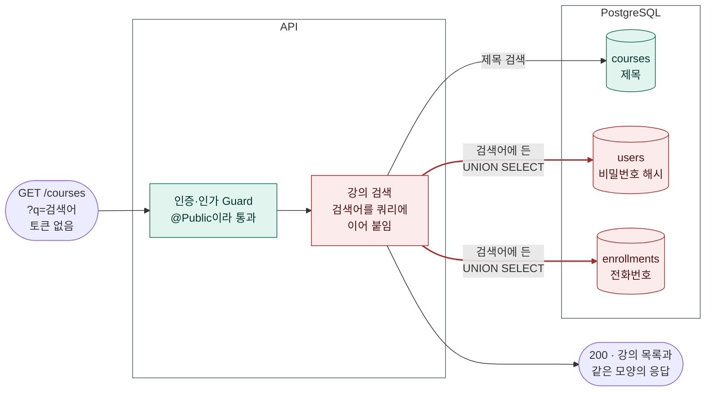
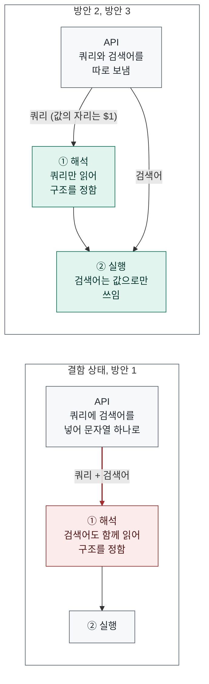
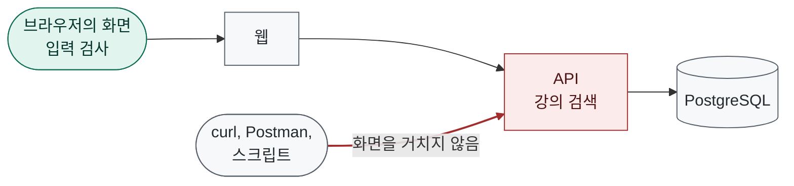

# 결함 6 진단 보고서: 강의 검색의 검색어가 쿼리로 실행됨

| 항목 | 내용 |
|---|---|
| 대상 | 이 저장소의 태그 `v2-defect-6`을 로컬에서 띄운 API (`http://127.0.0.1:4000`) |
| 경로 | `GET /courses?q=` (로그인 없이 열리는 경로) |
| 분류 | OWASP Top 10 2025 A05 Injection / CWE-89 (SQL 인젝션) |
| 위험도 | 높음 |
| 해당 구성 요소 | 객체. 시행 지점(PEP)은 강의 목록을 열어 준 것인데, 검색어가 쿼리를 바꿔 다른 객체(사용자, 신청)를 읽습니다 |
| 상태 | 확인됨. 조치 전 |

## 1. 요약

강의 검색이 검색어를 쿼리 문자열에 이어 붙여 실행합니다. 검색어에 작은따옴표를 넣으면 그 뒤의 글자가 값이 아니라 쿼리의 일부로 실행됩니다. 이 경로는 로그인 없이 열려 있어서, 토큰 없이 요청 한 번으로 사용자 테이블의 계정 이름과 비밀번호 해시, 신청 테이블의 전화번호를 읽을 수 있습니다.

위험도를 높음으로 본 근거입니다.

| | 근거 |
|---|---|
| 높이는 쪽 | 로그인이 필요 없습니다. 주소를 아는 누구나 보낼 수 있습니다 |
| 높이는 쪽 | 요청 한 번으로 테이블 전체가 나옵니다. 계정 5개의 비밀번호 해시와 신청 3건의 전화번호가 한 응답에 들어 있습니다 |
| 높이는 쪽 | 응답이 정상(200)이고 강의 목록과 같은 모양이라, 상태 코드만 봐서는 알 수 없습니다 |
| 높이는 쪽 | API가 DB에 접속하는 계정이 모든 테이블을 읽을 수 있습니다. 검색에 필요한 것은 `courses`뿐입니다 |
| 낮추는 쪽 | 비밀번호는 원문이 아니라 scrypt 해시입니다. 원문을 얻으려면 해시마다 따로 대입해야 합니다 |
| 낮추는 쪽 | 이 보고서가 확인한 것은 읽기입니다. 쓰기와 삭제는 확인하지 않았습니다 |

## 2. 재현 절차

준비:

```bash
git checkout v2-defect-6
docker compose up -d --wait
cd apps/api
cp .env.example .env
npm ci --ignore-scripts
npm run db:generate && npm run build
npm run db:migrate && npm run db:seed
npm start
```

요청 1 (기대한 동작: 제목에 "보안"이 든 강의):

```bash
curl -s -G --data-urlencode "q=보안" http://127.0.0.1:4000/courses
```

```json
[{"id":"c1","title":"웹 보안 입문"}]
```

요청 2 (작은따옴표 하나):

```bash
curl -s -G --data-urlencode "q='" http://127.0.0.1:4000/courses
```

```json
{"error":"internal_error"}
```

500입니다. 검색어의 따옴표가 쿼리의 문자열을 닫아서 문법 오류가 났습니다. 검색어가 값으로 다뤄졌다면 0건이 나와야 합니다.

요청 3 (조건을 항상 참으로):

```bash
curl -s -G --data-urlencode "q=없는 제목' OR '%'='" http://127.0.0.1:4000/courses
```

제목에 없는 말로 찾았는데 강의 2건이 모두 나옵니다.

요청 4 (사용자 테이블을 합침):

```bash
curl -s -G --data-urlencode "q=없는 제목' UNION SELECT username, \"passwordHash\" FROM users --" http://127.0.0.1:4000/courses
```

토큰 없이 200이고 5건입니다(해시는 이 문서에서 가렸습니다).

```json
[
  {"id":"student2","title":"scrypt$<가림>"},
  {"id":"admin1","title":"scrypt$<가림>"},
  {"id":"instructor1","title":"scrypt$<가림>"},
  {"id":"student1","title":"scrypt$<가림>"},
  {"id":"instructor2","title":"scrypt$<가림>"}
]
```

강의의 `id` 자리에 계정 이름이, `title` 자리에 비밀번호 해시가 들어 있습니다. `FROM enrollments`로 바꿔 `id, phone`을 고르면 신청 3건의 전화번호가 같은 방식으로 나옵니다.

재현 스크립트 (`main`의 스크립트를 결함 상태의 API에 실행):

```bash
node .github/scripts/defects/defect-6.mjs
```

```
결함 6: 강의 검색(GET /courses?q=)의 검색어 처리
대상: http://127.0.0.1:4000
- 검색어: 제목에 없는 말 (토큰 없음, 0건이 맞음)
    → 상태 200 · 0건
- 검색어: 작은따옴표 하나 (')
    → 상태 500 · 0건
- 검색어: 제목에 없는 말 + ' OR '%'='
    → 상태 200 · 2건 · 강의 2건
- 검색어: 제목에 없는 말 + UNION SELECT … FROM users
    → 상태 200 · 5건 · 사용자 테이블에서 온 행 5건(계정 이름과 비밀번호 해시)
- 검색어: 제목에 없는 말 + UNION SELECT … FROM enrollments
    → 상태 200 · 3건 · 신청 테이블에서 온 행 3건(신청 id와 전화번호)
판정: 취약
```

스크립트는 응답의 값을 출력하지 않고 건수만 셉니다. 기대한 동작은 다섯 요청 모두 200에 0건입니다. 다섯 검색어 모두 그대로 제목에 들어 있는 강의가 없기 때문입니다.

## 3. 원인

검색어가 쿼리 문자열 안에 들어간 뒤에 DB로 넘어갑니다. DB는 어디까지가 원래 쿼리이고 어디부터가 검색어인지 구분할 수 없습니다.



빨강은 검색어가 쿼리에 섞이는 곳과 그 쿼리가 읽는 테이블, 초록은 정상으로 동작하는 곳입니다. Guard는 강의 목록을 로그인 없이 열어 준 것이고, 그 판단은 맞습니다.

### 3.1 원인 코드

- 검색어 `q`를 템플릿 문자열로 쿼리에 넣고 `$queryRawUnsafe`로 실행합니다: [`courses/courses.service.ts` 17~21행](https://github.com/loquemedalagana/secure-enroll-demo/blob/v2-defect-6/apps/api/src/courses/courses.service.ts#L17-L21).
- 컨트롤러는 받은 `q`를 그대로 넘깁니다: [`courses/courses.controller.ts` 15행](https://github.com/loquemedalagana/secure-enroll-demo/blob/v2-defect-6/apps/api/src/courses/courses.controller.ts#L15).

### 3.2 검색어에 따라 실행되는 쿼리

코드가 만드는 쿼리는 `… WHERE title ILIKE '%` + 검색어 + `%' ORDER BY id ASC`입니다. 굵은 부분이 검색어입니다.

| 검색어 | 실행되는 쿼리의 조건 부분 | 결과 |
|---|---|---|
| `보안` | `title ILIKE '%`**`보안`**`%' ORDER BY …` | 기대한 동작 |
| `'` | `title ILIKE '%`**`'`**`%' ORDER BY …` | 문자열이 먼저 닫혀 문법 오류 (500) |
| `없는 제목' OR '%'='` | `title ILIKE '%`**`없는 제목' OR '%'='`**`%' ORDER BY …` | `'%'='%'`가 참이라 모든 강의 |
| `없는 제목' UNION SELECT username, "passwordHash" FROM users --` | `title ILIKE '%`**`없는 제목' UNION SELECT … FROM users --`**`%' ORDER BY …` | `--` 뒤는 주석이 되고, 사용자 테이블이 합쳐짐 |

### 3.3 이 결함을 처음 잡은 테스트

없습니다. 이 태그에서 API 테스트 94건이 모두 통과합니다. 검색 테스트 2건은 제목에 들어 있는 말, 없는 말, 빈 검색어만 보냅니다.

### 3.4 결함을 잡는 테스트

`apps/api/test/courses.test.mjs`에 "강의 검색 1~5"를 더했습니다. 테스트는 웹을 거치지 않고 띄워 놓은 API에 직접 요청하고, API는 실제 PostgreSQL에 연결되어 있습니다. DB를 흉내 내면 쿼리가 실제로 해석되지 않아서 이 결함이 드러나지 않습니다.


빨강은 검색어가 쿼리에 섞이는 곳과 그 쿼리가 읽는 테이블, 파랑은 테스트입니다.

| 테스트 | 보내는 검색어 | 개발 관점: 무엇을 확인하나 | 보안 관점: 무엇을 지키나 |
|---|---|---|---|
| 1 작은따옴표가 든 검색어도 오류 없이 200에 0건 | `'` | 특수문자가 든 검색어가 500을 내지 않는지 | 검색어가 쿼리의 문법을 깨지 못합니다. 오류 응답은 쿼리가 바뀐다는 것을 알려 주는 첫 신호입니다 |
| 2 검색어로 조건을 항상 참으로 만들 수 없음 | `없는 제목' OR '%'='` | 제목에 없는 말로 찾으면 0건인지 | 검색어가 조건을 바꾸지 못합니다 |
| 3 검색어로 사용자 테이블을 읽을 수 없음 | `… UNION SELECT … FROM users --` | 응답이 0건인지 | 객체의 범위. 계정 이름과 비밀번호 해시 |
| 4 검색어로 신청 테이블을 읽을 수 없음 | `… UNION SELECT … FROM enrollments --` | 응답이 0건인지 | 객체의 범위. 전화번호 |
| 5 어떤 검색어든 응답의 모든 행은 제목에 그 검색어가 든 강의 | 정상 검색어 1개와 위의 4개 | 검색 결과가 강의 목록을 제목으로 거른 것과 같은지 | 어떤 검색어가 와도 응답이 열어 준 범위(강의의 id와 제목) 안에 있습니다 |

테스트 1~4는 알려진 검색어를 하나씩 봅니다. 테스트 5는 검색어의 모양과 상관없이 지켜져야 하는 성질을 봅니다. 강의 전체 목록을 받아 제목에 검색어가 든 것만 고른 결과와 검색 응답이 같은지 비교합니다.

이 커밋에서 API 테스트는 99건 중 94건 통과, 5건 실패입니다.

```
✖ 강의 검색 1: 작은따옴표가 든 검색어도 오류 없이 200에 0건
✖ 강의 검색 2: 검색어로 조건을 항상 참으로 만들 수 없음
✖ 강의 검색 3: 검색어로 사용자 테이블을 읽을 수 없음
✖ 강의 검색 4: 검색어로 신청 테이블을 읽을 수 없음
✖ 강의 검색 5: 어떤 검색어든 응답의 모든 행은 제목에 그 검색어가 든 강의
```

테스트는 응답 전체를 비교하지 않고 상태 코드와 건수만 비교합니다. 응답 전체를 비교하면 실패할 때 비교한 값(비밀번호 해시, 전화번호)이 테스트 로그에 찍힙니다. DB의 내용을 바꾸는 검색어는 테스트에 넣지 않았습니다. 결함 상태에서 실제로 실행될 수 있고, 다른 테스트가 같은 DB를 씁니다.

### 3.5 보안 관점: 접근통제 구성 요소로 본 결함

| 구성 요소 | 이 결함에서 | 코드에서 확인하는 곳 |
|---|---|---|
| 주체 | 로그인하지 않은 요청 | |
| 객체 | 열어 준 것은 강의의 id와 제목입니다. **쿼리가 바뀌어 사용자와 신청까지 객체가 됩니다. 결함은 여기입니다** | [`courses/courses.service.ts` 17~21행](https://github.com/loquemedalagana/secure-enroll-demo/blob/v2-defect-6/apps/api/src/courses/courses.service.ts#L17-L21) |
| 시행 (PEP) | 정상. `@Public`이 붙은 핸들러라 통과시킵니다 | `auth/auth.guard.ts`, `authz/authz.guard.ts` |
| 판단 (PE) | 호출되지 않습니다. 공개 경로라 판단할 것이 없습니다 | `authz/policy.ts` |

결함 1과 2는 시행 지점이 요청을 막지 못한 경우였습니다. 결함 6에서는 시행 지점이 맞게 동작합니다. 시행 지점은 "어느 핸들러로 가는 요청인가"까지만 보고, 그 핸들러가 DB에서 무엇을 읽는지는 보지 않습니다. 신청 한 건 조회(`GET /enrollments/:id`)는 소유자, 담당 강사, 관리자만 통과하는데, 같은 전화번호가 공개 경로의 쿼리로 나옵니다.

## 4. 조치

### 4.1 조치 방안 비교

고칠 방법은 세 가지입니다.

- **방안 1 (따옴표 이스케이프)**: 검색어의 작은따옴표를 두 개로 바꾼 뒤 지금처럼 쿼리 문자열에 이어 붙입니다.
- **방안 2 (매개변수 쿼리)**: 쿼리에는 값이 들어갈 자리(`$1`)만 두고 검색어는 따로 넘깁니다. Prisma의 `$queryRaw` 태그 템플릿을 씁니다.
- **방안 3 (쿼리 빌더)**: 원시 쿼리를 쓰지 않고 Prisma의 `findMany`와 `contains`로 바꿉니다.

#### 방안마다 검색어가 거치는 단계

DB는 받은 쿼리를 두 단계로 처리합니다.

| 단계 | 하는 일 |
|---|---|
| ① 해석 | 받은 글자를 읽어 어디가 명령이고 어디가 값인지 구조를 정합니다 |
| ② 실행 | 정해진 구조대로 테이블을 읽습니다 |

SQL 인젝션은 ①에서 일어납니다. 검색어가 ①을 거치면서 값이 아니라 명령으로 읽히는 것입니다. 세 방안의 차이는 검색어가 ①을 거치는가입니다.



| 방안 | 검색어가 ①을 거치는가 | 안전한 이유 | 그 이유가 깨지는 경우 |
|---|---|---|---|
| 1 | 거칩니다 | 검색어의 `'`를 `''`로 바꿔서, DB가 해석할 때 문자열 안의 글자로 읽게 합니다 | DB가 문자열을 읽는 규칙이 다를 때, 값이 들어가는 자리 중 한 곳을 빠뜨렸을 때, 따옴표로 감싸지 않는 자리(숫자)일 때 |
| 2 | 거치지 않습니다 | DB가 `$1`이 든 쿼리만 해석해 구조를 먼저 정합니다. 검색어는 그 뒤에 값으로 들어갑니다 | 값이 들어가는 자리에 한해서는 없습니다 |
| 3 | 거치지 않습니다 | 방안 2와 같습니다. 쿼리는 Prisma가 만듭니다 | 방안 2와 같습니다 |

방안 2의 코드는 결함이 있는 코드와 비슷하게 생겼습니다. 차이는 괄호입니다.

```ts
this.prisma.$queryRawUnsafe(`… ILIKE '%${q}%' …`)  // 결함: 문자열이 먼저 완성된 뒤 함수로 넘어갑니다
this.prisma.$queryRaw`… ILIKE ${`%${q}%`} …`       // 방안 2: 쿼리 조각과 값이 따로 함수로 넘어갑니다
```

괄호 없이 템플릿을 붙여 쓰면 자바스크립트는 `${}` 안의 값을 문자열에 끼워 넣지 않고, 쿼리 조각들과 값들을 따로 함수에 넘깁니다. Prisma가 값의 자리를 `$1`로 바꿔 보냅니다. 값이 아닌 자리(테이블 이름, 정렬 방향)는 이 방식으로 넘길 수 없습니다.

#### 실제로 바꿔 본 결과

세 방안을 테스트를 더한 커밋의 코드에 각각 적용해 돌려 봤습니다. 이 변경들은 커밋하지 않았습니다. DB에 도착한 쿼리는 측정용 서버의 연결에만 `log_statement=all`을 켜서 PostgreSQL의 로그로 확인했습니다.

방안 1:

```diff
+    const escaped = q.replaceAll("'", "''");
     return this.prisma.$queryRawUnsafe<CourseView[]>(
-      `SELECT id, title FROM courses WHERE title ILIKE '%${q}%' ORDER BY id ASC`,
+      `SELECT id, title FROM courses WHERE title ILIKE '%${escaped}%' ORDER BY id ASC`,
     );
```

방안 2:

```diff
-    return this.prisma.$queryRawUnsafe<CourseView[]>(
-      `SELECT id, title FROM courses WHERE title ILIKE '%${q}%' ORDER BY id ASC`,
-    );
+    return this.prisma.$queryRaw<CourseView[]>`
+      SELECT id, title FROM courses WHERE title ILIKE ${`%${q}%`} ORDER BY id ASC`;
```

방안 3:

```diff
-    return this.prisma.$queryRawUnsafe<CourseView[]>(
-      `SELECT id, title FROM courses WHERE title ILIKE '%${q}%' ORDER BY id ASC`,
-    );
+    return this.prisma.course.findMany({
+      where: { title: { contains: q, mode: 'insensitive' } },
+      select: { id: true, title: true },
+      orderBy: { id: 'asc' },
+    });
```

| 확인 | 결함 상태 | 방안 1 | 방안 2 | 방안 3 |
|---|---|---|---|---|
| API 테스트 99건 | 5건 실패 | 모두 통과 | 모두 통과 | 모두 통과 |
| 재현 스크립트 판정 | 취약 | 차단 | 차단 | 차단 |
| 검색어가 DB로 가는 방식 | 쿼리 문자열 안 | **쿼리 문자열 안** | 매개변수 `$1` | 매개변수 `$1` |
| DB 설정 `standard_conforming_strings=off`에서 `\' UNION SELECT … FROM users --` | (재지 않음) | **사용자 테이블 5건** | 0건 | (재지 않음) |

`UNION SELECT … FROM users`가 든 검색어를 보냈을 때 PostgreSQL 로그에 남은 줄입니다.

```
결함     statement: SELECT id, title FROM courses WHERE title ILIKE '%없는 제목' UNION SELECT username, "passwordHash" FROM users --%' ORDER BY id ASC
방안 1   statement: SELECT id, title FROM courses WHERE title ILIKE '%없는 제목'' UNION SELECT username, "passwordHash" FROM users --%' ORDER BY id ASC
방안 2   execute <unnamed>: SELECT id, title FROM courses WHERE title ILIKE $1 ORDER BY id ASC
         Parameters: $1 = '%없는 제목'' UNION SELECT username, "passwordHash" FROM users --%'
방안 3   execute <unnamed>: SELECT "public"."courses"."id", "public"."courses"."title" FROM "public"."courses" WHERE "public"."courses"."title" ILIKE ('%' || $1 || '%') ORDER BY "public"."courses"."id" ASC OFFSET $2
         Parameters: $1 = '없는 제목'' UNION SELECT username, "passwordHash" FROM users --', $2 = '0'
```

이 표에서 볼 것은 세 가지입니다.

- 방안 1도 이 저장소의 설정에서는 결함을 고칩니다. 테스트 99건을 통과하고 재현 스크립트의 판정이 차단입니다.
- 방안 1에서는 검색어가 여전히 쿼리 문자열 안에 있습니다. 로그의 `statement:`는 쿼리를 문자열 하나로 보냈다는 뜻입니다. 방안 2와 3의 `execute`와 `Parameters:`는 쿼리와 값을 따로 보냈다는 뜻입니다. DB가 쿼리를 해석할 때 검색어는 그 안에 없습니다.
- 방안 1이 안전한지는 DB가 문자열을 읽는 규칙에 달려 있습니다. 측정용 연결에서 `standard_conforming_strings`를 `off`로 바꾸면 역슬래시가 이스케이프 문자가 되어, `\'`의 따옴표가 문자열 안의 글자로 읽히고 코드가 덧붙인 따옴표가 문자열을 닫습니다. 같은 코드에서 사용자 테이블 5건이 다시 나왔습니다. 이 설정의 기본값은 `on`이고 이 저장소의 DB(PostgreSQL 18.7)도 `on`입니다. 방안 2는 같은 설정에서 0건입니다.

세 방안에서 똑같이 남는 것도 쟀습니다. 인젝션이 아니라 입력 처리에 해당하는 것들입니다.

| 검색어 | 결함 상태 | 방안 1 | 방안 2 | 방안 3 |
|---|---|---|---|---|
| `%` | 200, 2건 | 200, 2건 | 200, 2건 | 200, 2건 |
| `_` | 200, 2건 | 200, 2건 | 200, 2건 | 200, 2건 |
| 널 바이트 (`%00`) | 500 | 500 | 500 | 500 |
| `q`를 두 번 (`?q=보안&q=실습`) | 200, 0건 | 200, 0건 | 200, 0건 | 200, 0건 |

`%`와 `_`는 `LIKE`의 와일드카드라서 모든 강의가 나옵니다. 방안 3의 `contains`도 이 글자를 그대로 넘깁니다. 널 바이트는 PostgreSQL이 문자열로 받지 않아 오류가 납니다. `q`를 두 번 보내면 두 값이 쉼표로 이어진 문자열 하나(`보안,실습`)로 검색됩니다.

#### 비교

| 기준 | 방안 1 (따옴표 이스케이프) | 방안 2 (매개변수 쿼리) | 방안 3 (쿼리 빌더) |
|---|---|---|---|
| 바꾸는 양 | 2줄 | 3줄 | 5줄 |
| 쿼리와 검색어 | 한 문자열로 섞여서 갑니다 | 따로 갑니다 | 따로 갑니다 |
| 안전한 근거 | 따옴표를 빠짐없이 바꿨다는 것과 DB의 문자열 규칙 | DB가 쿼리를 해석할 때 검색어가 없습니다 | 방안 2와 같음 |
| DB 설정이 바뀌면 | 다시 뚫릴 수 있습니다 (위에서 확인) | 영향 없음 (위에서 확인) | 재지 않음 |
| SQL을 직접 쓰는가 | 씁니다 | 씁니다 | 쓰지 않습니다 |
| 실행되는 쿼리 | 코드에 적힌 그대로 | 코드에 적힌 그대로 | Prisma가 만듭니다 (`OFFSET $2`가 붙음) |
| 같은 실수가 다시 들어올 자리 | `$queryRawUnsafe`가 남습니다 | `$queryRawUnsafe`가 없어집니다. 원시 쿼리는 남습니다 | 원시 쿼리가 없어집니다 |

**고른 것**: 정하기 전.

**채택하지 않은 대안 (화면에서 입력을 막기)**: 검색 화면에서 따옴표를 입력하지 못하게 하는 방법입니다. API에 요청이 들어오는 경로는 화면을 거치는 것 하나가 아닙니다.



화면의 검사는 화면을 쓰는 요청에만 적용됩니다. 2절의 재현 요청은 모두 화면 없이 API로 직접 보낸 것입니다. 지금은 웹에 검색 화면이 없어서 경로가 아래쪽 하나뿐이고, 화면이 생겨도 아래쪽 경로는 그대로 남습니다. 화면의 검사는 잘못 입력한 것을 일찍 알려 주는 용도로 둘 수 있지만 조치는 API에 있어야 합니다.

**채택하지 않은 대안 (검색어에서 글자나 단어를 걸러 내기)**: `'`, `--`, `UNION` 같은 것이 들면 거부하는 방법입니다. 제목에 따옴표가 든 강의를 찾을 수 없게 되고, 걸러 낼 목록에 빠진 표현이 있으면 그대로 통과합니다. 쿼리와 값이 섞이는 원인은 그대로입니다.

**이 PR에서 하지 않는 것 (DB 계정의 권한 줄이기)**: API가 DB에 접속하는 계정은 모든 테이블을 읽을 수 있습니다. 검색에 필요한 것은 `courses`뿐이지만 같은 계정으로 로그인과 신청 조회도 하므로, 권한을 줄이려면 계정을 나눠야 합니다. 인젝션을 막는 조치는 아니고, 뚫렸을 때 읽히는 범위를 줄이는 장치입니다.

## 5. 조치 뒤 재확인

작성 전.

## 6. Burp Suite 진단 기록

작성 전.
