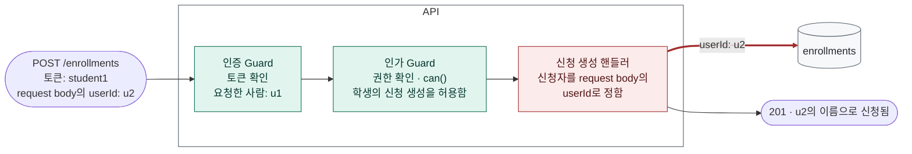
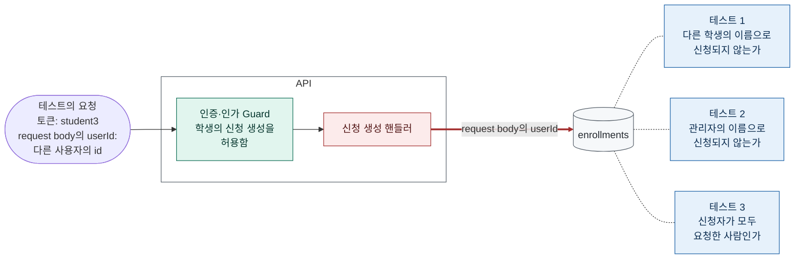
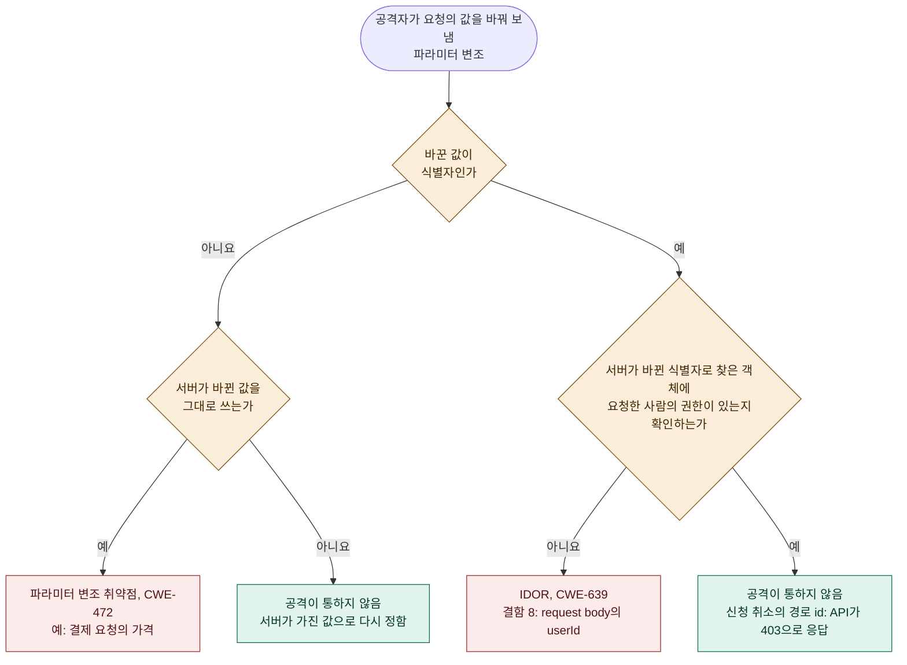
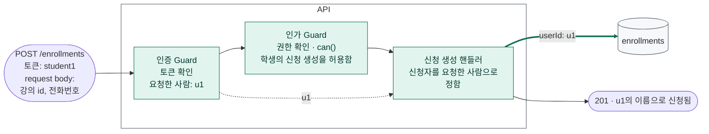

# 결함 8 진단 보고서: 신청 생성의 IDOR (request body의 사용자 id를 신뢰)

| 항목 | 내용 |
|---|---|
| 대상 | 태그 `v2-defect-8`의 코드로 로컬에서 띄운 API (`http://127.0.0.1:4000`) |
| 경로 | `POST /enrollments` (학생의 토큰이 필요한 경로) |
| 분류 | OWASP Top 10 2025 A01 Broken Access Control / CWE-639 (사용자가 제어하는 키를 통한 인가 우회). IDOR(Insecure Direct Object Reference)라고 부르는 유형입니다 |
| 위험도 | 높음 |
| 해당 구성 요소 | 객체의 속성(소유자, 여기서는 신청자). 시행 지점(PEP)과 판단(PE)은 정상으로 동작합니다. 판단이 끝난 뒤 핸들러가 저장할 값을 클라이언트가 보낸 request body에서 읽습니다 |
| 상태 | 조치 완료 (`v2-fix-8`) |

## 1. 요약

API는 신청을 받을 때 신청자를 request body의 `userId` 필드로 정합니다. 서버가 요청에 담긴 식별자를 토큰의 사용자와 비교하지 않고 그대로 쓰므로, 이 취약점은 IDOR입니다. v1의 결함 2(신청 조회에서 소유자를 확인하지 않음)는 신청을 조회할 때의 IDOR였고, 이 결함은 신청할 때의 IDOR입니다. 로그인한 학생이 request body의 `userId`만 바꾸면 다른 사용자의 이름으로 신청할 수 있습니다. 인증 Guard와 인가 Guard는 이 요청을 통과시킵니다. 토큰이 유효하고, 학생에게는 신청할 권한이 있기 때문입니다.

위험도를 높음으로 본 근거입니다.

| | 근거 |
|---|---|
| 높이는 쪽 | 공격자에게 필요한 것은 학생 계정 하나입니다. 공격자는 request body의 `userId` 필드 하나만 바꿔 보냅니다 |
| 높이는 쪽 | 대상에 제한이 없습니다. 다른 학생뿐 아니라 강사와 관리자의 id로도 신청됩니다 |
| 높이는 쪽 | 한 사용자는 같은 강의를 한 번만 신청할 수 있습니다. 그런데 공격자는 request body의 `userId`에 다른 사용자의 id를 하나씩 넣는 방식으로 한 강의에 여러 번 신청해서, 그 강의의 정원을 의도적으로 채울 수 있습니다. 정원이 찬 뒤에는 API가 이 강의를 신청하는 요청에 409로 응답하므로, 다른 학생은 이 강의를 신청할 수 없습니다 |
| 높이는 쪽 | 요청한 사람은 이 신청을 취소할 수 없습니다. 신청은 본인과 관리자만 취소할 수 있어서, 이름이 도용된 사람(피해자)이나 관리자가 취소해야 합니다 |
| 높이는 쪽 | 서버에는 요청한 사람(토큰의 사용자)과 신청자가 다르다는 기록이 남지 않습니다. 요청 로그의 `uid`는 요청한 사람이고, 신청에는 request body의 값만 남습니다 |
| 낮추는 쪽 | 로그인하지 않은 사람은 이 취약점을 이용할 수 없습니다. API가 토큰 없는 요청에 401로 응답하기 때문입니다 |
| 낮추는 쪽 | 공격자는 이 취약점으로 다른 사용자의 정보를 조회할 수 없습니다. 응답에는 요청한 사람이 보낸 값만 들어 있습니다 |
| 낮추는 쪽 | 피해자는 신청 목록에서 그 신청을 확인하고 직접 취소할 수 있습니다 |

## 2. 재현 절차

준비:

```bash
git checkout v2-defect-8
docker compose up -d --wait
cd apps/api
cp .env.example .env
npm ci --ignore-scripts
npm run db:generate && npm run build
npm run db:migrate && npm run db:seed
npm start
```

요청 1 (`student1`로 로그인):

```bash
curl -s -X POST -H 'content-type: application/json' \
  -d '{"username":"student1","password":"student1-pass"}' \
  http://127.0.0.1:4000/auth/login
```

요청 2 (`student1`의 토큰으로, request body의 `userId`는 `student2`의 id인 `u2`):

```bash
curl -s -X POST -H 'authorization: Bearer <student1의 토큰>' -H 'content-type: application/json' \
  -d '{"userId":"u2","courseId":"c4","phone":"010-0000-0009"}' \
  http://127.0.0.1:4000/enrollments
```

API는 201로 응답합니다. 응답의 `userId`가 `u2`입니다.

```json
{"id":"<새 id>","userId":"u2","courseId":"c4","phone":"010-0000-0009"}
```

`student2`로 로그인해 `GET /enrollments`를 요청하면, `student2`가 신청하지 않은 강의 `c4`가 목록에 있습니다. `student1`의 목록에는 없습니다.

재현 스크립트 (`main`의 스크립트를 결함 상태의 API에 실행):

```bash
node .github/scripts/defects/defect-8.mjs
```

```
결함 8: 신청 생성(POST /enrollments)의 신청자
대상: http://127.0.0.1:4000
- POST /enrollments (student1의 토큰, request body의 userId: u2)
    → 상태 201 · u2의 이름으로 신청됨
- POST /enrollments (student1의 토큰, request body의 userId: a1, 관리자의 id)
    → 상태 201 · a1의 이름으로 신청됨
- GET /enrollments (student2의 토큰) 요청 전과 후
    → 2건 → 3건
판정: 취약
```

스크립트는 끝나기 전에 재현하면서 생긴 신청을 관리자 계정(`admin1`)으로 취소합니다. 신청은 본인과 관리자만 취소할 수 있는데, 이 신청들은 요청을 보낸 `student1`의 신청이 아니기 때문입니다. 결함이 없다면 두 요청 뒤에도 다른 사용자 이름의 신청은 없고, `student2`의 목록은 2건 그대로여야 합니다.

## 3. 원인

인증 Guard는 토큰을 검증하고 `req.user = user`를 실행합니다([`auth/auth.guard.ts` 24~27행](https://github.com/loquemedalagana/secure-enroll-demo/blob/v2-defect-8/apps/api/src/auth/auth.guard.ts#L24-L27)). 그런데 신청 생성 핸들러는 신청자를 `req.user`가 아니라 request body의 `userId` 필드로 정합니다.



- 빨간색 상자는 request body의 `userId`를 신청자로 쓰는 신청 생성 핸들러를 나타냅니다.
- 빨간색 화살표는 request body의 `userId`가 `enrollments` 테이블에 저장되는 흐름을 나타냅니다.
- 초록색 상자는 정상으로 동작하는 인증 Guard와 인가 Guard를 나타냅니다.

### 3.1 원인 코드

- request body의 형식(DTO)에 `userId` 필드가 있습니다: [`enrollments/create-enrollment.dto.ts` 5~8행](https://github.com/loquemedalagana/secure-enroll-demo/blob/v2-defect-8/apps/api/src/enrollments/create-enrollment.dto.ts#L5-L8).
- 핸들러는 24행에서 `this.enrollments.create(body.userId, body.courseId, body.phone)`을 호출합니다: [`enrollments/enrollments.controller.ts` 23~25행](https://github.com/loquemedalagana/secure-enroll-demo/blob/v2-defect-8/apps/api/src/enrollments/enrollments.controller.ts#L23-L25). 23행의 선언은 `create(@Body() body: CreateEnrollmentDto)`이고, 토큰의 사용자를 받는 `@CurrentUser()`가 없습니다.
- 서비스는 39행에서 `tx.enrollment.create({ data: { userId, courseId, phone }, select: VIEW })`를 실행해, 받은 `userId`를 그대로 저장합니다: [`enrollments/enrollments.service.ts` 39행](https://github.com/loquemedalagana/secure-enroll-demo/blob/v2-defect-8/apps/api/src/enrollments/enrollments.service.ts#L39).

### 3.2 값이 어디에서 오는가

| 값 | 어디에서 오는가 | 누가 검증하는가 | 어디에 쓰이는가 |
|---|---|---|---|
| 요청한 사람 (`u1`) | 토큰 | 인증 Guard가 서명과 만료를 확인하고 DB에서 사용자를 읽음 | 인가 판단, 요청 로그의 `uid` |
| 신청자 (`u2`) | request body의 `userId` | 입력값 검증이 형식(`@IsString()`, `@Length(1, 64)`)만 확인함. 토큰의 사용자와 같은지는 확인하지 않음 | **저장되는 신청의 `userId`** |

결함 상태의 코드에는 두 값을 비교하는 식이 없습니다. 신청 조회와 신청 취소에서는 인가 Guard가 DB에서 신청의 `userId`를 읽어 `resource.ownerId`로 `can()`에 넘깁니다([`authz/authz.guard.ts` 40~50행](https://github.com/loquemedalagana/secure-enroll-demo/blob/v2-defect-8/apps/api/src/authz/authz.guard.ts#L40-L50)). 신청 생성에서는 DB에 신청이 아직 없어서 인가 Guard가 `resource` 없이 `can()`을 호출하고, `can()`은 `user.role === 'student'`이면 허용합니다([`authz/policy.ts` 40~42행](https://github.com/loquemedalagana/secure-enroll-demo/blob/v2-defect-8/apps/api/src/authz/policy.ts#L40-L42)).

### 3.3 이 결함을 처음 잡은 테스트

이 결함을 처음 잡은 테스트는 없습니다. 결함 태그(`v2-defect-8`)의 코드에서 API 테스트 128건이 모두 통과합니다. 신청 생성 테스트는 모두 request body의 `userId`에 요청한 사람 본인의 id를 넣어 보냅니다.

### 3.4 결함을 잡는 테스트

`apps/api/test/enrollments-write.test.mjs`에 "신청 생성 1~3"을 추가했습니다. 세 테스트는 토큰의 사용자와 request body의 `userId`가 다른 요청을 보냅니다. 그리고 응답이 아니라 DB의 `enrollments` 테이블을 직접 조회해 신청자를 확인합니다.



- 빨간색 상자는 request body의 `userId`를 신청자로 쓰는 신청 생성 핸들러를 나타냅니다.
- 빨간색 화살표는 request body의 `userId`가 `enrollments` 테이블에 저장되는 흐름을 나타냅니다.
- 초록색 상자는 정상으로 동작하는 인증 Guard와 인가 Guard를 나타냅니다.
- 파란색 상자는 테스트를 나타냅니다.

| 테스트 | 보내는 요청 | 개발 관점: 무엇을 확인하나 | 보안 관점: 무엇을 지키나 |
|---|---|---|---|
| 1 다른 학생의 id를 request body에 넣어도 그 학생의 이름으로 신청되지 않음 | `student3`의 토큰, request body `userId: u4` | DB에 신청자가 `u4`인 신청이 0건인지. API가 201이 아닌 상태 코드로 응답하는지도 확인합니다 | 객체의 속성(소유자). 학생이 다른 학생의 이름으로 신청할 수 없는가 |
| 2 관리자의 id를 request body에 넣어도 관리자의 이름으로 신청되지 않음 | `student3`의 토큰, request body `userId: a1` | DB에 신청자가 `a1`인 신청이 0건인지. API가 201이 아닌 상태 코드로 응답하는지도 확인합니다 | 객체의 속성(소유자). 학생이 관리자의 이름으로 신청할 수 없는가 |
| 3 request body의 userId가 무엇이든 신청자는 요청한 사람 | `student3`의 토큰, request body의 `userId`를 `u3`, `u4`, `u5`, `i1`, `a1`로 바꿔 5번 요청 | DB에 새로 저장된 신청 중 신청자가 `u3`이 아닌 신청이 0건인지 | 객체의 속성(소유자). request body의 `userId`가 어떤 값이어도 신청자가 요청한 사람인가 |

테스트는 API가 요청을 거부하는 방식을 정하지 않습니다. 상태 코드는 201이 아닌지만 확인합니다. API가 request body의 `userId`를 토큰의 사용자와 비교해 403으로 응답하게 고칠 수도 있고, request body에서 `userId`를 없애 400으로 응답하게 고칠 수도 있습니다. 어느 방안으로 고칠지는 4.1절에서 방안을 하나씩 적용해 본 뒤에 정합니다.

테스트를 추가한 커밋([`5af414d`](https://github.com/loquemedalagana/secure-enroll-demo/commit/5af414d))에서 API 테스트는 131건 중 128건이 통과하고 3건이 실패합니다. 아래 출력에 있는 테스트 이름은 변경 전의 이름입니다.

```
✖ 신청 생성 1: 다른 학생의 id를 request body에 넣어도 그 학생의 신청이 생성되지 않음
    student4(u4)의 이름으로 생성된 신청의 건수
    1 !== 0
✖ 신청 생성 2: 관리자의 id를 request body에 넣어도 관리자의 신청이 생성되지 않음
    admin1(a1)의 이름으로 생성된 신청의 건수
    1 !== 0
✖ 신청 생성 3: request body의 userId가 무엇이든 생성된 신청의 소유자는 요청한 사람
    요청한 사람(u3)이 아닌 사용자의 이름으로 생성된 신청의 건수
    4 !== 0
```

위 출력의 테스트 이름은 지금의 테스트 이름과 다릅니다. 테스트 이름은 이 커밋 뒤에 고쳤습니다.

테스트 3에서 5번 보낸 요청 중 4건이 다른 사용자의 이름으로 신청됐습니다. 테스트는 끝날 때 새로 생긴 신청을 모두 삭제합니다.

### 3.5 보안 관점: 접근통제 구성 요소로 본 결함

| 구성 요소 | 이 결함에서 | 코드에서 확인하는 곳 |
|---|---|---|
| 주체 | 정상으로 동작합니다. 인증 Guard가 토큰을 검증하고 `req.user = user`를 실행합니다 | [`auth/auth.guard.ts` 24~27행](https://github.com/loquemedalagana/secure-enroll-demo/blob/v2-defect-8/apps/api/src/auth/auth.guard.ts#L24-L27) |
| 시행 (PEP) | 정상으로 동작합니다. API는 토큰 없는 요청에 401로, 학생이 아닌 사용자의 요청에 403으로 응답합니다 | [`auth/auth.guard.ts` 25행](https://github.com/loquemedalagana/secure-enroll-demo/blob/v2-defect-8/apps/api/src/auth/auth.guard.ts#L25), [`authz/authz.guard.ts` 62행](https://github.com/loquemedalagana/secure-enroll-demo/blob/v2-defect-8/apps/api/src/authz/authz.guard.ts#L62) |
| 판단 (PE) | 정상으로 동작합니다. `can()`은 `enrollment:create`를 `user.role === 'student'`일 때 허용합니다. 인가 Guard는 이 경로에서 `resource` 없이 `can()`을 호출하므로, `can()`은 신청자가 누구인지 비교하지 않습니다 | [`authz/policy.ts` 40~42행](https://github.com/loquemedalagana/secure-enroll-demo/blob/v2-defect-8/apps/api/src/authz/policy.ts#L40-L42) |
| 객체의 속성 (소유자) | **핸들러가 이 값을 클라이언트가 보낸 request body에서 읽습니다. 이 부분이 결함이고, 그 결과 다른 사용자의 이름으로 신청할 수 있는 취약점(IDOR)이 생깁니다** | [`enrollments/enrollments.controller.ts` 23~25행](https://github.com/loquemedalagana/secure-enroll-demo/blob/v2-defect-8/apps/api/src/enrollments/enrollments.controller.ts#L23-L25) |

결함 1과 2에서는 API가 토큰을 확인하지 않고 응답했습니다. 결함 6에서는 시행 지점(PEP)이 공개 경로인 강의 목록 요청을 통과시켰고, 검색어가 SQL 문자열을 바꿔 강의가 아닌 객체(사용자, 신청)를 읽었습니다. 결함 8에서는 시행과 판단이 모두 정상으로 동작합니다. 판단이 끝난 뒤에 핸들러가 신청자를 판단에 쓴 주체(`req.user`)가 아니라 request body의 `userId`로 정합니다.

제로 트러스트의 원칙으로 보면, 결함 상태의 API는 주체를 요청마다 검증하지만, request body의 `userId`는 토큰의 사용자와 같은지 확인하지 않고 신뢰합니다.

### 3.6 파라미터 변조와의 차이

이 결함을 재현하는 요청에서 학생은 request body의 `userId` 필드를 다른 사용자의 id로 바꿔 보냅니다. 클라이언트가 보내는 값을 바꿔 보내는 공격을 파라미터 변조(parameter tampering)라고 하고, 서버가 바뀐 값을 확인하지 않고 그대로 써서 공격이 통하는 상태를 파라미터 변조 취약점(CWE-472)이라고 부릅니다. 같은 파라미터 변조라도 공격자가 바꾼 값이 식별자이고, 서버가 그 식별자로 찾은 객체에 대해 인가하지 않으면 분류는 IDOR(CWE-639)입니다.

| | 파라미터 변조 취약점 (CWE-472) | IDOR (CWE-639) |
|---|---|---|
| 공격자가 바꾸는 값 | 클라이언트가 변경하지 않는다고 서버가 가정한 값. 예: 가격, 수량, 역할, hidden 필드, 쿠키 | 객체나 사용자의 식별자(id) |
| 결함 | 서버가 클라이언트가 보낸 값을 확인하지 않고 그대로 씁니다 | 서버가 요청에 담긴 식별자로 찾은 객체에 대해 인가하지 않습니다 |
| 조치 | 서버가 가진 값으로 다시 정합니다. 예를 들어 서버가 가격을 DB에서 읽습니다 | 서버가 소유자를 확인하거나, 식별자를 요청에서 받지 않습니다 |

두 취약점에서 공격자가 보내는 요청은 같은 꼴입니다. 어느 쪽이든 공격자는 요청의 값을 바꿔 보냅니다. 그래서 요청만으로는 둘을 구분할 수 없고, 공격자가 바꾼 값이 식별자인지와 서버가 그 식별자로 인가하는지를 확인해야 합니다. 결제 요청의 가격을 바꾸는 공격은 파라미터 변조지만 IDOR은 아닙니다. 가격에는 서버가 확인할 소유자가 없기 때문입니다.

결함 8에서 공격자가 바꾸는 값은 사용자 id입니다. 핸들러는 이 id를 토큰의 사용자와 비교하지 않고 신청자로 저장합니다. 그래서 분류를 IDOR(CWE-639)로 적었고, 4.1절의 조치 방안도 식별자를 다루는 방식으로 비교했습니다.

신청 취소(`DELETE /enrollments/:id`)에서 경로의 id를 다른 학생의 신청 id로 바꾸는 요청도 파라미터 변조입니다. API는 이 요청에 403으로 응답합니다. 인가 Guard가 DB에 저장된 소유자를 읽어 PE에 넘기기 때문입니다. `apps/api/test/enrollments-write.test.mjs`의 "신청 취소: 다른 학생의 신청은 403이고 삭제되지 않음" 테스트가 이것을 확인합니다.



- 빨간색 상자는 공격이 통해 취약점이 생기는 결과를 나타냅니다.
- 초록색 상자는 서버가 공격이 통하지 않게 처리하는 결과를 나타냅니다. 서버를 지키는 쪽에서 본 색이라서 공격이 통하지 않는 쪽이 초록색입니다.
- 노란색 상자는 서버가 확인하는 단계를 나타냅니다.

## 4. 조치

### 4.1 조치 방안 비교

고칠 방법은 세 가지입니다.

- **방안 1 (핸들러에서 비교)**: 핸들러가 request body의 `userId`를 토큰의 사용자와 비교하고, 다르면 403으로 거부합니다.
- **방안 2 (request body에서 제거)**: request body에서 `userId`를 없애고 신청자를 토큰에서만 읽습니다.
- **방안 3 (PE가 판단)**: 인가 Guard가 request body의 `userId`를 객체의 속성(소유자)으로 PE에 넘기고, `can()`이 주체와 같은지 판단합니다.

#### 실제로 바꿔 본 결과

결함을 잡는 테스트를 추가한 뒤의 코드에 세 방안을 하나씩 적용했습니다. 방안을 하나 적용할 때마다 API 테스트와 재현 스크립트를 실행했습니다. 세 방안의 변경은 커밋하지 않았습니다.

방안 1:

```diff
-  create(@Body() body: CreateEnrollmentDto): Promise<EnrollmentView> {
+  create(@CurrentUser() user: AuthUser, @Body() body: CreateEnrollmentDto): Promise<EnrollmentView> {
+    if (body.userId !== user.id) throw new ForbiddenException();
     return this.enrollments.create(body.userId, body.courseId, body.phone);
   }
```

방안 2:

```diff
 // enrollments/create-enrollment.dto.ts
-  // 신청하는 사용자의 id
-  @IsString()
-  @Length(1, 64)
-  userId!: string;

 // enrollments/enrollments.controller.ts
-  create(@Body() body: CreateEnrollmentDto): Promise<EnrollmentView> {
-    return this.enrollments.create(body.userId, body.courseId, body.phone);
+  create(@CurrentUser() user: AuthUser, @Body() body: CreateEnrollmentDto): Promise<EnrollmentView> {
+    return this.enrollments.create(user.id, body.courseId, body.phone);
   }
```

방안 3:

```diff
 // enrollments/enrollments.controller.ts
-  @Authorize('enrollment:create')
+  @Authorize('enrollment:create', { resource: 'new-enrollment' })

 // authz/authz.guard.ts
+    if (rule.resource === 'new-enrollment') {
+      const owner = (req.body as { userId?: unknown } | undefined)?.userId;
+      resource = typeof owner === 'string' ? { ownerId: owner, instructorId: '' } : undefined;
+    }

 // authz/policy.ts
     case 'enrollment:create':
-      return user.role === 'student';
+      if (!resource) return false;
+      return user.role === 'student' && resource.ownerId === user.id;
```

| 확인 | 결함 상태 | 방안 1 | 방안 2 | 방안 3 |
|---|---|---|---|---|
| 재현 스크립트 판정 | 취약 | 차단 | 차단 | 차단 |
| 결함을 잡는 테스트 3건 | 3건 실패 | 통과 | 통과 | 통과 |
| API 테스트 131건, 테스트를 고치지 않고 | 3건 실패 | 모두 통과 | 8건 실패 | 2건 실패 |
| 같은 131건, 바뀐 request body 형식에 맞춰 테스트를 고친 뒤 | | | 모두 통과 | 1건 실패 (테스트 "형식이 잘못된 request body는 400") |
| 다른 사용자의 id를 넣은 요청의 응답 | 201 | 403 | 400 | 403 |
| 그 요청이 요청 로그에 남는 모양 | `status` 201, `allowed` true | `status` 403, **`allowed` true** | `status` 400, `allowed` true | `status` 403, `allowed` false |
| 수정 뒤에 request body의 `userId`를 읽는 코드 | 2곳 | 2곳 | **없음** | 3곳 |
| 호출하는 쪽이 request body에 넣는 것 | 본인의 id | 본인의 id | 넣지 않음 (넣으면 400) | 본인의 id |

아래 표는 `student3`의 토큰으로 request body의 `userId`를 바꿔 보낸 요청에 API가 응답한 상태 코드입니다. API가 신청을 저장한 요청에는 그 신청의 신청자를 괄호 안에 적었습니다.

| request body의 `userId` | 결함 상태 | 방안 1 | 방안 2 | 방안 3 |
|---|---|---|---|---|
| 본인의 id (`u3`) | 201 (u3) | 201 (u3) | 400 | 201 (u3) |
| 다른 학생 (`u4`) | **201 (u4)** | 403 | 400 | 403 |
| 없음 | 400 | 400 | 201 (u3) | 403 |
| 배열 `["u4"]` | 400 | 400 | 400 | 403 |
| 숫자 `4` | 400 | 400 | 400 | 403 |
| 객체 `{"id":"u4"}` | 400 | 400 | 400 | 403 |
| 대문자 `U4` | 500 | 403 | 400 | 403 |
| 뒤에 공백 `"u4 "` | 500 | 403 | 400 | 403 |
| 같은 키를 두 번, `u3` 다음 `u4` | **201 (u4)** | 403 | 400 | 403 |
| 같은 키를 두 번, `u4` 다음 `u3` | 201 (u3) | 201 (u3) | 400 | 201 (u3) |

이 표에서 확인할 것은 다섯 가지입니다.

- 세 방안 모두 결함을 고칩니다. 어느 방안을 적용해도 다른 사용자의 이름으로는 신청할 수 없었습니다. `userId`의 형식을 바꿔 보내도(배열, 숫자, 객체, 대소문자, 공백, 같은 키를 두 번) 결과는 같았습니다.
- 방안 1에서는 요청 로그에 `allowed`가 true인 403이 남습니다. PE는 학생의 신청 생성(`enrollment:create`)을 허용했고, 요청을 거부한 것은 핸들러이기 때문입니다. 방안 1에서는 판단을 PE와 핸들러 두 곳에서 합니다. 요청 로그에서 `allowed`가 false인 줄만 검색하면 핸들러가 거부한 이 요청을 찾을 수 없습니다.
- 방안 2에서는 request body의 `userId`를 읽는 코드가 남지 않습니다. 방안 1과 3에서는 DTO가 `userId`를 계속 받고, 저장할 때도 request body의 값을 씁니다. 방안 1과 방안 3의 차이는 같은 DTO를 쓰는 경로를 추가할 때 나타납니다. 방안 1에서는 추가한 핸들러에 `if (body.userId !== user.id) throw new ForbiddenException();`을 적지 않으면 그 경로에 같은 취약점이 생깁니다. 방안 3에서는 추가한 핸들러에 `@Authorize('enrollment:create')`만 붙이고 객체 선언(`@Authorize`의 `resource`)을 적지 않으면, `can()`이 `if (!resource) return false;`로 거부해서 API가 403으로 응답합니다.
- 방안 2에서는 API가 다른 사용자의 id를 넣은 요청에 400으로 응답합니다. 이 요청은 요청 로그에 `status` 400, `allowed` true로 남아서, 형식이 잘못된 다른 요청과 구분되지 않습니다. 방안 3에서는 `allowed` false로 남습니다.
- 방안 3에서는 인가 Guard가 입력값 검증보다 먼저 실행됩니다. API는 request body가 비어 있거나 형식이 잘못된 요청에 400이 아니라 403으로 응답합니다. 테스트 "형식이 잘못된 request body는 400"이 이 때문에 실패합니다. 이 테스트의 기댓값 400은 인가 Guard가 request body를 읽지 않던 때의 동작에 맞춘 값이므로, 방안 3을 고른다면 403으로 고치면 됩니다. 이 실패는 테스트의 기댓값이 달라져서 생긴 것이고, 방안 3이 잘못 동작해서 생긴 것이 아닙니다. 방안 3에서 인가 Guard는 입력값 검증을 거치지 않은 request body를 읽습니다. `userId`가 문자열이 아니면 Guard는 `resource`를 `undefined`로 두고, `can()`은 `false`를 반환합니다. 위 표에서 배열, 숫자, 객체를 넣은 요청에 API는 모두 403으로 응답했습니다.

결함 상태에서는 `userId` 필드에 `U4`나 `"u4 "`를 넣어 보내면 API가 500으로 응답합니다. API가 존재하지 않는 사용자 id를 저장하려다 외래 키 제약 조건(참조 무결성)에 걸리기 때문입니다. 이 오류는 request body의 값을 그대로 저장해서 생깁니다. 세 방안 중 어느 것을 적용해도 API는 이 요청에 500으로 응답하지 않습니다.

방안 2에서 8건이 실패한 이유는 기존 테스트가 request body에 `userId`를 넣어 보내기 때문입니다. API는 이 요청에 400으로 응답합니다. request body에서 `userId`를 빼도록 테스트의 도우미 함수 두 곳을 고치면 131건이 모두 통과합니다.

#### 비교

| 기준 | 방안 1 (핸들러에서 비교) | 방안 2 (request body에서 제거) | 방안 3 (PE가 판단) |
|---|---|---|---|
| 바꾸는 양 | 2줄 | 파일 2개, 6줄. 테스트의 도우미 2곳 | 파일 4개, 8줄. 테스트 2곳 |
| 신청자를 어디에서 읽는가 | request body. 토큰과 같은지 확인한 뒤 | 토큰 | request body. PE가 토큰과 같은지 판단한 뒤 |
| 판단하는 곳 | PE와 핸들러 두 곳 | PE 한 곳. 소유자는 판단할 것이 없어짐 | PE 한 곳 |
| 요청 로그 | 거부했는데 `allowed` true | 400, `allowed` true | 403, `allowed` false |
| request body의 `userId` | 남습니다 | 없어집니다 | 남습니다 |
| API의 request body 형식 | 그대로 | 바뀝니다 (`userId`를 보내면 400) | 그대로 |
| 형식이 잘못된 요청 | 400 | 400 | 403 |

**고른 것**: 방안 2 (request body에서 제거).

**이유**: 이 결함의 원인은 핸들러에 비교식 하나가 없는 것이 아니라, 서버가 토큰으로 이미 확인한 사용자 id를 request body에서 다시 받는 것입니다. 방안 2는 그 값을 받지 않습니다. 신청자는 인증 Guard가 검증한 주체 하나로만 정해지고, request body의 `userId`를 읽는 코드가 남지 않습니다. 클라이언트도 본인의 id를 조회해서 보낼 필요가 없습니다.

**채택하지 않은 대안 (방안 1)**: 변경이 2줄이고 결함을 고칩니다. 그런데 판단을 PE와 핸들러 두 곳에서 하게 되고, 요청 로그에는 API가 403으로 응답했는데 `allowed`가 true인 줄이 남습니다. 같은 DTO를 쓰는 경로를 추가할 때 핸들러에 비교식을 적지 않으면 그 경로에 같은 취약점이 생깁니다.

**채택하지 않은 대안 (방안 3)**: 판단을 PE 한 곳에서 하고, 다른 사용자의 id를 넣은 요청이 요청 로그에 403, `allowed` false로 남습니다. 이 점은 방안 2보다 낫습니다. 객체 선언(`@Authorize`의 `resource`)을 적지 않은 경로에서 `can()`이 요청을 거부하는 것도 장점입니다. 채택하지 않은 이유는 request body에 `userId` 필드가 그대로 남기 때문입니다. 서버는 토큰으로 이미 아는 값을 다시 받아서 같은지 확인해야 하고, 인가 Guard에는 입력값 검증을 거치지 않은 request body를 읽는 코드가 생깁니다.

**감수하는 것**:

- API는 다른 사용자의 id를 넣은 요청에 400으로 응답하고, 요청 로그에는 `status` 400, `allowed` true를 남깁니다. 요청 로그에서는 이 요청이 형식이 잘못된 다른 요청과 구분되지 않습니다.
- API의 request body 형식이 바뀝니다. 결함 상태에서 `userId`를 보내던 클라이언트가 본인의 id를 그대로 보내면 API는 400으로 응답합니다. 이 저장소에는 이 경로를 호출하는 클라이언트가 아직 없습니다.
- 관리자가 학생 대신 신청하는 기능은 이 형식으로는 만들 수 없습니다. 필요해지면 별도의 행위와 경로로 만들어야 합니다.

### 4.2 적용한 조치

방안 2를 커밋 하나([`d108c31`](https://github.com/loquemedalagana/secure-enroll-demo/commit/d108c31))로 적용했습니다. 태그 `v2-fix-8`이 이 커밋을 가리킵니다. 이 커밋에서 고친 소스 파일은 두 개입니다. 같은 커밋에서 테스트(`apps/api/test/enrollments-write.test.mjs`)도 바뀐 request body 형식에 맞춰 고쳤습니다.

| 파일 | 바꾼 것 |
|---|---|
| [`enrollments/create-enrollment.dto.ts`](https://github.com/loquemedalagana/secure-enroll-demo/blob/v2-fix-8/apps/api/src/enrollments/create-enrollment.dto.ts) | request body의 형식에서 `userId` 필드를 지웠습니다. `userId`를 보내면 선언하지 않은 필드이므로 전역 `ValidationPipe`가 400으로 거부합니다 |
| [`enrollments/enrollments.controller.ts` 24~26행](https://github.com/loquemedalagana/secure-enroll-demo/blob/v2-fix-8/apps/api/src/enrollments/enrollments.controller.ts#L24-L26) | 24행의 선언에 `@CurrentUser() user: AuthUser`를 추가하고, 25행에서 `this.enrollments.create(user.id, body.courseId, body.phone)`을 호출합니다 |

```diff
-  create(@Body() body: CreateEnrollmentDto): Promise<EnrollmentView> {
-    return this.enrollments.create(body.userId, body.courseId, body.phone);
+  create(@CurrentUser() user: AuthUser, @Body() body: CreateEnrollmentDto): Promise<EnrollmentView> {
+    return this.enrollments.create(user.id, body.courseId, body.phone);
   }
```

`@CurrentUser()`는 `req.user`를 반환합니다([`auth/current-user.ts` 11~16행](https://github.com/loquemedalagana/secure-enroll-demo/blob/v2-fix-8/apps/api/src/auth/current-user.ts#L11-L16)). `req.user`는 인증 Guard가 토큰을 검증한 뒤 넣은 값이고, 인가 Guard가 `can()`에 넘기는 주체와 같은 값입니다.



3절의 그림에서는 핸들러가 저장할 `userId`를 request body에서 읽었습니다. 조치 뒤에는 핸들러가 인증 Guard가 넣은 `req.user`의 `id`를 저장합니다. request body에는 신청자를 정하는 필드가 없습니다.

## 5. 조치 뒤 재확인

태그 `v2-fix-8`의 코드로 API를 로컬에서 띄우고, 2절과 같은 스크립트를 실행한 결과입니다.

```bash
node .github/scripts/defects/defect-8.mjs --expect blocked
```

```
결함 8: 신청 생성(POST /enrollments)의 신청자
대상: http://127.0.0.1:4000
- POST /enrollments (student1의 토큰, request body의 userId: u2)
    → 상태 400 · 신청되지 않음
- POST /enrollments (student1의 토큰, request body의 userId: a1, 관리자의 id)
    → 상태 400 · 신청되지 않음
- GET /enrollments (student2의 토큰) 요청 전과 후
    → 2건 → 2건
판정: 차단
```

| 확인 | 결함 상태 (`v2-defect-8`) | 조치 뒤 (`v2-fix-8`) |
|---|---|---|
| request body에 다른 학생의 id | 201, 그 학생의 이름으로 신청됨 | 400, 신청되지 않음 |
| request body에 관리자의 id | 201, 관리자의 이름으로 신청됨 | 400, 신청되지 않음 |
| request body에 본인의 id | 201 | 400 (request body에 `userId` 필드가 없음) |
| request body에 `userId` 없이 | 400 | 201, 요청한 사람의 이름으로 신청됨 |
| 존재하지 않는 id (`U4`) | 500 | 400 |
| 신청자를 정하는 값 | request body의 `userId` | 토큰의 사용자 |
| 수정 태그의 API 테스트 132건 | 12건 실패 | 모두 통과 |

표의 마지막 줄은 두 태그의 코드를 내려받아 `defects.yml`과 같은 순서로 로컬에서 실행한 결과입니다. 결함 태그의 코드에 수정 태그의 테스트를 실행하면 12건이 실패합니다. 실패하는 12건은 두 종류입니다.

- 3.4절의 테스트 3건. 결함 태그의 코드에서는 다른 사용자 이름의 신청이 DB에 남기 때문에 실패합니다. 결함을 잡는 것은 이 3건입니다.
- 나머지 9건. 수정 태그의 테스트는 request body에 `userId`를 넣지 않는데, 결함 태그의 코드는 `userId`가 없는 요청에 400으로 응답합니다. 이 9건은 두 태그의 request body 형식이 달라서 실패합니다. 결함 때문에 실패하는 테스트가 아닙니다.

### CI 실행 기록

이 결함을 다룬 PR에서 실행된 CI 기록입니다.

| 시점 | 커밋 | `api` 잡 | 실행 |
|---|---|---|---|
| 결함이 있는 코드를 푸시한 뒤 | `519a086` | 통과 (128건. 결함을 잡는 테스트가 없었음) | [45971418187](https://github.com/loquemedalagana/secure-enroll-demo/actions/runs/45971418187) |
| 테스트를 추가한 뒤 | `7e6ea30` | 실패 (131건 중 3건) | [45973489880](https://github.com/loquemedalagana/secure-enroll-demo/actions/runs/45973489880) |
| 수정한 뒤 | `3067506` | 통과 (132건) | [45978284047](https://github.com/loquemedalagana/secure-enroll-demo/actions/runs/45978284047) |

첫째 줄은 결함이 있는 코드를 추가한 커밋과 그 뒤의 문서 커밋들을 함께 푸시한 뒤에 실행된 CI 기록입니다. 둘째 줄은 테스트를 푸시한 뒤의 두 번째 실행 기록이고, 이 실행의 Summary에는 실패한 이유가 함께 나옵니다. 첫 번째 실행([45972981182](https://github.com/loquemedalagana/secure-enroll-demo/actions/runs/45972981182))에서도 같은 3건이 실패했습니다. 셋째 줄은 수정 커밋과 문서 커밋을 함께 푸시한 뒤에 실행된 CI 기록입니다.

실행 로그는 GitHub의 보존 기간(기본 90일)이 지나면 삭제됩니다. `defects.yml`은 실행할 때마다 결함 태그와 수정 태그를 다시 테스트하므로, 위 표의 실패와 통과를 언제든 재현할 수 있습니다.

## 6. Burp Suite 진단 기록

작성 전.
