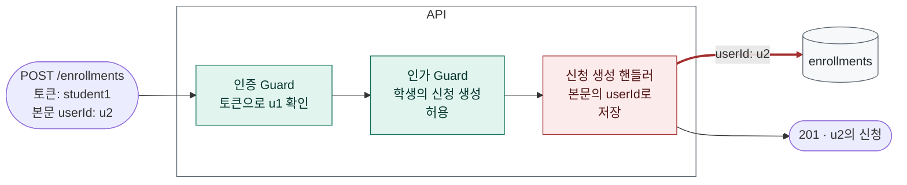
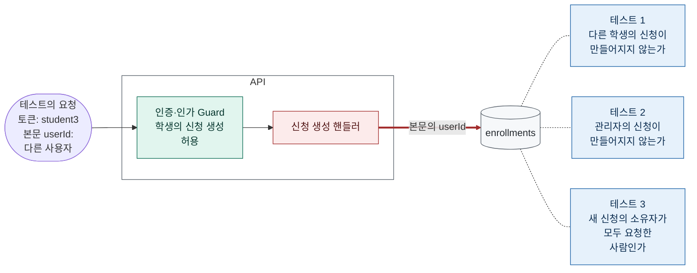

# 결함 8 진단 보고서: 신청 생성이 본문의 사용자 id를 신뢰함

| 항목 | 내용 |
|---|---|
| 대상 | 이 저장소의 태그 `v2-defect-8`을 로컬에서 띄운 API (`http://127.0.0.1:4000`) |
| 경로 | `POST /enrollments` (학생의 토큰이 필요한 경로) |
| 분류 | OWASP Top 10 2025 A01 Broken Access Control / CWE-639 (사용자가 제어하는 키를 통한 인가 우회) |
| 위험도 | 높음 |
| 해당 구성 요소 | 객체의 속성(신청의 소유자). 시행 지점(PEP)과 판단(PE)은 정상으로 동작하고, 판단이 끝난 뒤에 쓰는 값을 검증되지 않은 본문에서 가져옵니다 |
| 상태 | 확인됨. 조치 전 |

## 1. 요약

신청 생성이 누구의 신청인지를 요청 본문의 `userId`에서 읽습니다. 로그인한 학생이 본문의 `userId`만 바꾸면 다른 사용자의 이름으로 신청이 만들어집니다. 인증과 인가는 모두 통과합니다. 토큰은 유효하고, 학생은 신청을 만들 수 있기 때문입니다.

위험도를 높음으로 본 근거입니다.

| | 근거 |
|---|---|
| 높이는 쪽 | 학생 계정 하나면 됩니다. 바꾸는 것은 본문의 값 하나입니다 |
| 높이는 쪽 | 대상에 제한이 없습니다. 다른 학생뿐 아니라 강사와 관리자의 id로도 신청이 만들어집니다 |
| 높이는 쪽 | 다른 사람의 이름으로 강의의 정원을 채울 수 있습니다. 정원이 찬 강의는 신청을 받지 않습니다 |
| 높이는 쪽 | 만들어진 신청은 요청한 사람이 지울 수 없습니다. 취소는 소유자와 관리자만 할 수 있어서, 이름이 쓰인 사람이나 관리자가 지워야 합니다 |
| 높이는 쪽 | 서버에는 누가 요청했는지(토큰의 사용자)와 신청의 소유자가 다르다는 기록이 남지 않습니다. 요청 로그의 `uid`는 요청한 사람이고, 신청에는 본문의 값만 남습니다 |
| 낮추는 쪽 | 로그인해야 합니다. 토큰 없이는 401입니다 |
| 낮추는 쪽 | 다른 사람의 정보를 읽게 되지는 않습니다. 응답에 나오는 것은 요청한 사람이 보낸 값입니다 |
| 낮추는 쪽 | 이름이 쓰인 사람은 자기 신청 목록에서 그 신청을 볼 수 있고 직접 취소할 수 있습니다 |

## 2. 재현 절차

준비:

```bash
git checkout v2-defect-8
docker compose up -d --wait
cd apps/api
cp .env.example .env
npm ci --ignore-scripts
npm run db:generate && npm run build
npm run db:migrate && npm run db:seed
npm start
```

요청 1 (`student1`로 로그인):

```bash
curl -s -X POST -H 'content-type: application/json' \
  -d '{"username":"student1","password":"student1-pass"}' \
  http://127.0.0.1:4000/auth/login
```

요청 2 (`student1`의 토큰으로, 본문의 `userId`는 `student2`의 id인 `u2`):

```bash
curl -s -X POST -H 'authorization: Bearer <student1의 토큰>' -H 'content-type: application/json' \
  -d '{"userId":"u2","courseId":"c4","phone":"010-0000-0009"}' \
  http://127.0.0.1:4000/enrollments
```

201입니다. 응답의 `userId`가 `u2`입니다.

```json
{"id":"<새 id>","userId":"u2","courseId":"c4","phone":"010-0000-0009"}
```

`student2`로 로그인해 `GET /enrollments`를 보면 신청하지 않은 강의 `c4`가 목록에 있습니다. `student1`의 목록에는 없습니다.

재현 스크립트 (`main`의 스크립트를 결함 상태의 API에 실행):

```bash
node .github/scripts/defects/defect-8.mjs
```

```
결함 8: 신청 생성(POST /enrollments)의 신청자
대상: http://127.0.0.1:4000
- POST /enrollments (student1의 토큰, 본문 userId: u2)
    → 상태 201 · u2의 신청이 만들어짐
- POST /enrollments (student1의 토큰, 본문 userId: a1, 관리자의 id)
    → 상태 201 · a1의 신청이 만들어짐
- GET /enrollments (student2의 토큰) 요청 전과 후
    → 2건 → 3건
판정: 취약
```

스크립트는 만든 신청을 끝날 때 관리자 토큰으로 지웁니다. 기대한 동작은 두 요청 모두 신청이 만들어지지 않고, `student2`의 목록이 2건 그대로인 것입니다.

## 3. 원인

요청한 사람이 누구인지는 인증 Guard가 토큰으로 확인합니다. 신청의 소유자는 그 값이 아니라 본문에서 따로 읽습니다.



빨강은 검증되지 않은 값을 쓰는 곳과 그 값이 저장되는 경로, 초록은 정상으로 동작하는 곳입니다.

### 3.1 원인 코드

- 본문의 형식이 `userId`를 받습니다: [`enrollments/create-enrollment.dto.ts` 5~8행](https://github.com/loquemedalagana/secure-enroll-demo/blob/v2-defect-8/apps/api/src/enrollments/create-enrollment.dto.ts#L5-L8).
- 핸들러가 본문의 `userId`를 서비스에 넘깁니다: [`enrollments/enrollments.controller.ts` 23~25행](https://github.com/loquemedalagana/secure-enroll-demo/blob/v2-defect-8/apps/api/src/enrollments/enrollments.controller.ts#L23-L25). 토큰의 사용자(`@CurrentUser`)는 이 핸들러에서 쓰이지 않습니다.
- 서비스는 받은 값을 그대로 저장합니다: [`enrollments/enrollments.service.ts` 39행](https://github.com/loquemedalagana/secure-enroll-demo/blob/v2-defect-8/apps/api/src/enrollments/enrollments.service.ts#L39).

### 3.2 값이 어디에서 오는가

| 값 | 어디에서 오는가 | 누가 검증하는가 | 어디에 쓰이는가 |
|---|---|---|---|
| 요청한 사람 (`u1`) | 토큰 | 인증 Guard가 서명과 만료를 확인하고 DB에서 사용자를 읽음 | 인가 판단, 요청 로그의 `uid` |
| 신청의 소유자 (`u2`) | 본문의 `userId` | 형식(문자열, 길이)만 확인 | **저장되는 신청의 `userId`** |

두 값이 같아야 한다는 규칙이 코드 어디에도 없습니다. 조회와 취소에서는 소유자가 DB에 저장된 값이라 인가 Guard가 그것을 읽어 PE에 넘깁니다. 생성에서는 신청이 아직 없어서 넘길 객체가 없고, PE는 역할만 보고 허용합니다.

### 3.3 이 결함을 처음 잡은 테스트

없습니다. 이 태그에서 API 테스트 128건이 모두 통과합니다. 신청 생성 테스트는 모두 본문의 `userId`에 요청한 사람 자신의 id를 넣어 보냅니다.

### 3.4 결함을 잡는 테스트

`apps/api/test/enrollments-write.test.mjs`에 "신청 생성 1~3"을 더했습니다. 요청한 사람(토큰)과 본문의 `userId`가 다른 요청을 보내고, 응답이 아니라 DB의 `enrollments` 테이블을 직접 조회해 확인합니다.



빨강은 검증되지 않은 값을 쓰는 곳과 그 값이 저장되는 경로, 파랑은 테스트입니다.

| 테스트 | 보내는 요청 | 개발 관점: 무엇을 확인하나 | 보안 관점: 무엇을 지키나 |
|---|---|---|---|
| 1 다른 학생의 id를 본문에 넣어도 그 학생의 신청이 만들어지지 않음 | `student3`의 토큰, 본문 `userId: u4` | `u4`의 신청이 DB에 0건인지 | 객체의 속성(소유자). 같은 역할의 다른 사용자 |
| 2 관리자의 id를 본문에 넣어도 관리자의 신청이 만들어지지 않음 | `student3`의 토큰, 본문 `userId: a1` | `a1`의 신청이 DB에 0건인지 | 객체의 속성(소유자). 역할이 다른 사용자 |
| 3 본문의 userId가 무엇이든 만들어진 신청의 소유자는 요청한 사람 | `student3`의 토큰, 본문의 `userId`를 `u3`, `u4`, `u5`, `i1`, `a1`로 바꿔 5번 | 새로 생긴 신청 중 소유자가 `u3`이 아닌 것이 0건인지 | 주체와 소유자의 일치. 어떤 값이 와도 지켜져야 하는 성질 |

테스트는 거부하는 방식을 정하지 않습니다. 상태 코드는 201이 아닌지만 봅니다. 본문의 `userId`를 토큰과 비교해 403으로 거부할 수도 있고, 본문에서 `userId`를 없애 400으로 거부할 수도 있습니다. 어느 쪽으로 고칠지는 4.1절에서 방안을 적용해 보고 정합니다.

이 커밋에서 API 테스트는 131건 중 128건 통과, 3건 실패입니다.

```
✖ 신청 생성 1: 다른 학생의 id를 본문에 넣어도 그 학생의 신청이 만들어지지 않음
    student4(u4)의 이름으로 만들어진 신청의 건수
    1 !== 0
✖ 신청 생성 2: 관리자의 id를 본문에 넣어도 관리자의 신청이 만들어지지 않음
    admin1(a1)의 이름으로 만들어진 신청의 건수
    1 !== 0
✖ 신청 생성 3: 본문의 userId가 무엇이든 만들어진 신청의 소유자는 요청한 사람
    요청한 사람(u3)이 아닌 사용자의 이름으로 만들어진 신청의 건수
    4 !== 0
```

테스트 3에서 5번 보낸 요청 중 4건이 다른 사용자의 신청으로 저장됐습니다. 테스트는 만든 신청을 끝날 때 지웁니다.

### 3.5 보안 관점: 접근통제 구성 요소로 본 결함

| 구성 요소 | 이 결함에서 | 코드에서 확인하는 곳 |
|---|---|---|
| 주체 | 정상. 토큰으로 검증한 `student1` | `auth/auth.guard.ts` |
| 시행 (PEP) | 정상. 토큰이 없으면 401, 학생이 아니면 403입니다 | `auth/auth.guard.ts`, `authz/authz.guard.ts` |
| 판단 (PE) | 정상. `can(student1, 'enrollment:create')`는 참입니다. 누구의 신청인지는 판단의 입력에 없습니다 | `authz/policy.ts` |
| 객체의 속성 (소유자) | **검증되지 않은 본문에서 옵니다. 결함은 여기입니다** | [`enrollments/enrollments.controller.ts` 23~25행](https://github.com/loquemedalagana/secure-enroll-demo/blob/v2-defect-8/apps/api/src/enrollments/enrollments.controller.ts#L23-L25) |

결함 1과 2는 시행 지점이 요청을 막지 못한 경우였고, 결함 6은 시행 지점이 열어 준 범위 밖의 객체를 쿼리가 읽은 경우였습니다. 결함 8에서는 시행과 판단이 모두 맞게 끝납니다. 그 뒤에 만들어지는 객체의 소유자가 판단에 쓰인 주체와 다른 값으로 정해집니다.

제로 트러스트의 원칙으로 보면 주체는 요청마다 검증하고 있지만, 그 요청이 싣고 온 값은 검증 없이 믿은 경우입니다.

## 4. 조치

### 4.1 조치 방안 비교

고칠 방법은 세 가지입니다.

- **방안 1 (핸들러에서 비교)**: 핸들러가 본문의 `userId`를 토큰의 사용자와 비교하고, 다르면 403으로 거부합니다.
- **방안 2 (본문에서 제거)**: 본문에서 `userId`를 없애고 신청자를 토큰에서만 읽습니다.
- **방안 3 (PE가 판단)**: 인가 Guard가 본문의 `userId`를 객체의 속성(소유자)으로 PE에 넘기고, `can()`이 주체와 같은지 판단합니다.

#### 실제로 바꿔 본 결과

세 방안을 테스트를 더한 커밋의 코드에 각각 적용해 돌려 봤습니다. 이 변경들은 커밋하지 않았습니다.

방안 1:

```diff
-  create(@Body() body: CreateEnrollmentDto): Promise<EnrollmentView> {
+  create(@CurrentUser() user: AuthUser, @Body() body: CreateEnrollmentDto): Promise<EnrollmentView> {
+    if (body.userId !== user.id) throw new ForbiddenException();
     return this.enrollments.create(body.userId, body.courseId, body.phone);
   }
```

방안 2:

```diff
 // enrollments/create-enrollment.dto.ts
-  // 신청하는 사용자의 id
-  @IsString()
-  @Length(1, 64)
-  userId!: string;

 // enrollments/enrollments.controller.ts
-  create(@Body() body: CreateEnrollmentDto): Promise<EnrollmentView> {
-    return this.enrollments.create(body.userId, body.courseId, body.phone);
+  create(@CurrentUser() user: AuthUser, @Body() body: CreateEnrollmentDto): Promise<EnrollmentView> {
+    return this.enrollments.create(user.id, body.courseId, body.phone);
   }
```

방안 3:

```diff
 // enrollments/enrollments.controller.ts
-  @Authorize('enrollment:create')
+  @Authorize('enrollment:create', { resource: 'new-enrollment' })

 // authz/authz.guard.ts
+    if (rule.resource === 'new-enrollment') {
+      const owner = (req.body as { userId?: unknown } | undefined)?.userId;
+      resource = typeof owner === 'string' ? { ownerId: owner, instructorId: '' } : undefined;
+    }

 // authz/policy.ts
     case 'enrollment:create':
-      return user.role === 'student';
+      if (!resource) return false;
+      return user.role === 'student' && resource.ownerId === user.id;
```

| 확인 | 결함 상태 | 방안 1 | 방안 2 | 방안 3 |
|---|---|---|---|---|
| 재현 스크립트 판정 | 취약 | 차단 | 차단 | 차단 |
| 결함을 잡는 테스트 3건 | 3건 실패 | 통과 | 통과 | 통과 |
| API 테스트 131건, 테스트를 고치지 않고 | 3건 실패 | 모두 통과 | 8건 실패 | 2건 실패 |
| 같은 131건, 바뀐 본문 형식에 맞춰 테스트를 고친 뒤 | | | 모두 통과 | 1건 실패 |
| 다른 사용자의 id를 넣은 요청의 응답 | 201 | 403 | 400 | 403 |
| 그 요청이 요청 로그에 남는 모양 | `status` 201, `allowed` true | `status` 403, **`allowed` true** | `status` 400, `allowed` true | `status` 403, `allowed` false |
| 수정 뒤에 본문의 `userId`를 읽는 코드 | 2곳 | 2곳 | **없음** | 3곳 |
| 호출하는 쪽이 본문에 넣는 것 | 자기 id | 자기 id | 넣지 않음 (넣으면 400) | 자기 id |

`student3`의 토큰으로 본문의 `userId`를 바꿔 가며 보낸 결과입니다. 칸의 값은 상태 코드이고, 괄호는 만들어진 신청의 소유자입니다.

| 본문의 `userId` | 결함 상태 | 방안 1 | 방안 2 | 방안 3 |
|---|---|---|---|---|
| 자기 id (`u3`) | 201 (u3) | 201 (u3) | 400 | 201 (u3) |
| 다른 학생 (`u4`) | **201 (u4)** | 403 | 400 | 403 |
| 없음 | 400 | 400 | 201 (u3) | 403 |
| 배열 `["u4"]` | 400 | 400 | 400 | 403 |
| 숫자 `4` | 400 | 400 | 400 | 403 |
| 객체 `{"id":"u4"}` | 400 | 400 | 400 | 403 |
| 대문자 `U4` | 500 | 403 | 400 | 403 |
| 뒤에 공백 `"u4 "` | 500 | 403 | 400 | 403 |
| 같은 키를 두 번, `u3` 다음 `u4` | **201 (u4)** | 403 | 400 | 403 |
| 같은 키를 두 번, `u4` 다음 `u3` | 201 (u3) | 201 (u3) | 400 | 201 (u3) |

이 표에서 볼 것은 다섯 가지입니다.

- 세 방안 모두 결함을 막습니다. 다른 사용자의 신청이 만들어진 경우는 어느 방안에도 없습니다. 형식이 다른 값(배열, 숫자, 객체, 대소문자, 공백, 같은 키를 두 번)으로도 통과한 것이 없습니다.
- 방안 1에서는 요청 로그에 `allowed`가 true인 403이 남습니다. PE는 "학생이 신청을 만든다"를 허용했고 거부는 핸들러가 했기 때문입니다. 판단을 PE 한 곳에서 한다는 구조에서 벗어나고, 로그의 `allowed`만 보고 거부된 요청을 찾으면 이 요청이 빠집니다.
- 방안 2에서는 본문의 `userId`를 읽는 코드가 남지 않습니다. 방안 1과 3에서는 DTO가 `userId`를 계속 받고, 저장할 때도 본문의 값을 씁니다. 같은 DTO를 쓰는 경로가 새로 생기면 그 경로에도 비교나 선언을 넣어야 합니다.
- 방안 2에서는 다른 사용자의 id를 넣은 요청이 400으로 끝납니다. 요청 로그에는 `status` 400, `allowed` true로 남아서, 형식이 틀린 다른 요청과 구분되지 않습니다. 방안 3은 `allowed` false로 남습니다.
- 방안 3에서는 인가 Guard가 입력 검증보다 먼저 실행됩니다. 본문이 비어 있거나 형식이 틀린 요청이 400이 아니라 403이 됩니다. 테스트 "형식이 틀린 본문은 400"이 이 때문에 실패하고, 방안 3을 고르면 이 테스트의 기대를 403으로 바꿔야 합니다. Guard가 검증되지 않은 본문을 읽지만, 문자열이 아닌 값은 판단에 넘기지 않아서 통과한 경우는 없었습니다.

결함 상태에서 `U4`와 `"u4 "`가 500인 것은 존재하지 않는 사용자 id로 저장하려다 외래 키 제약에 걸린 것입니다. 본문의 값을 그대로 저장하기 때문에 생기는 오류이고, 세 방안 모두에서 없어집니다.

방안 2의 "8건 실패"는 기존 테스트가 본문에 `userId`를 넣어 보내기 때문입니다. 응답은 400입니다. 본문에서 `userId`를 빼도록 테스트의 도우미 함수 두 곳을 고치면 131건이 모두 통과합니다.

#### 비교

| 기준 | 방안 1 (핸들러에서 비교) | 방안 2 (본문에서 제거) | 방안 3 (PE가 판단) |
|---|---|---|---|
| 바꾸는 양 | 2줄 | 파일 2개, 6줄. 테스트의 도우미 2곳 | 파일 4개, 8줄. 테스트 2곳 |
| 신청자를 어디에서 읽는가 | 본문. 토큰과 같은지 확인한 뒤 | 토큰 | 본문. PE가 토큰과 같은지 판단한 뒤 |
| 판단하는 곳 | PE와 핸들러 두 곳 | PE 한 곳. 소유자는 판단할 것이 없어짐 | PE 한 곳 |
| 요청 로그 | 거부했는데 `allowed` true | 400, `allowed` true | 403, `allowed` false |
| 본문의 `userId` | 남습니다 | 없어집니다 | 남습니다 |
| API의 본문 형식 | 그대로 | 바뀝니다 (`userId`를 보내면 400) | 그대로 |
| 형식이 틀린 요청 | 400 | 400 | 403 |

**고른 것**: 정하기 전.

## 5. 조치 뒤 재확인

작성 전.

## 6. Burp Suite 진단 기록

작성 전.
