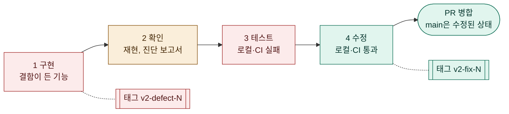

# v2의 의도된 결함

> v2에서 다루는 결함의 목록과, 결함 하나를 저장소에 남기는 방법을 적습니다. v1 README의 "의도된 결함 (vulnerable)" 절이 하던 역할을 v2에서는 이 문서가 맡습니다. 이 문서는 계획이고, 진행 상태는 4절의 표에 적습니다.

## 1. 범위

- v1은 인가 결함 두 가지(역할 확인 누락, 조회할 때 소유자 확인 누락)를 다뤘습니다. v2는 그 둘을 반복하지 않고, API를 분리하면서 새로 생긴 자리의 결함을 다룹니다.
  - 인증 계층: Guard의 적용 범위, 요청 로그, 토큰을 보관하는 위치, HTTP 메서드 (결함 1~5)
  - 입력 처리: SQL 인젝션, 저장형 XSS, 요청 본문의 사용자 id 신뢰 (결함 6~8)
- 역할과 소유자 확인은 v1 `fixed` 브랜치의 정책 함수 방식을 API로 옮기고 테스트로 검증합니다.
- 결함 코드는 결함을 다루는 PR 브랜치의 커밋과 태그로만 남습니다. `main`의 병합 지점은 항상 수정된 상태입니다.
- 결함 커밋에서 쓰는 계정, 토큰, 전화번호는 모두 더미 값입니다.
- 공개된 CVE를 재현하는 코드나 취약한 버전의 의존성은 쓰지 않습니다. 결함은 모두 이 데모의 코드에 직접 넣습니다.

## 2. 결함 하나를 다루는 방법

v1은 `vulnerable`과 `fixed` 두 브랜치의 차이로 결함을 보여 줬습니다. v2는 결함마다 같은 브랜치 안에서 아래 순서로 다루고, 결함이 든 커밋과 수정한 커밋에 태그를 붙입니다.

| 순서 | 하는 일 | 테스트 결과 | 태그 |
|---|---|---|---|
| 1 | 구현: 기능을 결함이 든 채로 만든다 | 기존 테스트는 통과. 앞선 결함에서 넣은 테스트가 이 결함을 잡으면 그 테스트는 실패 | `v2-defect-N` |
| 2 | 확인: 결함 상태를 로컬에서 띄우고 재현 요청을 보내 결과를 진단 보고서에 적는다 | | |
| 3 | 테스트: 결함을 잡는 테스트를 넣고 푸시한다. 기존 테스트가 이미 잡았으면 이 결함을 직접 겨냥한 테스트를 더한다 | 새 테스트가 실패 (로컬과 CI) | |
| 4 | 수정: 고치고 푸시한다 | 모두 통과 (로컬과 CI) | `v2-fix-N` |



빨강은 결함이 있는 상태, 초록은 수정된 상태입니다.

- 결함은 그 결함이 들어갈 기능을 만드는 브랜치에서 다룹니다.
- PR은 3번에서 초안으로 열고, 4번 뒤에 병합합니다. 그래서 PR의 커밋 목록에 테스트 커밋의 CI 실패와 수정 커밋의 CI 통과가 차례로 남습니다.
- 3번에서 실패한 테스트의 이름과 건수는 PR 설명에도 적습니다.
- 기능과 같은 브랜치에서 다루지 못한 결함은 기능을 병합한 뒤 별도 브랜치에서 같은 순서로 다룹니다.

결함마다 남는 것:

| 무엇 | 위치 |
|---|---|
| 진단 보고서(분류와 위험도, 재현 절차, 조치, 조치 뒤 재확인) | `docs/diagnosis/defect-N.md` |
| 재현 스크립트(결함 상태에서는 "취약", 수정 상태에서는 "차단"을 출력) | `.github/scripts/defects/defect-N.mjs` |
| 회귀 테스트 | 해당 앱의 `test/` 또는 `tests/` |

보는 법:

```bash
git diff v2-defect-N v2-fix-N -- apps     # 무엇을 고쳤는지
git checkout v2-defect-N                  # 결함 상태 재현
```

## 3. 결함 목록

모두 이 데모의 도메인(세미나 신청: 강의, 신청, 학생·강사·관리자)으로 씁니다. 분류는 OWASP Top 10 2025와 CWE 기준입니다.

### 결함 1. Guard를 컨트롤러마다 붙여서 새 컨트롤러가 기본으로 열림

- **분류**: A07 Authentication Failures / CWE-306 (중요 기능의 인증 누락)
- **어떻게 생기는가**: 인가 Guard를 추가하면서 인증·인가 Guard를 전역(`APP_GUARD`) 등록에서 컨트롤러마다 `@UseGuards`로 붙이는 방식으로 바꿉니다. 새로 만든 관리자 컨트롤러에 붙이는 것을 빠뜨려서 그 컨트롤러의 핸들러가 토큰 없이 열립니다. 핸들러에 `@Authorize`로 행위를 선언해 두었어도, 그것을 읽을 Guard가 돌지 않으면 아무 효과가 없습니다.
- **왜 위험한가**: 전체 신청 목록(`GET /admin/enrollments`)에는 전화번호가 있습니다. 빠뜨렸을 때의 기본값이 "열림"이고, 관리자로 로그인해서 확인하면 정상으로 보여서 테스트가 없으면 드러나지 않습니다.
- **수정 방향**: 두 Guard를 `APP_GUARD`로 전역 등록합니다. 열어 둘 경로에만 `@Public`을 붙입니다.
- **검증 테스트**: 토큰 없이 `GET /admin/enrollments` → 401, 학생 토큰으로 → 403. 등록된 모든 경로에 토큰 없이 요청해 `@Public`이 아닌 경로가 모두 401인지 확인하는 테스트 1건.
- **브랜치**: `v2/05-authorization`

### 결함 2. 경로 문자열로 공개 경로를 열어 인증을 건너뜀

- **분류**: A07 / CWE-306
- **어떻게 생기는가**: 강의 목록(`GET /courses`)을 로그인 없이 보여 주려고, Guard가 공개 여부를 판단하는 곳에 "경로가 `/courses`로 시작하면 공개"라는 조건을 넣습니다. 똑같이 `/courses`로 시작하는 수강생 명단(`GET /courses/:id/enrollments`)까지 토큰 없이 열립니다.
- **왜 위험한가**: 수강생 명단에는 전화번호가 있습니다. 공개 여부가 핸들러가 아니라 문자열 비교에 달려 있어서, `/courses` 아래에 경로를 새로 만들 때마다 인증 없이 열립니다.
- **수정 방향**: 공개 여부는 핸들러에 붙인 `@Public`만으로 판단합니다. 경로 문자열 비교를 없앱니다.
- **검증 테스트**: 토큰 없이 `GET /courses` → 200, 토큰 없이 `GET /courses/c1/enrollments` → 401.
- **브랜치**: `v2/05-authorization`. 결함 1과 같은 파일을 고치므로 한 브랜치에서 순서대로 다루고, 태그는 따로 둡니다.

### 결함 3. 요청 로그에 토큰과 비밀번호가 남음

- **분류**: A09 Security Logging and Alerting Failures / CWE-532 (로그 파일에 민감 정보 기록)
- **어떻게 생기는가**: 요청 로그를 남기는 코드가 요청 헤더와 본문을 그대로 출력합니다. `Authorization` 헤더의 토큰과 `POST /auth/login` 본문의 비밀번호가 로그에 들어갑니다.
- **왜 위험한가**: 로그는 앱보다 넓은 범위에서 읽히고 오래 보관됩니다. 로그를 읽을 수 있는 사람이 만료 전의 토큰으로 그 사용자의 요청을 보낼 수 있습니다.
- **수정 방향**: 로그 한 줄에 들어가는 필드를 한 곳에서 정하고, 헤더와 본문은 넣지 않습니다. 필드는 요청 id, 사용자 id, 메서드, 경로, 인가 결과, 상태 코드, 처리 시간입니다.
- **검증 테스트**: 로그인하고 신청을 조회한 뒤 API 프로세스의 출력에 토큰 문자열, 비밀번호 문자열, 전화번호가 없는지 확인합니다.
- **브랜치**: `v2/06-logging`

### 결함 4. 토큰을 브라우저 스크립트가 읽을 수 있는 곳에 보관

- **분류**: A02 Security Misconfiguration / CWE-1004 (HttpOnly 없는 민감 쿠키)
- **어떻게 생기는가**: 웹(`apps/web`)의 로그인 경로가 토큰 쿠키를 `httpOnly` 없이 설정합니다. 페이지의 스크립트가 `document.cookie`로 토큰을 읽을 수 있습니다.
- **왜 위험한가**: 스크립트 삽입(XSS)이 한 번 일어나면 토큰이 밖으로 나갑니다. 토큰은 만료 전까지 API에 그대로 쓸 수 있습니다.
- **수정 방향**: 토큰은 `httpOnly`, `SameSite=Lax` 쿠키로만 보관하고, 운영 환경에서는 `Secure`를 붙입니다. 브라우저 쪽 코드는 토큰을 읽거나 저장하지 않습니다. [결정 기록](decisions.md) 2번의 전제입니다.
- **검증 테스트**: 웹 로그인 응답의 `Set-Cookie`에 `HttpOnly`가 있는지 확인합니다. 웹 소스에 토큰을 `localStorage`나 `document.cookie`로 다루는 코드가 없는지 확인합니다.
- **브랜치**: `v2/08-web-to-api`

### 결함 5. 상태를 바꾸는 요청을 GET으로 받음

- **분류**: A01 Broken Access Control / CWE-352 (CSRF)
- **어떻게 생기는가**: 웹에 신청 취소를 `GET /api/enrollments/:id/cancel`로 만듭니다. 쿠키가 `SameSite=Lax`여도 브라우저는 다른 사이트에서 시작된 최상위 GET 이동에는 쿠키를 붙입니다.
- **왜 위험한가**: 로그인한 사용자가 다른 사이트의 링크를 누르거나 그 사이트가 페이지를 이동시키면, 사용자가 의도하지 않은 취소가 그 사용자의 권한으로 실행됩니다.
- **수정 방향**: 상태를 바꾸는 경로는 POST와 DELETE로만 받습니다. 로그인 경로에 있는 요청 형식·출처 검사를 공통 함수로 빼서 이 경로에도 적용합니다.
- **검증 테스트**: `GET /api/enrollments/e1/cancel` → 404 또는 405(구현할 때 정합니다), 본인의 `DELETE /api/enrollments/e1` → 204, 다른 출처에서 온 DELETE → 403.
- **브랜치**: `v2/09-web-enroll`
- **API와의 관계**: API는 쿠키가 아니라 `Authorization` 헤더의 토큰으로 인증합니다. 브라우저가 이 헤더를 자동으로 붙이지 않으므로 이 결함은 쿠키를 쓰는 웹 계층에서 다룹니다.

### 결함 6. 검색어를 쿼리 문자열에 이어 붙임 (SQL 인젝션)

- **분류**: A05 Injection / CWE-89 (SQL 인젝션)
- **어떻게 생기는가**: 강의 검색(`GET /courses?q=`)의 쿼리를 검색어를 이어 붙인 문자열로 만들어 실행합니다.
- **왜 위험한가**: 검색어로 쿼리의 조건을 바꾸거나 다른 테이블을 함께 조회할 수 있습니다. 사용자 테이블의 비밀번호 해시와 신청 테이블의 전화번호가 대상이 됩니다.
- **수정 방향**: 검색어를 쿼리 문자열에 넣지 않고 매개변수로 넘깁니다.
- **검증 테스트**: 조건을 항상 참으로 만드는 검색어와 다른 테이블을 합치는 검색어를 보내도, 응답에는 제목이 그 검색어를 포함하는 강의만 있습니다.
- **브랜치**: `v2/07-enroll-create`

### 결함 7. 신청 메모를 HTML로 그대로 출력 (저장형 XSS)

- **분류**: A05 Injection / CWE-79 (크로스 사이트 스크립팅)
- **어떻게 생기는가**: 신청할 때 적는 메모를 웹의 수강생 명단 화면이 HTML로 그대로 출력합니다.
- **왜 위험한가**: 학생이 메모에 넣은 스크립트가 명단을 여는 강사나 관리자의 브라우저에서 실행됩니다.
- **수정 방향**: 메모를 텍스트로 출력합니다.
- **검증 테스트**: 태그가 든 메모로 신청한 뒤, 명단 화면의 응답에 그 태그가 이스케이프된 문자열로 들어 있는지 확인합니다.
- **브랜치**: `v2/09-web-enroll`

### 결함 8. 요청 본문의 사용자 id를 신뢰 (파라미터 변조)

- **분류**: A01 Broken Access Control / CWE-639 (사용자가 제어하는 키를 통한 인가 우회)
- **어떻게 생기는가**: 신청 생성(`POST /enrollments`)이 누구의 신청인지를 요청 본문의 `userId`에서 읽습니다.
- **왜 위험한가**: 로그인한 사용자가 본문의 `userId`를 바꿔 다른 사용자 이름으로 신청을 만들 수 있습니다.
- **수정 방향**: 신청자는 토큰에서만 읽습니다. 본문에서 `userId` 필드를 없애고, 선언하지 않은 필드가 오면 400으로 거부합니다.
- **검증 테스트**: 학생 `u1`의 토큰으로 본문에 `userId: "u2"`를 넣어 보내면 400이고, `u2`의 신청이 생기지 않습니다.
- **브랜치**: `v2/07-enroll-create`

## 4. 진행표

| # | 결함 | 브랜치 | 결함 태그 | 수정 태그 | 상태 |
|---|---|---|---|---|---|
| 1 | Guard를 컨트롤러마다 붙임 | `v2/05-authorization` | `v2-defect-1` | `v2-fix-1` | 수정함. [보고서](diagnosis/defect-1.md) |
| 2 | 경로 문자열로 인증을 건너뜀 | `v2/05-authorization` | `v2-defect-2` | `v2-fix-2` | 수정함. [보고서](diagnosis/defect-2.md) |
| 3 | 요청 로그에 토큰과 비밀번호 | `v2/06-logging` | 미정 | 미정 | 계획 |
| 4 | 스크립트가 읽을 수 있는 토큰 | `v2/08-web-to-api` | 미정 | 미정 | 계획 |
| 5 | 상태 변경을 GET으로 받음 | `v2/09-web-enroll` | 미정 | 미정 | 계획 |
| 6 | SQL 인젝션 | `v2/07-enroll-create` | 미정 | 미정 | 계획 |
| 7 | 저장형 XSS | `v2/09-web-enroll` | 미정 | 미정 | 계획 |
| 8 | 요청 본문의 사용자 id 신뢰 | `v2/07-enroll-create` | 미정 | 미정 | 계획 |

번호는 결함을 정한 순서이고 다루는 순서와 다를 수 있습니다.

## 5. 한계

- 결함 여덟 개는 대표적인 유형이고 전체 목록이 아닙니다. 세션 고정, 토큰 폐기, 로그인 시도 횟수 제한은 다루지 않습니다.
- 결함 4의 위험은 스크립트 삽입이 일어난 뒤의 피해 범위에 관한 것입니다. 스크립트 삽입은 결함 7에서 따로 다룹니다.
- 진단 보고서의 재현 대상은 이 저장소의 결함 태그를 로컬에서 띄운 것입니다.
