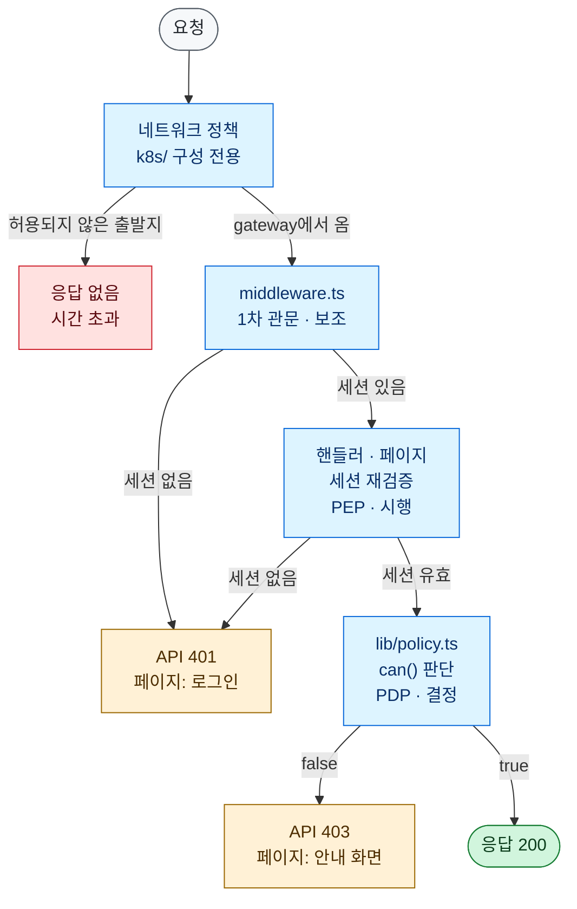

# 제로 트러스트 매핑: PDP/PEP로 읽는 접근통제 구조

> 이 문서는 `fixed` 브랜치의 접근통제 구조를 NIST SP 800-207의 논리 구성요소에 대응시킨 **설계 해설**입니다. 이 데모가 제로 트러스트 아키텍처를 구현했다는 뜻은 아닙니다. 해당하는 것과 해당하지 않는 것을 구분해 적었습니다.

## 1. 요청이 지나는 길

파란 상자는 요청이 지나는 단계, 빨강은 네트워크 정책의 차단, 주황은 앱의 거부, 초록은 허용입니다. 맨 위의 네트워크 정책 단계는 `k8s/` 구성으로 클러스터에 올렸을 때만 있습니다(5절). `npm run dev`로 실행하면 미들웨어부터 시작합니다.

"결정은 한 곳, 시행은 여러 곳"입니다. 판단 규칙은 `can()` 한 함수에만 있고, 라우트와 페이지는 그 결과를 따르기만 합니다.

거부 방식은 진입점마다 다릅니다. API 라우트는 HTTP 상태 코드(401/403)로 거부합니다. 페이지는 비로그인이면 `/login`으로 리다이렉트하고(307), 권한이 없으면 "403 접근 권한 없음" 안내 화면을 보여줍니다. 이 안내 화면의 HTTP 상태 코드는 200입니다. 데이터는 노출되지 않지만, 상태 코드로 거부를 판단하는 도구에는 성공으로 보입니다.

## 2. 구성요소 대응

| 800-207 | 이 데모에서 | 위치 | 대응의 한계 |
|---|---|---|---|
| **PE** (접근 허용 여부 결정) | `can()` — 기본 거부, 역할(RBAC)과 소유자·담당 강사(ABAC)로 판단 | `lib/policy.ts` | 입력이 역할·소유 관계뿐. 신뢰 점수나 위협 정보를 쓰지 않음 |
| **PA** (세션 토큰 발급, 경로 설정·종료) | 로그인 시 서명 세션 쿠키 발급. 가장 가까운 대응일 뿐 | `app/api/login/route.ts`, `lib/session.ts` | 발급만 하고 종료·폐기·재평가가 없음 |
| **PEP** (결정의 시행) | 각 진입점이 `getSession()`으로 재검증하고 `can()` 결과를 적용. API는 401/403, 페이지는 리다이렉트와 안내 화면. 미들웨어는 보조 | `app/api/**`, `app/admin`, `app/enrollments`, `middleware.ts` | 앱 프로세스 안에 있음. 네트워크 계층의 시행 지점은 `k8s/` 구성에만 있음(5절) |
| 판단 입력(data sources) | 세션 클레임(`uid`, `role`)과 리소스 속성(`ownerId`, `instructorId`) | `lib/session.ts`, `lib/data.ts` | 리소스 속성은 호출 측이 채워서 `can()`에 넘김 |

참고: 800-207 원문의 논리 구성요소는 PE·PA·PEP 셋이고, 판단 입력은 "데이터 소스"로 부릅니다. PIP는 XACML 쪽 명칭이라 위 표에서는 풀어 썼습니다.

### 판단 입력: RBAC와 ABAC 속성

`can()`은 역할(RBAC)과 속성(ABAC)을 함께 씁니다.

**RBAC 구성요소**

| 구성요소 | 의미 | 이 데모에서 | 위치 |
|---|---|---|---|
| 사용자 | 시스템을 쓰는 주체 | 더미 계정(student1, instructor1, admin1 등) | `lib/data.ts`의 `users` |
| 역할 | 직무 단위의 권한 묶음 | `student`, `instructor`, `admin` | `lib/session.ts`의 `Role` |
| 허가 | 자원에 대한 행위 | `admin:read`, `enrollment:read` | `lib/policy.ts`의 `Action` |
| 사용자–역할 할당 | 사용자에게 역할 부여 | 계정의 `role` 필드(정적) | `lib/data.ts`의 `users` |
| 역할–허가 할당 | 역할에 허가 부여 | `can()` 안의 분기. 별도 매핑 테이블은 없음 | `lib/policy.ts`의 `can()` |

**ABAC 속성**

속성 분류는 NIST SP 800-162의 주체·객체·환경 세 가지를 따랐습니다.

| 속성 | 의미 | 이 데모에서 | 어디서 오나 |
|---|---|---|---|
| 주체 | 요청하는 능동적 존재(사용자, 프로세스) | `uid`, `role` | 서명된 세션 쿠키(`lib/session.ts`) |
| 객체 | 접근 대상이 되는 수동적 존재(레코드, 파일) | 신청의 `ownerId`, 강의의 `instructorId` | 데이터(`lib/data.ts`)에서 핸들러가 채워 넘김 |
| 환경 | 접근이 일어나는 맥락(시간, 위치, 기기) | 없음 | — |

`can()`의 판단 규칙은 다음과 같습니다.

| 행위 | 허용 조건 | 모델 |
|---|---|---|
| `admin:read` | `role`이 admin | RBAC |
| `enrollment:read` | `role`이 admin | RBAC |
| | `role`이 student이고 `ownerId`가 본인 `uid` | RBAC + ABAC |
| | `role`이 instructor이고 `instructorId`가 본인 `uid` | RBAC + ABAC |
| 그 밖의 모든 경우 | 거부 | 기본 거부 |

- 역할만으로는 "본인의 신청인가"를 표현할 수 없습니다. 그래서 객체 속성을 함께 봅니다. `vulnerable`의 결함 2번(소유자 확인 누락)은 이 객체 속성 비교가 없어서 생긴 것입니다.
- 주체 속성은 서명으로 무결성을 지킵니다(시크릿이 없으면 실패). 객체 속성은 호출 측이 채워 넘기므로, 잘못 채우면 결정도 틀립니다(4절 참고).
- 환경 속성은 쓰지 않습니다. 3절의 "디바이스·환경 속성: 미적용"과 같은 한계입니다. 넣는다면 관리자 API를 정해진 시간대나 사내망에서만 허용하는 규칙이 예가 됩니다(구현하지 않음).

### 컨트롤 플레인과 데이터 플레인

800-207은 정책을 정하고 내려보내는 **컨트롤 플레인**과, 그 결정에 따라 요청을 빠르게 통과·차단하는 **데이터 플레인**을 나눕니다. 이 데모에 대응시키면 다음과 같습니다.

| 평면 | 이 데모에서 | 성격 |
|---|---|---|
| 컨트롤 | `can()`의 정책 규칙, 로그인과 세션 발급, 그리고 정책을 바꿀 때 거치는 리뷰·테스트·CI | 정책을 정하고 바꾸는 쪽. 드물게 일어나고 신중해야 함 |
| 데이터 | 요청마다 하는 세션 서명·만료 검증과 `can()` 결과의 적용(API는 401/403/200, 페이지는 리다이렉트와 안내 화면) | 매 요청마다 일어남. 네트워크 호출 없이 메모리 안에서 끝나는 단순한 판정 |

- **표준 대응과의 차이.** 800-207의 표준 대응으로는 결정을 맡는 PE·PA가 컨트롤 플레인, 시행을 맡는 PEP가 데이터 플레인입니다(PEP는 PA와 컨트롤 플레인으로 통신하고, 요청은 데이터 플레인에서 처리합니다). 이 데모에 적용하면 `can()`의 판단과 세션 발급이 컨트롤, 핸들러의 세션 재검증과 결과 적용이 데이터입니다. 위 표는 "정책을 정하는 일"과 "요청 처리"로 나눈 해석이라 요청마다 하는 `can()` 판단이 데이터 쪽처럼 보이지만, 표준으로는 컨트롤 쪽 결정입니다. 이 데모는 두 평면이 한 프로세스 안에 있어서, PE의 결정이 네트워크 통신이 아니라 함수 호출로 끝납니다.
- **정책은 코드로 관리합니다.** 규칙을 바꾸려면 `lib/policy.ts`를 고치고 정책 단위 테스트와 권한 매트릭스를 통과해야 합니다. 컨트롤 플레인의 변경이 리뷰와 테스트를 거치게 해서 무결성을 지키는 대신, 정책을 바꿀 때마다 다시 배포해야 하는 비용이 있습니다.
- **CI는 실패를 보여주지만 병합을 강제로 막지는 않습니다.** 브랜치 보호와 필수 점검을 켜지 않았기 때문입니다([CI 하드닝 문서](ci-hardening.md) 5절).
- **두 평면이 한 프로세스 안에 있습니다.** 실제 제로 트러스트에서는 정책 서비스와 시행 지점이 분리되고, 정책이 바뀌면 PA가 PEP에 새 결정을 내려보냅니다. 이 데모에는 그런 분리와 동적 배포가 없습니다. 데이터 플레인도 Edge 런타임의 미들웨어와 Node 런타임의 핸들러로 나뉘어 각자 세션을 검증합니다.

## 3. 원칙별로 어디까지 되었나

| 원칙 | 상태 | 근거 |
|---|---|---|
| 모든 요청을 개별 검증 | 적용 | 모든 보호 진입점이 요청마다 `getSession()`과 `can()`을 호출 |
| 기본 거부 | 적용 | `can()`은 명시한 허용 외 `false`. 알 수 없는 역할·행위도 거부(단위 테스트) |
| 최소 권한 | 부분 | 학생은 본인 신청, 강사는 자기 강의 신청만. 행위 종류는 읽기 2가지뿐 |
| 네트워크 위치로 신뢰하지 않음 | 부분 | `k8s/` 구성에서 허용된 출발지(`gateway`)에서 온 요청도 앱이 매번 세션과 권한을 다시 확인(검증 표의 401·403 줄). 다만 출발지 제한 자체는 위치 기반 통제이고, `gateway`가 요청자를 검증하지는 않음 |
| 지속 평가·모니터링 | 미적용 | 감사 로그 없음, 세션 중 재평가 없음 |
| 디바이스·환경 속성 | 미적용 | 시간, 위치, 기기 상태를 쓰지 않음 |

## 4. 설계 판단과 트레이드오프

보안 요구와 사용성·가용성이 부딪히는 지점에서 어떻게 정했고, 무엇을 남겼는지 적습니다.

- **미들웨어와 핸들러의 이중 검증.** 비용은 요청당 HMAC 검증이 한 번 더 늘어나는 것입니다. 얻는 것은 미들웨어가 우회되거나 설정에서 빠져도 각 진입점이 자체적으로 차단한다는 점입니다. 미들웨어를 지우지 않은 이유는 미인증 요청을 앞단에서 적은 비용으로 걸러 로그인 화면으로 보내는 사용성 때문입니다.
- **정책 함수가 리소스 속성을 직접 조회하지 않음.** `can()`은 순수 함수라서 입력만으로 테스트되고 빠릅니다. 대신 호출 측이 `ownerId`를 잘못 채우면 결정도 틀립니다. 지금은 권한 매트릭스 테스트로 완화합니다. 정책이 데이터 저장소를 직접 읽게 하면 이 위험은 줄지만 결합도와 테스트 비용이 늘어납니다.
- **서명 쿠키, 유효 1시간, 서버 저장 없음.** 서버 상태가 없어서 단순하고 확장하기 쉽습니다. 대신 만료 전에 세션을 즉시 폐기할 수 없습니다. 폐기가 필요하면 서버 측 세션 저장소나 짧은 만료와 갱신 구조가 필요하고, 그만큼 가용성 의존이 늘어납니다.
- **404와 403의 순서(미해결).** `app/api/enrollments/[id]/route.ts`는 존재 여부를 먼저 확인해 404를 반환하고 그다음 `can()`을 호출합니다. 로그인한 사용자가 신청 ID의 존재 여부를 구분할 수 있다는 뜻입니다. 권한 없음과 없음을 같은 응답으로 통일하면 열거를 막지만 오류 원인 파악은 어려워집니다. 이 데모는 현재 코드를 바꾸지 않고 판단 사항으로 남겨 둡니다.
- **네트워크 정책의 차단은 응답 없이 버립니다(`k8s/` 구성).** 표준 NetworkPolicy는 허용 규칙만 쓸 수 있어서, 허용되지 않은 패킷은 거절 응답 없이 버려지고 보낸 쪽에는 시간 초과로 보입니다. 얻는 것은 허용되지 않은 출발지가 대상의 존재나 열린 포트를 응답으로 알아낼 수 없다는 점입니다. 치르는 것은 두 가지입니다. 설정 실수로 막힌 정상 호출도 오류 메시지 없이 시간 초과만 보게 되어 호출하는 쪽에서는 장애와 정책 차단을 구분할 수 없고, 거절은 즉시 오지만 시간 초과는 기다려야 합니다. 그래서 원인은 운영하는 쪽이 차단 기록으로 확인하도록 했습니다. 검증 스크립트가 Hubble의 정책 거부 기록과 차단 방향까지 보는 이유입니다. 허용된 경로로 들어온 요청은 앱이 401·403으로 이유를 알려 줍니다. 차단 기록을 모아 알림으로 잇는 일은 하지 않았습니다.

## 5. 이 데모가 하지 않는 것, 확장한다면

**범위 밖(구현하지 않음):** 디바이스 상태 검증, 지속 신뢰 평가, 세션 폐기, 감사 로그, 서비스 간 마이크로세그멘테이션, mTLS, 분리된 정책 서비스. 데이터는 인메모리이고 세션은 단순 쿠키입니다. 이 데모의 중심은 애플리케이션 계층의 접근통제입니다. 네트워크 계층은 로컬 클러스터에서 앱 하나의 들어오고 나가는 경로를 제한하는 데까지만 구현했고(아래 "구현한 부분"), 클라우드 인프라 계층의 통제는 포함하지 않습니다.

### 확장 방향 (설계안. 구현한 부분은 표 아래에 따로 적음)

| 계층 | 이 데모 | 확장한다면 | 새로 생기는 판단 |
|---|---|---|---|
| PEP 위치 | 앱 내부(핸들러, 미들웨어) | ALB OIDC 인증, API 게이트웨이, ZTNA 프록시로 앞단 이동. 앱의 `can()`은 앞단이 우회될 때를 대비한 두 번째 방어선으로 유지 | 앞단 PEP가 우회되는 경로(직접 접근, 내부 호출)를 어떻게 막을지 |
| PDP 위치 | 앱 내 순수 함수 `can()` | 별도 정책 서비스로 분리, 정책을 코드와 분리해 관리 | 정책 서비스 장애 시 fail-closed(거부)와 fail-open(허용) 중 무엇인지, 가용성 의존. 지금은 객체 속성을 호출 측이 채우므로(4절) 속성 조회를 누가 할지 다시 설계해야 함 |
| 서비스 간 통제(East-West) | 단일 앱이라 서비스 간 통신은 없음. 앱 하나의 들어오고 나가는 경로만 NetworkPolicy로 제한(`k8s/`) | 서비스 간 mTLS, Kubernetes NetworkPolicy, 마이크로 세그멘테이션으로 허용된 통신만 열기 | 트래픽 가시성 확보 없이 막으면 장애가 나므로, 관측 후 점진 적용해야 함 |
| 환경 속성 | 미사용 | 디바이스 상태, 접속 위치, 시간대를 PDP 입력으로 추가 | 속성 수집 에이전트 부담, 오탐 시 사용성 저하 |
| 지속 평가·감사 | 없음 | 인가 결정 로그(허용·거부), 세션 중 재평가, 세션 폐기 | 로그 보관 기간과 개인정보, 알림 임계값 |
| 인프라 기준선 | 없음 | IaC(Terraform)로 네트워크·IAM·외부 노출 기준을 코드화하고, 기준에서 벗어난 구성을 탐지·교정 | 기준을 어디까지 강제할지, 예외 승인 절차 |

### 구현한 부분: 네트워크 계층의 시행 지점 (`k8s/`)

표의 첫 줄은 "앞단 PEP가 우회되는 경로(직접 접근, 내부 호출)를 어떻게 막을지"를 새로 생기는 판단으로 적었습니다. 이 질문을 로컬 kind 클러스터에서 한 가지 방법으로 확인했습니다. 앱 앞에 허용된 출발지(`gateway`)를 하나 두고, 그 밖의 출발지가 앱에 직접 닿는 경로를 네트워크 정책으로 막는 구성입니다.

| 구성요소 | 앱 계층 | 네트워크 계층 |
|---|---|---|
| 정책 정의 | `lib/policy.ts`의 `can()` | `k8s/policies/`의 NetworkPolicy 3장 |
| 시행 지점(PEP) | 핸들러와 서버 컴포넌트 | 노드의 Cilium(커널에서 패킷을 통과시키거나 버림) |
| 판단 입력 | 세션의 사용자·역할, 리소스의 소유자·담당 강사 | 출발지·목적지 파드의 라벨, 포트 |
| 기본값 | 명시적으로 허용한 경우 외 거부 | 네임스페이스 기본 거부 뒤 한 경로만 허용 |
| 거부가 보이는 모습 | 401·403 응답 | 응답 없음(시간 초과), Hubble에 정책 거부 기록 |
| 검증 | 권한 매트릭스(`tests/matrix.test.mjs`) | 두 계층 매트릭스(`k8s/verify/run.mjs`) |

두 계층은 서로를 대신하지 않습니다. 네트워크 정책은 어떤 사용자가 무엇을 요청했는지 모르므로, 허용된 출발지에서 온 요청의 권한은 여전히 `can()`이 판단합니다. 반대로 앱은 요청이 어디서 왔는지로 거부하지 않으므로, 올바른 계정이라도 허용되지 않은 위치에서 오는 요청은 네트워크 정책이 막습니다. 검증 표에서 이 둘이 다른 결과(시간 초과와 401·403)로 나뉘어 보입니다.

여기서 확인하지 않은 것은 README의 한계에 적었습니다. `gateway`는 인증이나 라우팅을 하지 않는 빈 파드이고, 단일 노드 로컬 실습입니다.

이 중 현재 저장소에서 이미 하는 것과 맞닿는 부분은 두 가지입니다. 하나는 판단(`can()`)과 시행(핸들러)을 분리해 PDP를 밖으로 옮길 수 있는 구조로 짠 점이고, 다른 하나는 CI에서 의존성 감사와 액션 고정으로 "기준에서 벗어난 상태를 확인할 수 있게" 하는 점입니다. 다만 이는 코드와 파이프라인 계층의 통제이고, 네트워크·클라우드 계층의 운영 경험을 대체하지 않습니다.

## 6. 검증 근거

`npm test`로 29건을 실행해 모두 통과했습니다(정책 단위 16건 + 권한 매트릭스 10건 + 로그인 요청 제한 3건). 로그인 요청 제한은 판단 입력인 세션이 위조되지 않게 하는 인증 쪽 보강입니다. 매트릭스는 비로그인 401, 학생·강사의 관리자 API 403, 본인/타인 신청 조회(학생), 자기/다른 강사 강의 신청(강사), 관리자 접근을 다룹니다.

네트워크 계층은 `node k8s/verify/run.mjs`로 확인했습니다. 정책 전 기준선 4건, 정책 후 두 계층 매트릭스 10건, Hubble 차단 기록 4건이 로컬과 GitHub Actions 러너에서 모두 기대와 일치했습니다(2026-11-15).
